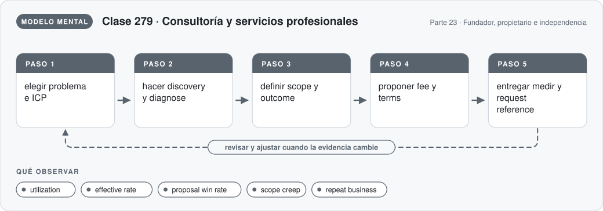

# Clase 279 — Consultoría y servicios profesionales

<!-- nav:inicio -->
> **Parte 23 · Independencia profesional y Business Owner Capstone** — clase 3 de 12 · [índice de la parte](../../README.md) · [temario](../../../../SYLLABUS.md)
<!-- nav:fin -->

**Parte:** 23 — Independencia profesional y Business Owner Capstone  
**Nivel:** Etapa 6 — Independencia  
**Duración sugerida:** 150–180 minutos · **Estándar:** deep-class-v2

## 🎯 Propósito

La consultoría y los servicios profesionales son el camino más frecuente hacia la independencia, y por buenas razones: no requieren inversión inicial grande, aprovechan capacidades ya probadas, generan ingresos rápido y enseñan mucho sobre los problemas reales de los clientes. También tienen un techo claro: **el ingreso está limitado por las horas de una persona**, y esa persona hace a la vez de vendedor, ejecutor, administrador y cobrador. Muchos consultores independientes viven en un ciclo de «banquete y hambruna»: cuando están entregando no venden, y cuando terminan no tienen pipeline. Otros fijan precios por hora sin saber cuántas horas reales consume cada proyecto, aceptan alcances difusos que se expanden sin pago adicional o trabajan para clientes que no valoran su trabajo. Un servicio profesional bien diseñado trata el trabajo como **una secuencia repetible**: elegir un problema y un cliente, descubrir y diagnosticar, definir alcance y resultado, proponer honorarios y condiciones, entregar, medir y pedir referencias.

La clase presenta ese ciclo con herramientas de decisión: cálculo de tarifa efectiva y utilización, estimación de horas, fijación de precio por valor con transparencia y límites, estructura de propuesta, manejo de cambios de alcance y construcción de referencias. Se apoya en Drucker (eficacia del trabajo del conocimiento), McKeown (elegir pocas cosas y rechazar el resto), Voss (negociación basada en preguntas y empatía táctica), Rackham (venta consultiva con preguntas de situación, problema, implicación y necesidad), Ries (aprender con experimentos) y Gerber (convertir el oficio en sistema). Al terminar sabrás diseñar una propuesta, calcular cuántos proyectos y propuestas necesitas para alcanzar un ingreso objetivo y decidir cuándo rechazar un encargo.

## 📚 Resultados de aprendizaje

Al finalizar podrás:

1. **Elegir** un problema y un cliente ideal para tu servicio.
2. **Conducir** un descubrimiento con preguntas que aclaren problema, impacto y criterio de éxito.
3. **Definir** alcance, resultado, supuestos y exclusiones por escrito.
4. **Calcular** utilización, tarifa efectiva y tasa de éxito de propuestas, y fijar honorarios con transparencia.
5. **Gestionar** cambios de alcance, cierre y referencias.

## 🧭 Agenda

| Tramo | Qué se hace |
|---|---|
| 0–20 min | Recuperación: ¿cuánto ganas realmente por hora trabajada, incluyendo vender y administrar? |
| 20–60 min | Problema y cliente, descubrimiento, alcance, honorarios, negociación, entrega y referencia. |
| 60–105 min | Ejemplo trabajado: tarifa efectiva, precio por valor y proyección de propuestas necesarias. |
| 105–150 min | Caso ejecutivo y práctica. |
| 150–175 min | Límites y entregable. |

## 🧩 Conceptos centrales

| Concepto | Definición | Cómo se reconoce |
|---|---|---|
| **Utilización** | Proporción de horas disponibles que se factura. | Horas facturables ÷ horas disponibles. |
| **Tarifa efectiva** | Ingreso por hora total trabajada, incluidas ventas y administración. | Honorarios ÷ horas reales. |
| **Tasa de éxito de propuestas** | Proporción de propuestas que se aceptan. | Aceptadas ÷ enviadas. |
| **Alcance** | Qué se entrega, qué no y bajo qué supuestos. | Documento con exclusiones. |
| **Precio por valor** | Honorarios ligados al valor del resultado para el cliente. | Beneficio estimado y fracción cobrada. |
| **Referencia** | Testimonio o contacto que respalda el trabajo. | Cliente que recomienda. |

## 🧠 Modelo mental

**Cómo leer el diagrama.** Una cadena de cinco pasos. **Problema y cliente ideal**: quién tiene el problema y paga por resolverlo. **Descubrimiento y diagnóstico**: entender antes de proponer. **Alcance y resultado**: qué se entrega y cómo se mide. **Honorarios y condiciones**: precio, plazos y términos. **Entrega y referencia**: medir, cerrar y pedir una referencia. La flecha de retorno indica que cada proyecto mejora la siguiente propuesta. La nota recuerda que el precio por valor no es una cifra arbitraria ni oculta el esfuerzo, sino que es transparente, defendible y compatible con el mercado, la ética y el contrato; el pie, que se miden utilización, tarifa efectiva y tasa de éxito de las propuestas.

## 📖 Desarrollo

### 1. Elegir el problema y el cliente

Un servicio profesional sólido responde a: **¿qué problema resuelvo, para quién y con qué resultado?** Se elige un **problema** que sea frecuente, costoso para el cliente y que uno sepa resolver con evidencia (clase 278), y un **cliente ideal** (tamaño, sector, rol de quien decide, situación que dispara la necesidad). McKeown sostiene que el esencialismo exige decir no a lo no esencial; para un consultor, eso significa **rechazar encargos fuera del foco**, aunque paguen. Un consultor generalista compite por precio; uno que resuelve un problema específico para un tipo de cliente construye reputación y referidos. Se escribe una **ficha**: problema, cliente, resultado típico, método, evidencia, precio de referencia y señales de que un cliente **no** es adecuado.

### 2. Descubrimiento y diagnóstico

Antes de proponer, se entiende. Rackham, tras estudiar miles de visitas de ventas, concluye que en ventas complejas lo que se asocia con el éxito es **preguntar bien**: preguntas de **situación** (cómo funciona hoy), de **problema** (qué dificultades tienen), de **implicación** (qué consecuencias y costos tiene el problema) y de **necesidad de solución** (qué valor tendría resolverlo). El consultor escucha más de lo que habla y busca cuantificar el **impacto** (dinero, tiempo, riesgo), identificar al **decisor** y el **presupuesto**, y entender el **criterio de éxito** del cliente. Voss agrega que la empatía táctica y las preguntas abiertas permiten descubrir intereses y restricciones que el cliente no declara al comienzo. Un buen diagnóstico se entrega como documento breve, a veces como un servicio pagado.

### 3. Alcance, resultado y supuestos

El alcance es la principal defensa contra el «trabajo infinito». Una propuesta clara especifica: **resultado esperado** (qué cambia para el cliente), **entregables** (qué documentos, sesiones o implementaciones recibe), **actividades** y **plazos**, **responsabilidades del cliente** (acceso, información, personas, decisiones a tiempo), **supuestos** (qué se da por cierto), **exclusiones** (qué no está incluido) y **criterios de aceptación**. Se define cómo se manejarán los **cambios**: una solicitud fuera del alcance se registra, se estima y se acuerda antes de ejecutarla. Gerber insiste en que el oficio debe convertirse en método; un alcance estandarizado con módulos y opciones facilita vender, entregar y mejorar. Los contratos se revisan con asesoría legal y se respetan las normas aplicables.

### 4. Honorarios: hora, proyecto, valor y recurrencia

Hay varias modalidades. **Por hora o por día**: simple y transparente, pero premia la lentitud y castiga la eficiencia. **Por proyecto**: precio fijo por un alcance definido; traslada el riesgo al consultor. **Por valor**: honorarios ligados a una fracción del valor del resultado para el cliente; exige cuantificar el beneficio y ser transparente. **Recurrente**: un retainer por acceso o por un conjunto definido de servicios. El **precio por valor** no es cobrar cifras arbitrarias ni esconder el esfuerzo: debe ser **defendible, transparente y compatible con el mercado, la ética y el contrato**. Se calcula el **piso** (horas estimadas por la tarifa efectiva mínima que se acepta) y el **techo** (el valor para el cliente), y se ubica el precio en el rango con una justificación. Conviene ofrecer **tres opciones** de alcance y precio.

### 5. Negociación y condiciones

Las condiciones importan tanto como el precio: **forma de pago** (anticipo, hitos), **plazos**, **propiedad intelectual** de los entregables, **confidencialidad**, **exclusividad** (se evita cuando limita ingresos), **responsabilidad y garantías**, **terminación**. Voss propone negociar con preguntas calibradas («¿cómo podemos hacer que esto funcione para ambos?»), reconocer las emociones y evitar el compromiso prematuro. Se prepara una **tabla de concesiones**: qué se puede ceder y a cambio de qué (plazo de pago, mayor volumen, referencia, publicidad del caso). Un descuento sin contraprestación enseña al cliente a negociar. Se revisa el contrato con un abogado antes de firmar encargos relevantes y se cumplen las obligaciones tributarias y previsionales del trabajo independiente, que se consultan en fuentes oficiales.

### 6. Entrega, medición y referencia

Durante la entrega se mantienen: **reuniones de avance**, **registro de horas reales** (aunque el precio sea fijo, para aprender), **gestión de expectativas** y **documentación**. Al cierre se **mide el resultado** con los criterios acordados, se entrega un informe breve de lo logrado y de lo que sigue, y se pide **retroalimentación y una referencia** (testimonio, caso, presentación a otros). Un caso bien documentado (con permiso y respetando la confidencialidad) es el activo más valioso para el próximo cliente. También se examina qué se aprendió: ¿el alcance fue realista?, ¿cuántas horas consumió cada fase?, ¿qué haría distinto?, ¿qué tipo de cliente conviene repetir? Ries diría que cada proyecto es un experimento que aporta evidencia para ajustar la oferta.

### 7. La economía del consultor: utilización y tarifa efectiva

El consultor es dueño de un negocio con una capacidad limitada: sus horas. Dos medidas ordenan la conversación. La **utilización** es la proporción de horas disponibles que se factura; en la práctica, ventas, administración, formación y descanso reducen las horas facturables. La **tarifa efectiva** es el ingreso dividido por **todas** las horas dedicadas al proyecto (descubrimiento, propuesta, entrega, reuniones, correcciones y cobranza). Con ellas se calcula **cuántos proyectos** se necesitan para llegar a un ingreso objetivo y **cuántas propuestas** deben enviarse según la tasa de éxito. Esa cuenta muestra por qué conviene aumentar el valor por proyecto, estandarizar para reducir horas (clase 280), generar ingresos recurrentes (clase 282) y reservar tiempo semanal para vender (clase 285). Drucker recomienda administrar el tiempo según lo que realmente se hace, no según lo que se cree.

## 📚 Lectura comparada

| Obra | Qué aporta | Qué no resuelve | Pregunta para contrastar |
|---|---|---|---|
| Drucker | Eficacia del trabajo del conocimiento y gestión del tiempo. | No trata el precio del servicio. | ¿En qué se va realmente mi tiempo? |
| McKeown | Elegir lo esencial y rechazar el resto. | No calcula economía. | ¿Qué encargos debo rechazar? |
| Voss | Negociación con preguntas calibradas y empatía. | No define el alcance. | ¿Qué interés no declarado tiene el cliente? |
| Rackham | Preguntas de situación, problema, implicación y necesidad. | Enfoque de ventas complejas. | ¿Cuánto cuesta el problema para el cliente? |
| Gerber | Convertir el oficio en un método repetible. | Enfoque general. | ¿Qué parte de mi servicio puedo estandarizar? |

## 🧮 Ejemplo trabajado

**Situación (hipotética).** Un consultor en mejora de procesos para empresas de manufactura cotiza un proyecto de 12 semanas y calcula su economía. Todos los valores son **supuestos**; los impuestos y cotizaciones del trabajo independiente se verifican con fuentes oficiales.

**Tarifa efectiva del último proyecto.** Honorarios: 6.000.000 de pesos. Horas reales: entrega 96, descubrimiento y propuesta 22, correcciones y reuniones fuera de plan 14: **132 horas**. **Tarifa efectiva: 6.000.000 ÷ 132 = 45.455 pesos por hora.** Con la tarifa lista de 55.000 por hora y 120 horas, el cobro por hora habría sido 6.600.000, pero los cambios de alcance y las horas de venta no se habrían cobrado.

**Precio por valor.** El diagnóstico muestra que el cliente pierde 24 millones al año por reprocesos que el proyecto eliminaría en un 80 %: beneficio estimado de 19,2 millones al año. Fracción cobrada (supuesto): 31 % del beneficio del primer año = **5,95 millones** (≈ 6,0). Se ofrece tres opciones: básica (diagnóstico y plan: 2,4 millones), estándar (diagnóstico, implementación guiada y medición: 6,0 millones) y ampliada (con capacitación y seguimiento a 6 meses: 9,0 millones). **Piso:** 120 horas × 45.000 = 5,4 millones; **techo:** 19,2 millones de valor anual. El precio de 6,0 millones deja al cliente con 13,2 millones de beneficio neto en el primer año.

**Utilización anual.** Horas disponibles: 2.000 al año. Horas facturables reales: 900. **Utilización: 900 ÷ 2.000 = 45 %.** El resto se va en ventas, administración, formación y descanso.

**Economía anual.** Objetivo de ingreso antes de impuestos y cotizaciones: 36 millones de ingreso personal más 4,8 millones de gastos del negocio = **40,8 millones**. Con una tarifa efectiva de 45.455, las horas necesarias son 40.800.000 ÷ 45.455 = **898 horas** (≈ 900, coincide con la utilización actual). Si cada proyecto estándar consume 132 horas totales y paga 6,0 millones, se necesitan 40,8 ÷ 6,0 = **6,8 proyectos**, es decir **7 proyectos al año** (924 horas).

**Propuestas necesarias.** El año pasado envió 8 propuestas y se aceptaron 3: tasa de éxito **37,5 %**. Para 7 proyectos: 7 ÷ 0,375 = **18,7**, es decir **19 propuestas**. Con 6 horas de trabajo por propuesta: 19 × 6 = **114 horas** de venta, dentro de las 22 horas ya incluidas por proyecto (7 × 22 = 154). **El cuello de botella no es la entrega sino la generación de oportunidades.**

**Sensibilidad.** Si la tasa de éxito baja a 25 %, se necesitan 28 propuestas (7 ÷ 0,25). Si el precio sube a 7,5 millones con la misma tasa, se necesitan 40,8 ÷ 7,5 = 5,4 → **6 proyectos** y 16 propuestas. **Subir el valor por proyecto reduce la carga de ventas y de entrega.**

**Gestión del alcance.** El contrato incluye un máximo de tres rondas de ajustes, una lista de exclusiones y una tarifa de 55.000 por hora para trabajos adicionales, previamente aprobados. Si el cliente pide un módulo extra de 20 horas, el costo adicional es 1,1 millones, acordado por escrito antes de ejecutar.

**Decisión.** Mantener el servicio estándar a 6,0 millones, ofrecer tres opciones en cada propuesta, apuntar a 19 propuestas al año (una cada 2,7 semanas), registrar horas reales por proyecto y pedir una referencia al cierre. Revisar el precio a 7,5 millones si la tasa de éxito se mantiene sobre 35 %. Consultar un contrato modelo con un abogado y las obligaciones tributarias con un contador.

**Cuidados.** Las cifras son supuestos; el beneficio para el cliente debe estimarse con datos del cliente y comunicarse con transparencia.

**Qué muestra.** (1) La tarifa efectiva es menor que la tarifa lista. (2) La economía anual se traduce en proyectos y propuestas. (3) Subir el valor por proyecto reduce la presión de ventas.

## 🔀 Comparación y límites

**Consultoría frente a empleo.** El empleo ofrece ingresos estables y beneficios; la consultoría ofrece control y potencial de ingresos, pero con variabilidad, responsabilidades administrativas y la necesidad de vender. Ambos pueden combinarse en una etapa de transición.

**Límites.** El precio por valor no significa cobrar cifras arbitrarias ni ocultar esfuerzo: debe ser transparente, defendible y compatible con el mercado, la ética y el contrato. Los ingresos dependen de las horas de una persona. No se ofrecen servicios que exijan habilitaciones profesionales que no se poseen. Las cifras del ejemplo son supuestos.

## 🪜 De profesional a owner

| Nivel | Cómo se relaciona con los servicios profesionales |
|---|---|
| **Profesional** | Presta servicios de alta calidad y documenta resultados. |
| **Jefe / Team Lead** | Coordina proyectos y estima esfuerzo con realismo. |
| **Gerente** | Responde por la rentabilidad de los proyectos de su unidad. |
| **CEO / Director** | Define el portafolio de servicios y la política de precios. |
| **Founder / Owner** | Diseña el servicio, vende, entrega y decide cuándo estandarizar. |

## 🏢 Caso ejecutivo

Una consultora independiente en gestión del cambio para empresas de servicios financieros cobra 70.000 pesos por hora. En el último año facturó 54 millones de pesos por 770 horas, pero trabajó en total 1.450 horas (ventas, propuestas no ganadas, administración, reuniones sin cobro y correcciones). Envió 15 propuestas y ganó 4. Dos clientes representan el 71 % de sus ingresos; uno de ellos le pide exclusividad en su sector durante 12 meses a cambio de un contrato de 36 millones. Su último proyecto, cotizado en 14 millones por 10 semanas, se extendió a 16 semanas por cambios solicitados por el cliente y tuvo costos de 2,4 millones en subcontratación que no cobró. Un cliente potencial le propone «honorarios por éxito» ligados a un ahorro que ella no controla. Su objetivo de ingreso es de 60 millones anuales antes de impuestos y cotizaciones, con gastos del negocio de 6 millones.

Entrega un **informe de gobierno y riesgos del servicio** que contenga: (a) el cálculo de utilización y tarifa efectiva con los datos del caso; (b) el número de proyectos y propuestas necesarios para su objetivo con sensibilidad; (c) la estructura de propuesta y alcance, con exclusiones, cambios y tres opciones; (d) el análisis de la exclusividad y de los honorarios por éxito, con riesgos y condiciones; (e) el plan para reducir la concentración de clientes; (f) las verificaciones legales y tributarias pendientes y los límites del análisis.

## 🧪 Práctica

1. Calcula tu tarifa efectiva en tu último proyecto incluyendo todas las horas.
2. Estima cuántos proyectos y propuestas necesitas para tu objetivo anual.
3. Redacta una propuesta con resultado, entregables, supuestos, exclusiones y tres opciones.
4. Diseña tu tabla de concesiones y tu regla de cambios de alcance.
5. Prepara el proceso para pedir una referencia y documentar un caso.

## ⚠️ Errores frecuentes

| Error | Por qué ocurre | Cómo corregirlo |
|---|---|---|
| Cobrar por hora sin medir horas totales | Se ignora el tiempo de venta y administración | Calcular la tarifa efectiva. |
| Alcance difuso | Se quiere cerrar rápido | Resultado, entregables, supuestos y exclusiones. |
| Descuentos sin contraprestación | Miedo a perder el encargo | Tabla de concesiones. |
| Aceptar cualquier cliente | Necesidad de ingresos | Ficha de cliente ideal y criterios de rechazo. |
| No vender mientras se entrega | Se prioriza la urgencia | Reservar horas semanales para pipeline. |
| No pedir referencias | Se da por sentado el vínculo | Proceso de cierre con retroalimentación y caso. |

## ❓ Preguntas de comprobación

1. ¿Qué diferencia hay entre tarifa lista y tarifa efectiva?
2. ¿Qué preguntas conforman el descubrimiento?
3. ¿Qué debe incluir una propuesta de servicio?
4. ¿Cómo se fija un precio por valor con transparencia?
5. ¿Cómo se calculan los proyectos y las propuestas necesarias?
6. ¿Para qué sirve una tabla de concesiones?
7. ¿Qué límite tiene el precio por valor?

Claves de respuesta

1. La lista es el precio por hora publicado; la efectiva es el ingreso dividido por todas las horas dedicadas.
2. Preguntas de situación, problema, implicación y necesidad de solución.
3. Resultado, entregables, plazos, responsabilidades, supuestos, exclusiones, criterios de aceptación y manejo de cambios.
4. Estimando el beneficio para el cliente, el piso por horas y el techo por valor, y justificando el precio.
5. Dividiendo el ingreso objetivo por el valor del proyecto y luego por la tasa de éxito de las propuestas.
6. Para ceder condiciones a cambio de algo y evitar descuentos gratuitos.
7. No es una cifra arbitraria: debe ser transparente, defendible y compatible con mercado, ética y contrato.

## 📥 Entregable

Guarda en `portfolio/279-consultoria-y-servicios-profesionales/`:

- `risk-governance-brief.md` (plantilla [Risk governance brief](../../../../templates/risk-governance-brief.md)) con el informe del caso ejecutivo;
- `decision-journal.md` con la economía, la propuesta modelo y las condiciones.

## 📗 Fuentes y verificación

- Peter F. Drucker — *The Effective Executive* (Collins, 2002). **Uso en esta clase:** eficacia del trabajo del conocimiento y gestión del tiempo. Lectura selectiva sobre **consultoría y servicios profesionales**. **Localizador:** [ISBN-13 9780060516079](https://openlibrary.org/isbn/9780060516079).
- Peter F. Drucker — *Management: Tasks, Responsibilities, Practices* (Harper & Row, 1974). **Uso en esta clase:** gestión por resultados y responsabilidad. Lectura selectiva sobre **consultoría y servicios profesionales**. **Localizador:** [ISBN-13 9780060110925](https://openlibrary.org/isbn/9780060110925).
- Greg McKeown — *Essentialism* (Virgin Books, 2014). **Uso en esta clase:** elegir lo esencial y rechazar el resto. Lectura selectiva sobre **consultoría y servicios profesionales**. **Localizador:** [ISBN-13 9780753555163](https://openlibrary.org/isbn/9780753555163).
- Chris Voss & Tahl Raz — *Never Split the Difference* (Penguin Random House, 2016). **Uso en esta clase:** negociación con preguntas calibradas y empatía táctica. Lectura selectiva sobre **consultoría y servicios profesionales**. **Localizador:** [ISBN-13 9781847941480](https://openlibrary.org/isbn/9781847941480).
- Neil Rackham — *SPIN Selling* (Highbridge Audio, 1998). **Uso en esta clase:** preguntas de situación, problema, implicación y necesidad. Lectura selectiva sobre **consultoría y servicios profesionales**. **Localizador:** [ISBN-13 9781565112605](https://openlibrary.org/isbn/9781565112605).
- Eric Ries — *The Lean Startup* (Crown Business, 2011). **Uso en esta clase:** cada proyecto como un experimento que aporta evidencia. Lectura selectiva sobre **consultoría y servicios profesionales**. **Localizador:** [ISBN-13 9780307887894](https://openlibrary.org/isbn/9780307887894).
- Michael E. Gerber — *The E-Myth Revisited* (HarperAudio, 1995). **Uso en esta clase:** convertir el oficio en método repetible. Lectura selectiva sobre **consultoría y servicios profesionales**. **Localizador:** [ISBN-13 9780060574901](https://openlibrary.org/isbn/9780060574901).

> **Regla de fuentes para Consultoría y servicios profesionales:** las obras anteriores estructuran las perspectivas de esta materia; cualquier norma, ley o estándar vivo mencionado debe comprobarse nuevamente en su fuente primaria vigente, incluidas las obligaciones tributarias, previsionales y contractuales del trabajo independiente. Los ejemplos y casos son hipotéticos, con cifras ilustrativas. El desarrollo es original y no reproduce capítulos protegidos.

<!-- pie:inicio -->
---

| Anterior | Índice | Siguiente |
|---|---|---|
| [← 278 · Inventario de capacidades monetizables](../278-inventario-de-capacidades-monetizables/README.md) | [Parte 23](../../README.md) · [Programa](../../../../SYLLABUS.md) | [280 · Productized services →](../280-productized-services/README.md) |
<!-- pie:fin -->
