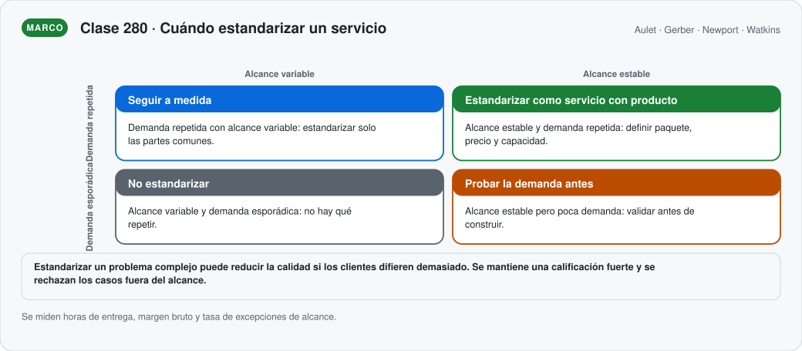

# Clase 280 — Productized services

<!-- nav:inicio -->
> **Parte 23 · Independencia profesional y Business Owner Capstone** — clase 4 de 12 · [índice de la parte](../../README.md) · [temario](../../../../SYLLABUS.md)
<!-- nav:fin -->

**Parte:** 23 — Independencia profesional y Business Owner Capstone  
**Nivel:** Etapa 6 — Independencia  
**Duración sugerida:** 150–180 minutos · **Estándar:** deep-class-v2

## 🎯 Propósito

Un **servicio productizado** es un servicio profesional empaquetado como si fuera un producto: tiene un nombre, un cliente ideal, un resultado definido, un alcance cerrado, un proceso estándar, un precio publicado o fácil de calcular y una capacidad limitada. En lugar de decir «puedo ayudarte con lo que necesites, cotizamos por hora», dice: «por un precio fijo y en cuatro semanas entrego este resultado a este tipo de cliente». Para un profesional independiente, productizar es la manera más directa de **salir del techo de las horas**: reduce el tiempo de venta y de propuesta, hace predecibles los costos y los plazos, facilita la delegación, mejora el margen por hora y permite que los clientes entiendan qué compran. Pero también tiene riesgos: estandarizar mal un problema que en realidad es muy variable degrada la calidad y genera excepciones constantes.

La clase presenta el proceso para productizar con criterio: identificar un servicio repetido, definir cliente ideal y resultado, estandarizar alcance y proceso, fijar precio y capacidad, y medir horas, margen y excepciones. Se apoya en Aulet (definir un cliente específico y un problema repetible), Gerber (el negocio como sistema replicable), Newport (el trabajo profundo y el valor de tiempo concentrado), Watkins (planificar transiciones y victorias tempranas) y Drucker (la eficacia del profesional del conocimiento). Al terminar sabrás decidir qué servicio conviene estandarizar, definir su envolvente (qué casos acepta y cuáles rechaza), calcular su economía por hora y por paquete, estimar la capacidad y diseñar un sistema para manejar excepciones.

## 📚 Resultados de aprendizaje

Al finalizar podrás:

1. **Distinguir** consultoría a medida, servicio productizado y producto.
2. **Identificar** un servicio repetido y su cliente ideal con evidencia de demanda.
3. **Definir** alcance, proceso, entregables, precio y envolvente de aceptación.
4. **Calcular** horas de entrega, margen y rendimiento por hora, y la capacidad mensual.
5. **Gestionar** excepciones y decidir cuándo ajustar, ampliar o abandonar el paquete.

## 🧭 Agenda

| Tramo | Qué se hace |
|---|---|
| 0–20 min | Recuperación: ¿qué servicio has entregado más de tres veces con el mismo patrón? |
| 20–60 min | Servicio repetido, cliente y resultado, alcance, proceso, precio, capacidad, excepciones. |
| 60–105 min | Ejemplo trabajado: rendimiento por hora, capacidad y costo de las excepciones. |
| 105–150 min | Caso ejecutivo y práctica. |
| 150–175 min | Límites y entregable. |

## 🧩 Conceptos centrales

| Concepto | Definición | Cómo se reconoce |
|---|---|---|
| **Servicio productizado** | Servicio con alcance, proceso y precio estandarizados. | Paquete con nombre y resultado. |
| **Envolvente de aceptación** | Condiciones que debe cumplir un caso para entrar al paquete. | Criterios de calificación. |
| **Excepción de alcance** | Caso que requiere trabajo fuera del paquete. | Horas o entregables adicionales. |
| **Rendimiento por hora** | Ingreso menos costos directos, dividido por horas dedicadas. | Pesos por hora de entrega. |
| **Capacidad** | Número de paquetes que se pueden entregar con calidad. | Horas disponibles ÷ horas por paquete. |
| **Calificación** | Filtro previo para aceptar o rechazar un cliente. | Preguntas y criterios escritos. |

## 🧠 Modelo mental

**Cómo leer el diagrama.** Dos ejes. El horizontal mide la estabilidad del **alcance** (de variable a estable); el vertical, la **demanda** (de esporádica a repetida). Cuatro cuadrantes: **alcance estable y demanda repetida**, estandarizar como servicio con producto, definiendo paquete, precio y capacidad; **alcance variable y demanda repetida**, seguir a medida estandarizando solo las partes comunes; **alcance estable y demanda esporádica**, probar la demanda antes de construir; **alcance variable y demanda esporádica**, no estandarizar. La nota advierte que estandarizar un problema complejo puede reducir la calidad si los clientes difieren demasiado y que se mantiene una calificación fuerte; el pie, que se miden horas de entrega, margen bruto y tasa de excepciones.

## 📖 Desarrollo

### 1. De la consultoría a medida al servicio productizado

En la consultoría a medida, cada encargo se diseña desde cero: se conversa, se diagnostica, se propone, se entrega algo único. Tiene ventajas (adaptación, precios altos, cercanía) y costos (mucho tiempo de venta, incertidumbre de horas, dificultad para delegar y para escalar). El servicio productizado conserva la experiencia del profesional pero **repite una fórmula**: mismo problema, mismo tipo de cliente, mismo resultado, mismo proceso. Gerber sostiene que el negocio debe diseñarse como un sistema que puede replicarse con independencia de quien lo ejecute; productizar es el primer paso concreto en esa dirección. No todos los servicios deberían productizarse: los muy complejos o con alta variabilidad pueden requerir una parte estandarizada (diagnóstico) y otra a medida (implementación).

### 2. Detectar el servicio repetido

La señal es la **repetición con el mismo patrón**: ya se entregó tres o más veces, con resultados similares, a clientes parecidos, y se siguieron los mismos pasos. Se revisan los proyectos anteriores: ¿qué problema inicial tenían?, ¿qué se hizo en cada fase?, ¿qué entregables eran comunes?, ¿cuántas horas tomó cada parte?, ¿qué varió y por qué?, ¿qué clientes quedaron mejor y cuáles peor? Aulet recomienda partir de un **segmento específico** y de un problema que ese segmento reconoce; un servicio productizado nace de un segmento acotado donde las necesidades se parecen. La frecuencia de la demanda también cuenta: no sirve productizar algo que se vende dos veces al año. Se verifica con **solicitudes espontáneas** y conversaciones.

### 3. Definir cliente, resultado y envolvente

El paquete se describe con precisión: **para quién es** (tamaño, sector, situación), **qué problema resuelve**, **qué resultado entrega** (con medida: «reducción del 20 % en tiempo de cierre contable», «auditoría con plan de acción en 15 días»), **qué incluye** y **qué no incluye**, **qué necesita del cliente** (datos, acceso, personas) y **qué casos no acepta**. Esto último es la **envolvente de aceptación**: criterios de calificación que se aplican antes de vender («solo trabajamos con empresas de 20 a 200 personas con un sistema contable instalado y un responsable disponible 3 horas por semana»). Una calificación fuerte protege la calidad y el margen. Cuando llegan casos fuera de la envolvente, se **derivan, se rechazan o se ofrecen a medida** con otro precio.

### 4. Estandarizar proceso y entregables

Se escribe el **proceso paso a paso**: fases, actividades, duración, plantillas, listas de verificación, reuniones, entregables y criterios de calidad. Newport destaca el valor del trabajo profundo: bloques de tiempo concentrado producen resultados de alta calidad; un servicio productizado permite **agrupar tareas**, reducir cambios de contexto y proteger bloques de concentración. Se documenta la **secuencia de comunicación** con el cliente (inicio, avances, entrega, cierre), los **materiales** y un **cuestionario de ingreso**. Se prepara un **caso modelo** para mostrar. El estándar debe permitir que, con ajustes menores, el servicio lo entregue otra persona entrenada, aunque no siempre se delegue. Cada entrega alimenta una mejora del proceso.

### 5. Precio, capacidad y condiciones

El precio de un paquete se fija según **valor para el cliente**, **costo de entrega** (horas propias y costos directos) y **referencias de mercado**; se publica o se comunica con claridad, con condiciones: pago por adelantado o por hitos, plazo, número de revisiones, qué ocurre con cambios, propiedad de los entregables y confidencialidad. La **capacidad** se calcula: horas disponibles por mes ÷ horas por paquete (incluyendo reuniones, ajustes e imprevistos). Con una **lista de espera** o un calendario de cupos se protege la calidad. Se evita fijar un precio por debajo de la capacidad de entrega sostenible: un paquete barato que satura al profesional lo lleva al agotamiento. Las condiciones contractuales y tributarias se verifican con asesoría y fuentes oficiales.

### 6. Medir: horas, margen y excepciones

Tres medidas guían la mejora. **Horas de entrega por paquete** (reales, no estimadas), para comparar con lo previsto. **Margen bruto y rendimiento por hora**: ingresos menos costos directos, dividido por horas. **Tasa de excepciones de alcance**: porcentaje de casos que requirieron trabajo fuera del paquete. Si la tasa de excepciones es alta, hay tres causas posibles: la envolvente es demasiado amplia (se aceptan casos que no calzan), el paquete está mal diseñado (olvidó algo común) o el cliente no entiende el alcance (comunicación). Se interpreta con cuidado: pocos casos dan estimaciones frágiles. Se comparan versiones del paquete y se registra qué cambió. Drucker recuerda que lo que se mide y se discute se mejora.

### 7. Cuándo ajustar, ampliar o abandonar

Con datos, se decide: **mantener** (resultados estables), **ajustar** (cambiar alcance, precio o envolvente), **ampliar** (agregar un segundo paquete complementario, un nivel superior o una versión recurrente) o **abandonar** (no hay demanda suficiente o el margen no compensa). Un servicio productizado también puede ser la **puerta de entrada** a una relación mayor (servicios a medida, retainer, capacitación). Watkins sugiere planificar etapas y hitos con revisión; aquí, el paquete se revisa cada trimestre. A largo plazo, la productización permite pasar de vender horas a vender **resultados repetibles**, delegar parte de la entrega (clase 283 sobre portafolio de ingresos) y construir activos (plantillas, métodos, cursos) que alimentan productos digitales (clase 281).

## 📚 Lectura comparada

| Obra | Qué aporta | Qué no resuelve | Pregunta para contrastar |
|---|---|---|---|
| Aulet | Segmento específico y problema reconocible. | Proceso extenso para empresas nuevas. | ¿Qué segmento comparte este problema? |
| Gerber | El negocio como sistema replicable. | No define paquetes de servicio. | ¿Qué parte de mi servicio es repetible? |
| Newport | Trabajo profundo y bloques de concentración. | No calcula economía. | ¿Cómo protejo el tiempo de entrega de alta calidad? |
| Watkins | Planificación por etapas, hitos y revisión. | Enfoque de transiciones de roles. | ¿Qué hito valida este paquete? |
| Drucker | Medir y gestionar la eficacia del trabajo del conocimiento. | No trata productización. | ¿Qué mido para mejorar el paquete? |

## 🧮 Ejemplo trabajado

**Situación (hipotética).** Una consultora de recursos humanos, que cobra por proyecto a medida, evalúa productizar su servicio de «diagnóstico de clima laboral y plan de acción» para empresas de 30 a 150 personas. Todos los valores son **supuestos**.

**Servicio a medida (promedio de 6 proyectos).**

| Concepto | Valor |
|---|---|
| Precio promedio | 2.000.000 pesos |
| Costos directos (herramientas y encuestas) | 100.000 |
| Horas planificadas | 40 |
| Horas reales (con extensiones de alcance) | 48 |

**Rendimiento por hora (a medida).** (2.000.000 − 100.000) ÷ 48 = **39.583 pesos por hora**.

**Servicio productizado propuesto.**

| Concepto | Valor |
|---|---|
| Precio fijo | 1.800.000 pesos |
| Costos directos | 180.000 (herramienta de encuestas con licencia y reportes) |
| Horas de entrega por paquete (con plantillas y proceso estándar) | 24 |

**Rendimiento por hora (paquete).** (1.800.000 − 180.000) ÷ 24 = **67.500 pesos por hora**: **70,5 % mayor** que a medida (67.500 ÷ 39.583 = 1,705).

**Capacidad mensual.** Horas disponibles para entrega: 120 al mes. A medida: 120 ÷ 48 = **2,5 proyectos** → 5,0 millones de ingreso bruto (2,5 × 2.000.000). Paquete: 120 ÷ 24 = **5 paquetes** → 9,0 millones (5 × 1.800.000). Ingreso neto de costos directos: a medida, 2,5 × 1.900.000 = 4,75 millones; paquete, 5 × 1.620.000 = **8,1 millones**.

**Excepciones.** En los tres primeros paquetes, 25 % de los casos requirió trabajo fuera del alcance de 8 horas adicionales. Horas esperadas por paquete: 24 + 0,25 × 8 = **26,0**; con una calificación más estricta (envolvente de 30 a 150 personas con un responsable disponible), la tasa baja a 10 %: 24 + 0,10 × 8 = **24,8** horas. Rendimiento por hora con 24,8 horas: 1.620.000 ÷ 24,8 = **65.323**; con 26,0 horas: 1.620.000 ÷ 26,0 = **62.308**. La calificación mejora el rendimiento en 3.015 pesos por hora (4,8 %).

**Costo de aceptar casos fuera de la envolvente.** Un cliente de 400 personas con tres sedes pide el paquete por 1,8 millones; la estimación realista es 60 horas. Rendimiento: 1.620.000 ÷ 60 = **27.000 por hora**, menos de la mitad del estándar y menos que el servicio a medida. **No se acepta como paquete**; se ofrece una propuesta a medida de 4,5 millones (rendimiento de (4.500.000 − 300.000) ÷ 60 = 70.000 por hora).

**Prueba de demanda.** La consultora ofrece el paquete a 20 empresas del perfil; 7 muestran interés, 4 compran y 1 pide ampliación a medida: tasa de compra de 20 % de los contactados (4 ÷ 20). Con este ritmo, para 5 paquetes al mes necesita 25 contactos por mes. Se revisa tras 3 meses.

**Decisión.** Lanzar el paquete a 1,8 millones con cupo de 5 paquetes al mes, aplicar la calificación por escrito, registrar horas reales y excepciones, rechazar casos fuera de la envolvente, y ofrecer a los clientes satisfechos un seguimiento a 6 meses como extensión. Revisar precio y alcance con 15 paquetes entregados.

**Cuidados.** Los valores son supuestos; los contratos, la protección de los datos de las encuestas y las obligaciones tributarias se verifican con asesoría y fuentes oficiales.

**Qué muestra.** (1) Productizar elevó el rendimiento por hora y la capacidad. (2) La calificación redujo la tasa de excepciones. (3) Un caso fuera de la envolvente destruiría el margen si se aceptara como paquete.

## 🔀 Comparación y límites

**Servicio productizado frente a producto digital.** El primero sigue requiriendo tiempo humano en cada entrega; el segundo se entrega con poco o ningún tiempo adicional por cliente, pero exige desarrollo, soporte y distribución. Muchos pasan por el primero antes del segundo.

**Límites.** Estandarizar un problema complejo puede reducir la calidad si los clientes difieren demasiado; hay que mantener una calificación fuerte y rechazar casos fuera de la envolvente. Los datos con pocos casos son frágiles. Las cifras del ejemplo son supuestos. Los contratos, la privacidad de datos y los efectos tributarios se verifican con asesoría.

## 🪜 De profesional a owner

| Nivel | Cómo se relaciona con los servicios productizados |
|---|---|
| **Profesional** | Entrega según un proceso estándar y propone mejoras. |
| **Jefe / Team Lead** | Coordina la entrega y controla horas y calidad. |
| **Gerente** | Gestiona el catálogo de paquetes y su rentabilidad. |
| **CEO / Director** | Decide qué estandarizar, a qué precio y con qué capacidad. |
| **Founder / Owner** | Diseña el paquete, define la envolvente y decide cuándo ampliar. |

## 🏢 Caso ejecutivo

Un contador independiente ofrece servicios a medida para microempresas: ordenamiento contable inicial, preparación de declaraciones, asesoría de costos y apoyo en créditos. Cobra por hora (35.000 pesos) pero siempre excede las horas. En el último año repitió 14 veces un patrón: «ordenar la contabilidad y dejar un sistema de registro simple para un negocio de menos de 10 personas» con 18 a 30 horas, según el desorden del cliente. Tiene dos clientes que le piden «lo mismo que a los demás pero más barato». Un cliente con inventario complejo y tres sucursales pidió el mismo servicio y consumió 85 horas. La demanda llega por recomendaciones, unas 3 por mes. Quiere fijar un paquete de 480.000 pesos, con 20 horas de entrega, y una versión «plus» a 780.000 con seguimiento por tres meses. Sus costos directos son de 40.000 por cliente. Capacidad disponible: 110 horas al mes.

Entrega un **memo de decisión del fundador** que contenga: (a) la comparación de rendimiento por hora entre el servicio actual (promedio de 24 horas, tarifa de 35.000, con 20 % de horas no cobradas) y el paquete; (b) la envolvente de aceptación y las preguntas de calificación; (c) la capacidad mensual y la economía de las dos versiones; (d) el tratamiento del cliente con 85 horas y del pedido de «más barato»; (e) la tasa de excepciones esperada y el plan de medición; (f) los límites del análisis y las verificaciones legales y tributarias pendientes.

## 🧪 Práctica

1. Identifica un servicio que hayas entregado al menos tres veces con el mismo patrón.
2. Escribe la ficha del paquete: cliente, resultado, incluye, no incluye, requisitos, precio y plazo.
3. Redacta la envolvente de aceptación con cinco criterios y tres preguntas de calificación.
4. Calcula rendimiento por hora y capacidad mensual de tu paquete con supuestos explícitos.
5. Define cómo registrarás horas reales y excepciones durante tres meses.

## ⚠️ Errores frecuentes

| Error | Por qué ocurre | Cómo corregirlo |
|---|---|---|
| Productizar algo que se vendió una vez | Se busca eficiencia temprano | Exigir repetición y demanda observable. |
| Paquete sin envolvente | Se quiere vender a todos | Criterios de calificación por escrito. |
| Precio por debajo de la capacidad sostenible | Miedo a perder ventas | Calcular horas reales y capacidad. |
| Aceptar excepciones sin cobrarlas | Se evita el conflicto | Regla de cambios y tarifa adicional. |
| No medir horas reales | Se confía en la estimación | Registro de horas y excepciones. |
| Estandarizar demasiado un problema variable | Se ignora la diversidad de clientes | Estandarizar partes y mantener opciones a medida. |

## ❓ Preguntas de comprobación

1. ¿Qué distingue un servicio productizado de uno a medida?
2. ¿Qué señales indican que un servicio es candidato?
3. ¿Qué es la envolvente de aceptación?
4. ¿Cómo se calcula el rendimiento por hora?
5. ¿Cómo se calcula la capacidad de un paquete?
6. ¿Qué indica una alta tasa de excepciones?
7. ¿Qué límite tiene estandarizar?

Claves de respuesta

1. El productizado tiene alcance, proceso y precio estandarizados; el a medida se diseña caso por caso.
2. Repetición con el mismo patrón, resultados similares, clientes parecidos y demanda observable.
3. Los criterios que debe cumplir un caso para entrar al paquete.
4. Ingreso menos costos directos, dividido por las horas dedicadas.
5. Horas disponibles dividido por las horas por paquete, incluyendo ajustes e imprevistos.
6. Que la envolvente es muy amplia, el paquete olvidó algo común o el cliente no entiende el alcance.
7. Puede reducir la calidad si los clientes difieren demasiado; se mantiene una calificación fuerte.

## 📥 Entregable

Guarda en `portfolio/280-productized-services/`:

- `founder-owner-decision-brief.md` (plantilla [Founder owner decision brief](../../../../templates/founder-owner-decision-brief.md)) con el memo del caso ejecutivo;
- `decision-journal.md` con la ficha del paquete, la envolvente y las métricas de los tres primeros meses.

## 📗 Fuentes y verificación

- Bill Aulet — *Disciplined Entrepreneurship* (John Wiley & Sons, Incorporated, 2013). **Uso en esta clase:** segmento específico y problema reconocible. Lectura selectiva sobre **productized services**. **Localizador:** [ISBN-13 9781299848641](https://openlibrary.org/isbn/9781299848641).
- Michael E. Gerber — *The E-Myth Revisited* (HarperAudio, 1995). **Uso en esta clase:** el negocio como sistema replicable. Lectura selectiva sobre **productized services**. **Localizador:** [ISBN-13 9780060574901](https://openlibrary.org/isbn/9780060574901).
- Cal Newport — *Deep Work* (Grand Central Publishing, 2016). **Uso en esta clase:** trabajo profundo y bloques de concentración. Lectura selectiva sobre **productized services**. **Localizador:** [ISBN-13 9781455586691](https://openlibrary.org/isbn/9781455586691).
- Michael D. Watkins — *The First 90 Days* (Harvard Business School Press, 2003). **Uso en esta clase:** planificación por etapas, hitos y revisión. Lectura selectiva sobre **productized services**. **Localizador:** [ISBN-13 9781591391104](https://openlibrary.org/isbn/9781591391104).
- Peter F. Drucker — *The Effective Executive* (Collins, 2002). **Uso en esta clase:** eficacia del trabajo del conocimiento. Lectura selectiva sobre **productized services**. **Localizador:** [ISBN-13 9780060516079](https://openlibrary.org/isbn/9780060516079).
- Peter F. Drucker — *Management: Tasks, Responsibilities, Practices* (Harper & Row, 1974). **Uso en esta clase:** medir y gestionar resultados. Lectura selectiva sobre **productized services**. **Localizador:** [ISBN-13 9780060110925](https://openlibrary.org/isbn/9780060110925).

> **Regla de fuentes para Productized services:** las obras anteriores estructuran las perspectivas de esta materia; cualquier norma, ley o estándar vivo mencionado debe comprobarse nuevamente en su fuente primaria vigente, incluidas las normas de protección de datos y las obligaciones tributarias. Los ejemplos y casos son hipotéticos, con cifras ilustrativas. El desarrollo es original y no reproduce capítulos protegidos.

<!-- pie:inicio -->
---

| Anterior | Índice | Siguiente |
|---|---|---|
| [← 279 · Consultoría y servicios profesionales](../279-consultoria-y-servicios-profesionales/README.md) | [Parte 23](../../README.md) · [Programa](../../../../SYLLABUS.md) | [281 · Producto digital y propiedad intelectual →](../281-producto-digital-y-propiedad-intelectual/README.md) |
<!-- pie:fin -->
