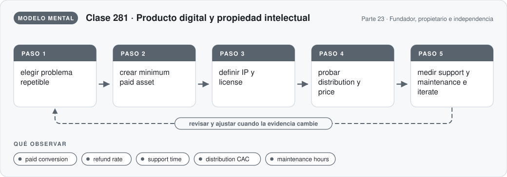

# Clase 281 — Producto digital y propiedad intelectual

<!-- nav:inicio -->
> **Parte 23 · Independencia profesional y Business Owner Capstone** — clase 5 de 12 · [índice de la parte](../../README.md) · [temario](../../../../SYLLABUS.md)
<!-- nav:fin -->

**Parte:** 23 — Independencia profesional y Business Owner Capstone  
**Nivel:** Etapa 6 — Independencia  
**Duración sugerida:** 150–180 minutos · **Estándar:** deep-class-v2

## 🎯 Propósito

Un producto digital —un curso, una plantilla, un libro, un conjunto de herramientas, una guía, un software pequeño— promete lo que ningún servicio puede: **venderse muchas veces sin que cada venta consuma las horas del autor**. Por eso seduce a quien busca independencia: «lo creo una vez y lo vendo mil veces». La promesa es parcialmente cierta y parcialmente peligrosa. Cierta, porque el costo de producir la copia adicional es casi cero. Peligrosa, porque el costo real está en otras partes: **encontrar compradores**, **convencerlos de pagar**, **atender consultas y reclamos**, **actualizar el producto**, **proteger su reputación y su propiedad intelectual** y **cumplir las normas** de comercio electrónico, consumo, datos personales y tributación. Muchos productos digitales fracasan no por mala calidad, sino por no resolver un problema por el que haya demanda o por no tener una vía de distribución. Digital no significa pasivo.

La clase presenta el proceso como una escalera: elegir un problema repetible, crear un **activo mínimo de pago**, definir propiedad intelectual y licencia, probar distribución y precio, y medir soporte y mantención para iterar. Se apoya en Ries (aprender con el producto mínimo y métricas accionables), McKeown (concentrarse en lo esencial), Wasserman (decisiones sobre quién crea, quién posee y cómo se reparte el valor), Gerber (un negocio como sistema) y Drucker (resultados que importan). **No es asesoría legal**: los derechos de autor, las licencias, las normas de consumo y de datos personales y los efectos tributarios se verifican con asesoría y fuentes oficiales vigentes. Al terminar sabrás validar la demanda de un producto antes de construirlo, calcular su economía por visita y por comprador, estimar el punto de equilibrio y el costo de mantenerlo, y definir quién es titular y qué licencia se otorga.

## 📚 Resultados de aprendizaje

Al finalizar podrás:

1. **Elegir** un problema repetible con demanda observable.
2. **Diseñar** un activo mínimo de pago y probarlo con compradores reales.
3. **Definir** titularidad y licencia, y revisar los derechos de terceros que contiene.
4. **Calcular** conversión, devoluciones, comisiones y soporte, y su punto de equilibrio.
5. **Modelar** el costo de mantención antes de ampliar el catálogo.

## 🧭 Agenda

| Tramo | Qué se hace |
|---|---|
| 0–20 min | Recuperación: ¿qué problema repetido de tus clientes podría resolverse con un producto? |
| 20–60 min | Problema, activo mínimo, propiedad intelectual, distribución, precio, soporte y mantención. |
| 60–105 min | Ejemplo trabajado: economía por mil visitas, punto de equilibrio y costo de mantención. |
| 105–150 min | Caso ejecutivo y práctica. |
| 150–175 min | Límites y entregable. |

## 🧩 Conceptos centrales

| Concepto | Definición | Cómo se reconoce |
|---|---|---|
| **Activo mínimo de pago** | Versión más pequeña del producto que alguien compra. | Pagos reales con alcance acotado. |
| **Licencia** | Permiso de uso que se otorga al comprador. | Términos de uso, personal o de equipo. |
| **Titularidad** | Quién es dueño de los derechos del producto. | Autor, empresa o cedente identificados. |
| **Conversión a pago** | Proporción de visitantes que compra. | Compradores ÷ visitantes. |
| **Tasa de devolución** | Proporción de ventas devueltas. | Devoluciones ÷ ventas. |
| **Carga de mantención** | Tiempo y costo de actualizar, atender y defender el producto. | Horas por mes. |

## 🧠 Modelo mental

**Cómo leer el diagrama.** Una escalera de cinco peldaños. **Problema repetible**: un problema que muchas personas tienen y pagan por resolver. **Activo mínimo de pago**: la versión más pequeña que alguien compre. **Propiedad intelectual y licencia**: qué se vende, qué se licencia y a nombre de quién. **Distribución y precio**: cómo llega a compradores y cuánto pagan. **Soporte y mantención**: el costo continuo de atender y actualizar. La nota afirma que digital no significa pasivo y que se modela la carga futura antes de ampliar el catálogo; el pie, que se mide conversión a pago, devoluciones y tiempo de soporte.

## 📖 Desarrollo

### 1. Elegir un problema repetible

El punto de partida no es «qué producto puedo hacer», sino **qué problema repetido tienen muchas personas y están dispuestas a pagar por resolver**. La fuente más confiable es el trabajo con clientes (clases 278 a 280): preguntas que se repiten, tareas que se explican una y otra vez, plantillas que se comparten, errores comunes. Se valida con conversaciones, con solicitudes espontáneas y con señales de compra (ya gastan en alternativas, ya buscan soluciones). Ries insiste en validar la demanda antes de construir: la primera versión de un producto digital puede ser una **página de preventa**, un documento de pocas páginas o una sesión en vivo, que se vende antes de ser un producto terminado, con honestidad sobre lo que se entregará. Si nadie compra la promesa, tampoco comprará una versión más pulida.

### 2. Un activo mínimo de pago

El **activo mínimo de pago** es la versión más pequeña que **alguien paga**: una plantilla, una guía de 20 páginas, un taller en vivo grabado, un conjunto de hojas de cálculo. Su objetivo es doble: **aprender** (qué valoran, qué falta, qué precio aceptan) y **generar ingresos** que financien la siguiente versión. Se define su **alcance**, su **promesa verificable** (qué logrará quien lo use), su **formato**, su **precio** y sus **condiciones** (política de devolución, soporte incluido, actualizaciones). McKeown recomienda concentrarse en lo esencial: un buen producto mínimo hace una cosa bien. Se evitan los proyectos de seis meses sin ventas intermedias. Se registran las **preguntas de los compradores**, que alimentan mejoras y contenido nuevo.

### 3. Propiedad intelectual y licencia

Un producto digital es un conjunto de **derechos**: sobre el contenido, el código, el diseño, la marca y los datos. Preguntas esenciales: **¿quién es el titular?** (el autor, la empresa, un cedente; ver la clase 261 sobre titularidad y cesiones), **¿incluye material de terceros?** (imágenes, fuentes tipográficas, música, código abierto o con licencia, extractos de obras, plantillas ajenas), **¿qué licencia se otorga al comprador?** (uso personal, uso en un equipo, uso comercial, reventa, modificación), **¿qué se prohíbe?** (copiar y revender, compartir credenciales) y **¿cómo se protege?** (términos de uso, marcas de agua, control de accesos, monitoreo). Las licencias de terceros pueden restringir el uso comercial: se revisan antes de vender. Los contratos y las normas de propiedad intelectual y de consumo se verifican con asesoría y fuentes oficiales.

### 4. Distribución: cómo se encuentra a los compradores

El mayor obstáculo de un producto digital es la **distribución**: que quienes tienen el problema sepan que existe la solución. Canales posibles: **audiencia propia** (lista de correos, redes, comunidad, charlas), **clientes y red existentes**, **alianzas** con quienes ya atienden a ese público, **marketplaces** de terceros (con comisiones y reglas propias), **búsqueda** y **publicidad pagada**. Newport (clase 278) y Aulet destacan la importancia de reputación y de definir un cliente específico; sin audiencia, un producto excelente no se vende solo. Se prueba un canal a la vez, se mide su costo por visita y por comprador, y se aprende. Un error frecuente es **lanzar sin audiencia ni plan de distribución**. Las comunicaciones comerciales deben respetar el consentimiento y la normativa aplicable.

### 5. Precio, conversión y devoluciones

El precio de un producto digital se fija según el **valor del resultado** para el comprador y las **alternativas** que tiene, no según el costo (que es casi nulo). Se prueban **dos o tres precios** y **niveles** (versión básica, versión con acompañamiento). Las métricas clave son: **conversión a pago** (compradores ÷ visitantes de la página), **tasa de devolución**, **ingreso por visitante**, **costo de adquisición** y **margen después de comisiones de pago**. Una tasa de devolución alta indica que la promesa no se cumple o que se vendió a la persona equivocada. Ries y su enfoque de **métricas accionables** sugieren evitar cifras de vanidad (visitas, seguidores) y mirar lo que cambia decisiones: conversión, devoluciones, repetición de compra, recomendaciones. Los precios y las condiciones deben respetar las normas de protección al consumidor y de comercio electrónico aplicables.

### 6. Soporte, mantención y reputación

Un producto vendido genera **obligaciones**: responder consultas, resolver problemas de acceso, atender reclamos, corregir errores, actualizar contenido que envejece, adaptar a cambios de plataformas y defender la reputación frente a críticas o copias no autorizadas. Se estima la **carga de soporte** por comprador (minutos o horas) y la **carga de mantención** mensual, y se valora con el costo de oportunidad del tiempo. Se diseñan **autoservicios** (preguntas frecuentes, tutoriales, comunidad) para reducir el soporte. Gerber recuerda que un negocio sano es un sistema; un catálogo de productos sin sistema de soporte se vuelve una carga. Antes de ampliar el catálogo se pregunta: ¿puedo mantener los productos que ya tengo con calidad? Un producto abandonado daña la marca.

### 7. Iterar, ampliar o cerrar

Con los datos de conversión, devoluciones, soporte y mantención se decide: **iterar** (mejorar el producto o la página), **ampliar** (versión superior, producto complementario, formato distinto), **combinar** con servicios (el producto como puerta de entrada a consultoría o acompañamiento) o **cerrar** (retirarlo con aviso y cumpliendo obligaciones con compradores). Drucker aconseja **abandonar sistemáticamente** lo que ya no produce resultados para liberar recursos. Wasserman señala que las decisiones sobre quién crea, quién posee y cómo se reparte el valor tienen consecuencias a largo plazo; si el producto se desarrolla con socios o colaboradores, se acuerdan por escrito titularidad, reparto de ingresos y responsabilidades. Se documenta todo y se revisa trimestralmente.

## 📚 Lectura comparada

| Obra | Qué aporta | Qué no resuelve | Pregunta para contrastar |
|---|---|---|---|
| Ries | Producto mínimo, validación y métricas accionables. | No define licencias. | ¿Qué prueba de pago valida mi idea? |
| McKeown | Concentrarse en lo esencial. | No calcula economía. | ¿Qué es lo único que mi producto debe hacer bien? |
| Wasserman | Decisiones sobre creación, propiedad y reparto del valor. | No cubre el marketing. | ¿Quién es titular y cómo se reparte el valor? |
| Gerber | El negocio como sistema. | No trata propiedad intelectual. | ¿Qué sistema sostiene el soporte? |
| Drucker | Abandonar sistemáticamente lo que no produce. | No es guía de producto digital. | ¿Qué producto debería dejar de mantener? |

## 🧮 Ejemplo trabajado

**Situación (hipotética).** Una consultora en finanzas para pequeños negocios crea un paquete de plantillas y guía de «control de caja para pymes» a un precio de 59.000 pesos. Quiere saber si el producto se paga y cuánto cuesta mantenerlo. Todos los valores son **supuestos**; los impuestos, comisiones y normas de consumo se verifican en fuentes oficiales y con los proveedores.

**Datos de prueba por cada 1.000 visitas a la página de venta.**

| Concepto | Valor |
|---|---|
| Precio | 59.000 |
| Conversión a pago | 2,0 % |
| Tasa de devolución | 6 % |
| Comisión de pagos | 3,5 % |
| Soporte por comprador | 0,5 hora, valorada a 40.000 pesos |
| Costo de tráfico pagado | 250 pesos por visita |

**Economía por 1.000 visitas.**

- Compradores: 1.000 × 2,0 % = **20**.
- Ingresos brutos: 20 × 59.000 = **1.180.000**.
- Devoluciones: 6 % × 1.180.000 = **70.800**; ingresos netos de devoluciones: **1.109.200**.
- Comisiones de pago: 3,5 % × 1.109.200 = **38.822**; ingresos netos de comisiones: **1.070.378**.
- Soporte: 20 compradores × 0,5 horas × 40.000 = **400.000**.
- Tráfico: 1.000 × 250 = **250.000**.
- **Resultado: 1.070.378 − 400.000 − 250.000 = 420.378 pesos por 1.000 visitas.**

**Punto de equilibrio de conversión.** Por comprador, el ingreso neto de devoluciones y comisiones es 59.000 × 0,94 × 0,965 = **53.519**; menos el soporte de 20.000: **33.519**. Cada visita cuesta 250 pesos. Conversión de equilibrio: 250 ÷ 33.519 = **0,75 %**. Con 2,0 % hay un margen de seguridad de 2,7 veces (2,0 ÷ 0,75).

**Carga de mantención.** Actualizar las plantillas y la guía (cambios de herramientas, ajustes) requiere 8 horas al mes, a 40.000 pesos: **320.000 mensuales**. Compradores necesarios por mes para cubrirla: 320.000 ÷ 33.519 = 9,5, es decir **10 compradores al mes**. Con 2,0 % de conversión, eso exige 500 visitas al mes (10 ÷ 0,02). Si la audiencia o el tráfico generan solo 300 visitas mensuales, el producto no cubre su mantención: 6 compradores × 33.519 = 201.114, menos 320.000 = **−118.886 al mes**.

**Sensibilidad.** Si la tasa de devolución fuera de 15 %: ingreso neto por comprador = 59.000 × 0,85 × 0,965 = 48.395; menos soporte 20.000 = 28.395; conversión de equilibrio = 250 ÷ 28.395 = **0,88 %**. Si el soporte fuera de 1,5 horas por comprador (60.000): 53.519 − 60.000 = −6.481 por comprador: **el producto se vuelve inviable con ese nivel de soporte**. Esto justifica invertir en autoservicio y en claridad de la promesa.

**Propiedad intelectual.** Revisión: el contenido es de la consultora; las plantillas incluyen una fuente tipográfica con licencia de uso personal (debe reemplazarse o licenciarse); dos gráficos fueron hechos por un freelance sin cesión (se firma una cesión); se define una licencia de uso para un negocio (no reventa), con versión de equipo a 129.000 pesos. Los términos de uso y la política de devolución se revisan con asesoría.

**Distribución.** El producto se ofrece primero a los 600 contactos de su lista (compra 3,5 % = 21 compradores), luego a una comunidad de emprendedores asociada (comisión de 20 % por venta) y con tráfico pagado en pruebas de 300 visitas. Se mide cada canal por separado.

**Decisión.** Lanzar la versión mínima con los cambios de licencias y la cesión del diseño, medir conversión y devoluciones en 90 días, producir material de autoservicio para bajar el soporte a 0,25 hora por comprador, no crear un segundo producto hasta cubrir la mantención del primero y evaluar una versión de equipo.

**Cuidados.** Las cifras son supuestos; las normas de consumo, comercio electrónico, datos personales y tributación se consultan en fuentes oficiales y con asesoría.

**Qué muestra.** (1) La economía por visitas y por comprador indicó el punto de equilibrio. (2) La mantención exige un volumen mínimo de ventas. (3) Un problema de licencias de terceros debe resolverse antes de vender.

## 🔀 Comparación y límites

**Producto digital frente a servicio productizado.** El producto digital se entrega casi sin tiempo humano por cliente; el servicio productizado requiere tiempo de entrega por cliente. El primero escala más, pero requiere distribución, soporte y mantención.

**Límites.** Digital no significa pasivo: el producto requiere marketing, soporte, actualización y defensa de la reputación. Las licencias de terceros y las normas de consumo y de datos personales deben revisarse. No es asesoría legal ni tributaria. Las cifras del ejemplo son supuestos.

## 🪜 De profesional a owner

| Nivel | Cómo se relaciona con el producto digital |
|---|---|
| **Profesional** | Contribuye con conocimiento y respeta la titularidad de lo creado. |
| **Jefe / Team Lead** | Convierte procesos del equipo en activos reutilizables. |
| **Gerente** | Gestiona el catálogo, el soporte y la mantención. |
| **CEO / Director** | Decide la inversión en productos y su relación con servicios. |
| **Founder / Owner** | Es titular de los activos, define licencias y asume la carga futura. |

## 🏢 Caso ejecutivo

Un arquitecto independiente crea un curso en línea de «presupuestos de obra para propietarios» con 14 horas de video. Lo vendió a 89.000 pesos en una preventa a 80 personas de su red (ingresos de 7,1 millones), y luego lo lanzó públicamente: en 3 meses, 12.000 visitas a la página con conversión de 0,6 %. Devoluciones del 11 %; soporte de 1,2 horas por comprador (a 35.000 pesos la hora); comisiones de plataforma del 8 %; publicidad por 1,2 millones en el trimestre. Usó música y fotos de bancos de imágenes con licencia personal, y un colega editó los videos sin contrato. Tiene tres cursos más en mente. Los cambios de normas y precios de materiales hacen que el contenido se actualice cada 6 meses con 40 horas de trabajo. Dedicó 300 horas al curso.

Entrega un **informe de evidencia de producto** que contenga: (a) la economía del trimestre con ingresos, devoluciones, comisiones, soporte y publicidad; (b) el punto de equilibrio de conversión y de ventas mensuales para cubrir la mantención; (c) el análisis de licencias y titularidad con las acciones necesarias; (d) los canales de distribución y las pruebas propuestas; (e) la decisión sobre los tres cursos adicionales; (f) los límites del análisis y las verificaciones legales y tributarias pendientes.

## 🧪 Práctica

1. Escribe el problema repetible y la evidencia de demanda de tu producto.
2. Define el activo mínimo de pago, su promesa verificable y su precio.
3. Revisa titularidad y licencias de todos los materiales y haz una lista de acciones.
4. Calcula economía por mil visitas, conversión de equilibrio y carga de mantención.
5. Diseña una prueba de distribución en un canal con una meta y un plazo.

## ⚠️ Errores frecuentes

| Error | Por qué ocurre | Cómo corregirlo |
|---|---|---|
| Construir antes de validar | Entusiasmo por producir | Preventa o prueba de pago primero. |
| Ignorar la distribución | Se piensa que el producto se vende solo | Un canal a la vez con métricas. |
| Material de terceros sin licencia adecuada | Se usa lo que está disponible | Revisar licencias y reemplazar. |
| Soporte sin límite | Se atiende todo a mano | Autoservicio y política clara. |
| Ampliar el catálogo sin capacidad | Se quiere escala | Modelar mantención antes de crear más. |
| Medir solo visitas | Es lo más visible | Medir conversión, devoluciones y soporte. |

## ❓ Preguntas de comprobación

1. ¿Qué es un activo mínimo de pago?
2. ¿Qué incluye revisar la propiedad intelectual de un producto digital?
3. ¿Qué métricas importan en un producto digital?
4. ¿Cómo se calcula la conversión de equilibrio?
5. ¿Por qué la mantención limita el catálogo?
6. ¿Qué indica una alta tasa de devolución?
7. ¿Qué límite tiene la idea de «ingreso pasivo»?

Claves de respuesta

1. La versión más pequeña del producto que alguien compra, para aprender y generar ingresos.
2. Titularidad, material de terceros, licencia otorgada, prohibiciones y protección.
3. Conversión a pago, devoluciones, ingreso por visitante, costo de adquisición, margen y tiempo de soporte.
4. Costo por visita dividido por el margen neto por comprador tras devoluciones, comisiones y soporte.
5. Porque cada producto exige tiempo de soporte y actualización que debe cubrirse con ventas.
6. Que la promesa no se cumple o que se vendió a la persona equivocada.
7. Digital no es pasivo: requiere marketing, soporte, actualización y defensa de la reputación.

## 📥 Entregable

Guarda en `portfolio/281-producto-digital-y-propiedad-intelectual/`:

- `product-evidence-brief.md` (plantilla [Product evidence brief](../../../../templates/product-evidence-brief.md)) con el informe del caso ejecutivo;
- `decision-journal.md` con la economía, las licencias y las pruebas de distribución.

## 📗 Fuentes y verificación

- Eric Ries — *The Lean Startup* (Crown Business, 2011). **Uso en esta clase:** producto mínimo, validación y métricas accionables. Lectura selectiva sobre **producto digital y propiedad intelectual**. **Localizador:** [ISBN-13 9780307887894](https://openlibrary.org/isbn/9780307887894).
- Greg McKeown — *Essentialism* (Virgin Books, 2014). **Uso en esta clase:** concentrarse en lo esencial. Lectura selectiva sobre **producto digital y propiedad intelectual**. **Localizador:** [ISBN-13 9780753555163](https://openlibrary.org/isbn/9780753555163).
- Noam Wasserman — *The Founder's Dilemmas* (Princeton University Press, 2012). **Uso en esta clase:** decisiones sobre creación, propiedad y reparto del valor. Lectura selectiva sobre **producto digital y propiedad intelectual**. **Localizador:** [ISBN-13 9780691149134](https://openlibrary.org/isbn/9780691149134).
- Michael E. Gerber — *The E-Myth Revisited* (HarperAudio, 1995). **Uso en esta clase:** el negocio como sistema de soporte y entrega. Lectura selectiva sobre **producto digital y propiedad intelectual**. **Localizador:** [ISBN-13 9780060574901](https://openlibrary.org/isbn/9780060574901).
- Peter F. Drucker — *The Effective Executive* (Collins, 2002). **Uso en esta clase:** concentración en lo que produce resultados. Lectura selectiva sobre **producto digital y propiedad intelectual**. **Localizador:** [ISBN-13 9780060516079](https://openlibrary.org/isbn/9780060516079).
- Peter F. Drucker — *Management: Tasks, Responsibilities, Practices* (Harper & Row, 1974). **Uso en esta clase:** abandonar sistemáticamente lo que ya no produce. Lectura selectiva sobre **producto digital y propiedad intelectual**. **Localizador:** [ISBN-13 9780060110925](https://openlibrary.org/isbn/9780060110925).

> **Regla de fuentes para Producto digital y propiedad intelectual:** las obras anteriores estructuran las perspectivas de esta materia; cualquier norma, ley o estándar vivo mencionado debe comprobarse nuevamente en su fuente primaria vigente, incluidas las normas de propiedad intelectual, consumo, comercio electrónico, datos personales y tributación. Los ejemplos y casos son hipotéticos, con cifras ilustrativas. El desarrollo es original y no reproduce capítulos protegidos.

<!-- pie:inicio -->
---

| Anterior | Índice | Siguiente |
|---|---|---|
| [← 280 · Productized services](../280-productized-services/README.md) | [Parte 23](../../README.md) · [Programa](../../../../SYLLABUS.md) | [282 · SaaS y modelos recurrentes →](../282-saas-y-modelos-recurrentes/README.md) |
<!-- pie:fin -->
