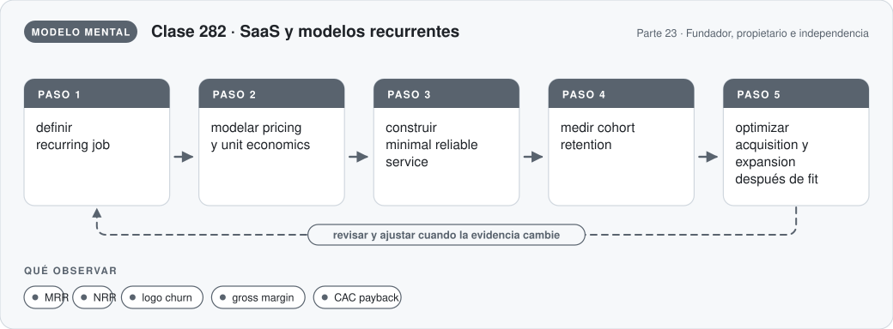

# Clase 282 — SaaS y modelos recurrentes

<!-- nav:inicio -->
> **Parte 23 · Independencia profesional y Business Owner Capstone** — clase 6 de 12 · [índice de la parte](../../README.md) · [temario](../../../../SYLLABUS.md)
<!-- nav:fin -->

**Parte:** 23 — Independencia profesional y Business Owner Capstone  
**Nivel:** Etapa 6 — Independencia  
**Duración sugerida:** 150–180 minutos · **Estándar:** deep-class-v2

## 🎯 Propósito

Un modelo recurrente cobra de forma periódica por un servicio continuo: una suscripción a un software (SaaS, software como servicio), una membresía, un mantenimiento mensual, un retainer de asesoría, una plataforma con cuota. Para un profesional independiente es atractivo porque convierte ingresos esporádicos en **ingresos predecibles**, mejora la capacidad de planificar y aumenta el valor del negocio. Pero también cambia las reglas del juego: el ingreso deja de ser el momento de la venta y pasa a ser **la retención del cliente mes tras mes**. Un cliente que se queda dos años aporta mucho más que su primer pago; uno que se va al tercer mes puede no recuperar siquiera el costo de haberlo conseguido. En un modelo recurrente, el **servicio** debe seguir entregando valor cada período; las promesas de venta no bastan.

La clase presenta el modelo recurrente como una cadena: definir el trabajo recurrente que el cliente necesita, modelar precio y economía unitaria, construir un servicio mínimo pero confiable, medir la retención por cohortes y recién después optimizar adquisición y expansión. Se apoya en Skok (métricas de negocios SaaS: ingreso recurrente, cancelación, valor de vida y costo de adquisición), Ries (aprender con el producto mínimo y medir con rigor), Drucker (gestión por resultados), Taleb (cuidado con las estructuras frágiles frente a la volatilidad), Newport (calidad del trabajo profundo en el desarrollo) y Gerber. Al terminar sabrás calcular MRR, retención neta de ingresos y cancelación de clientes, construir un puente de MRR, estimar valor de vida y recuperación del costo de adquisición, interpretar cohortes y decidir si tu problema merece una suscripción.

## 📚 Resultados de aprendizaje

Al finalizar podrás:

1. **Distinguir** ingreso recurrente de ingreso repetido y de ingreso puntual.
2. **Calcular** MRR, retención neta de ingresos, cancelación de clientes y de ingresos.
3. **Estimar** valor de vida del cliente y recuperación del costo de adquisición con supuestos.
4. **Leer** cohortes y detectar si el crecimiento esconde una fuga.
5. **Decidir** si un problema se presta a una suscripción o a otro modelo.

## 🧭 Agenda

| Tramo | Qué se hace |
|---|---|
| 0–20 min | Recuperación: ¿qué trabajo recurrente tiene tu cliente que justificaría un pago periódico? |
| 20–60 min | Trabajo recurrente, precio, servicio mínimo, cohortes, adquisición y expansión. |
| 60–105 min | Ejemplo trabajado: puente de MRR, NRR, valor de vida, recuperación y cohortes. |
| 105–150 min | Caso ejecutivo y práctica. |
| 150–175 min | Límites y entregable. |

## 🧩 Conceptos centrales

| Concepto | Definición | Cómo se reconoce |
|---|---|---|
| **MRR** | Ingreso recurrente mensual contratado. | Suma de cuotas mensuales vigentes. |
| **Cancelación de clientes (logo churn)** | Proporción de clientes que se va en un período. | Clientes perdidos ÷ clientes iniciales. |
| **Retención neta de ingresos (NRR)** | Ingresos de clientes existentes tras bajas, reducciones y ampliaciones. | (MRR inicial + ampliaciones − reducciones − bajas) ÷ MRR inicial. |
| **Valor de vida (LTV)** | Margen total esperable de un cliente. | Margen mensual ÷ tasa de cancelación. |
| **Costo de adquisición (CAC)** | Costo de conseguir un cliente nuevo. | Ventas y marketing ÷ clientes nuevos. |
| **Cohorte** | Grupo de clientes que comenzó en el mismo período. | Curva de retención del grupo. |

## 🧠 Modelo mental

**Cómo leer el diagrama.** Una tabla de tres columnas. **Métrica**: ingreso recurrente mensual, retención neta de ingresos, cancelación de clientes, retención por cohorte y recuperación del costo de adquisición. **Qué mide**: ingresos mensuales repetibles contratados, ingresos de clientes existentes tras bajas y ampliaciones, porcentaje de clientes que se va, qué porción de cada grupo sigue activa y meses para recuperar lo gastado en conseguir un cliente. **Cuidado al interpretarla**: no incluye ingresos únicos, puede ocultar bajas si hay ampliaciones, se separa por segmento y antigüedad, pocas cohortes dan resultados frágiles y depende de descuentos y plazos. La nota advierte que no todo problema necesita una suscripción; el pie, que se optimiza la adquisición después de comprobar que hay ajuste con el cliente.

## 📖 Desarrollo

### 1. Qué hace recurrente a un ingreso

Un ingreso es **recurrente** cuando el cliente paga periódicamente porque **recibe un valor continuo**: un servicio que se usa cada mes, un resultado que requiere mantenimiento, un acceso que sigue siendo útil. No es lo mismo que un ingreso **repetido** (un cliente que compra de nuevo porque quiere) ni que uno **puntual** (un proyecto). La pregunta clave es: **¿qué trabajo recurrente tiene el cliente, y mi servicio lo resuelve cada período?** Si el uso es episódico (una necesidad que aparece una vez al año), una suscripción mensual genera desconfianza y cancelación: el cliente siente que paga por nada. Los modelos recurrentes funcionan bien cuando el valor es **continuo** (monitoreo, plataforma de gestión, soporte permanente, contenido actualizado, mantenimiento). Un retainer de asesoría es recurrente solo si entrega algo cada período.

### 2. Precio y economía unitaria

El precio recurrente se modela con: **ingreso promedio por cliente (ARPA)**, **costo de servir** (infraestructura, soporte, licencias, comisiones de pago), **margen bruto**, **costo de adquisición (CAC)**, **permanencia esperada** (1 ÷ tasa de cancelación mensual) y **valor de vida (LTV)**, estimado como el margen mensual dividido por la tasa de cancelación. Skok recomienda mirar el cociente entre valor de vida y costo de adquisición y el **tiempo de recuperación** del CAC. Una relación de 3 a 1 o más y una recuperación menor de 12 meses suelen considerarse señales de salud en muchos negocios SaaS, pero **son referencias y no reglas universales**: dependen del sector, del acceso a capital y de la tolerancia al riesgo. Un precio demasiado bajo no cubre soporte y adquisición; uno demasiado alto frena la compra.

### 3. Un servicio mínimo pero confiable

En un modelo recurrente, un servicio inestable destruye la retención. El **servicio mínimo** debe cumplir una promesa limitada con **confiabilidad**: disponibilidad, precisión, tiempos de respuesta, seguridad básica, soporte, copias de respaldo y comunicación de incidentes. Ries sugiere comenzar con lo mínimo para aprender, pero un producto mínimo no es uno que falla: se acota el **alcance**, no la calidad. Newport recuerda el valor del trabajo profundo para construir sistemas de calidad; para un fundador solitario, proteger bloques de concentración para el desarrollo y la operación es decisivo. Se definen **acuerdos de servicio** simples, se protegen los datos de los clientes (se verifican las normas de datos personales y de seguridad aplicables con asesoría) y se documenta lo que ocurre si el servicio se interrumpe o se cierra.

### 4. Medir la retención con cohortes

Los promedios engañan; las **cohortes** muestran la verdad. Una cohorte es el grupo de clientes que comenzó en el mismo mes; se sigue qué porcentaje continúa activo en el mes 1, 3, 6, 12. Una curva que cae al comienzo y luego se estabiliza indica un **núcleo de clientes** que encuentran valor; una que sigue cayendo sin estabilizarse indica un problema de **ajuste** entre producto y cliente. Se separa por **segmento, canal y precio**, porque los clientes de un canal pueden retenerse mucho más que los de otro. Con pocas cohortes o pocos clientes, los resultados son frágiles: se interpretan con cautela. Una retención baja no se arregla con más publicidad: se resuelve entendiendo por qué se van (entrevistas de salida) y qué hace que los que se quedan se queden.

### 5. Puente de MRR: nuevos, ampliaciones, reducciones y bajas

El **puente de MRR** descompone la variación mensual: MRR inicial + **nuevos** + **ampliaciones** − **reducciones** − **bajas** = MRR final. De él se obtienen: **crecimiento neto**, **retención neta de ingresos (NRR)** (que excluye a los clientes nuevos), **cancelación de ingresos** y **cancelación de clientes**. Un NRR sobre 100 % significa que, sin clientes nuevos, los ingresos crecen; bajo 100 %, se encogen y el crecimiento depende de seguir adquiriendo. **Cuidado:** un NRR alto puede ocultar una alta cancelación de clientes si unos pocos clientes grandes amplían mucho. Por eso se mira siempre en conjunto: MRR, NRR, cancelación de clientes y cancelación por tamaño de cliente. Y se verifica que el MRR solo incluya ingresos realmente recurrentes y cobrables.

### 6. Adquisición y expansión: después del ajuste

Skok y Ries coinciden en un orden: **primero asegurar que los clientes se quedan y obtienen valor; después acelerar la adquisición**. Invertir en publicidad y ventas con una retención débil es llenar un balde con agujeros. Cuando hay señales de ajuste (retención estable, clientes que recomiendan, uso frecuente), se optimizan los canales de adquisición (clase 285), se mejora la conversión y se desarrolla la **expansión**: más usuarios, más funciones, niveles superiores, servicios complementarios. Se vigila el **CAC por canal** y su recuperación. Se evita crecer con descuentos que alarguen la recuperación y atraigan clientes que cancelan. Drucker señala que el cliente es el centro del negocio: en un modelo recurrente, esa centralidad se mide cada mes con la retención.

### 7. Cuándo no usar una suscripción

No todo problema necesita una suscripción. Alternativas: **pago por uso** (el cliente paga cuando usa), **pago por proyecto** (necesidad episódica), **licencia única con actualizaciones opcionales**, **membresías con acceso limitado**, **servicio productizado** (clase 280). Taleb advierte contra estructuras que se rompen con la volatilidad: un negocio que depende de una tasa de cancelación baja y de un flujo constante de nuevos clientes es frágil si cambian el mercado o los costos; se reducen los riesgos con **contratos anuales** cuando tienen sentido, **diversificación de clientes** y **caja suficiente**. Se evalúan también las **obligaciones**: cobros automáticos, facturación, protección de datos, términos de servicio, política de cancelación y devoluciones, que se verifican con asesoría y fuentes oficiales.

## 📚 Lectura comparada

| Obra | Qué aporta | Qué no resuelve | Pregunta para contrastar |
|---|---|---|---|
| Skok | Métricas de SaaS: MRR, cancelación, LTV y CAC. | Referencias de negocios de crecimiento. | ¿Qué relación LTV/CAC tengo y qué tan fiable es? |
| Ries | Producto mínimo y aprendizaje validado. | No define fórmulas de suscripción. | ¿Qué prueba demuestra que se quedan? |
| Drucker | El cliente como centro y los resultados. | No trata métricas SaaS. | ¿Qué valor recibe el cliente cada mes? |
| Taleb | Fragilidad y robustez ante la volatilidad. | No es guía de negocios recurrentes. | ¿Qué ocurre si la cancelación se duplica? |
| Newport | Trabajo profundo para construir con calidad. | No mide cohortes. | ¿Cómo protejo el tiempo de desarrollo? |

## 🧮 Ejemplo trabajado

**Situación (hipotética).** Un fundador ofrece una plataforma de gestión de turnos para clínicas pequeñas, con una cuota mensual. Revisa un mes de operación. Todas las cifras son **supuestos**; los impuestos y la facturación se verifican con asesoría y fuentes oficiales.

**Datos del mes.**

| Concepto | Valor |
|---|---|
| Clientes al inicio | 200 |
| MRR inicial | 12.000.000 (promedio de 60.000 por cliente) |
| Clientes nuevos | 24 (a 55.000 promedio) |
| Ampliaciones (MRR adicional de clientes existentes) | 400.000 |
| Reducciones (MRR perdido por bajas de plan) | 200.000 |
| Clientes que cancelaron | 6 (a 60.000 cada uno) |

**Puente de MRR.**

- Nuevos: 24 × 55.000 = **1.320.000**.
- Bajas: 6 × 60.000 = **360.000**.
- MRR final: 12.000.000 + 1.320.000 + 400.000 − 200.000 − 360.000 = **13.160.000** (+9,7 %).

**Retención y cancelación.**

- **NRR** = (12.000.000 + 400.000 − 200.000 − 360.000) ÷ 12.000.000 = 11.840.000 ÷ 12.000.000 = **98,7 %**.
- **Cancelación de ingresos** (bajas más reducciones) = (360.000 + 200.000) ÷ 12.000.000 = **4,7 %** mensual.
- **Cancelación de clientes** = 6 ÷ 200 = **3,0 %** mensual; anualizada: 1 − (1 − 0,03)¹² = 1 − 0,694 = **30,6 %**. Un NRR cercano a 100 % **no debe tranquilizar**: casi un tercio de los clientes se va cada año, y el crecimiento depende de reemplazarlos.

**Economía unitaria.** Ingreso promedio por cliente nuevo: 55.000; margen bruto: 80 % → 44.000 mensuales. **Valor de vida** = 44.000 ÷ 0,03 = **1.466.667**. **CAC** (ventas y marketing del mes ÷ clientes nuevos): 11.520.000 ÷ 24 = **480.000**. **LTV ÷ CAC** = 1.466.667 ÷ 480.000 = **3,06**. **Recuperación del CAC** = 480.000 ÷ 44.000 = **10,9 meses**.

**Sensibilidad.** Si la cancelación mensual sube a 5 %: LTV = 44.000 ÷ 0,05 = 880.000; LTV ÷ CAC = **1,83**. Si el CAC sube a 700.000 con 3 % de cancelación: LTV ÷ CAC = 2,1 y recuperación de 15,9 meses. **El modelo es muy sensible a la cancelación.**

**Cohortes (clientes activos de cada grupo, % del inicial).**

| Cohorte | Mes 1 | Mes 3 | Mes 6 | Mes 12 |
|---|---|---|---|---|
| Enero (40 clientes) | 100 % | 90 % | 82 % | 70 % |
| Abril (36 clientes) | 100 % | 83 % | 72 % | — |
| Julio (24 clientes) | 100 % | 79 % | — | — |

Las cohortes recientes retienen menos en el mes 3 (90 %, 83 %, 79 %): **la calidad de los clientes captados parece empeorar**, quizás por descuentos o por un canal nuevo. Con 24 a 40 clientes por cohorte, la evidencia es frágil, pero justifica **investigar antes de aumentar la inversión en adquisición**.

**Decisión.** No aumentar el gasto de adquisición hasta entender por qué las cohortes recientes retienen menos; realizar entrevistas de salida con los 12 clientes que cancelaron en tres meses; evaluar un plan anual con descuento moderado para reducir cancelación; medir NRR, cancelación de clientes y de ingresos por segmento; mantener el servicio con un acuerdo de nivel de servicio simple y respaldos.

**Cuidados.** Los números son supuestos; las condiciones de cobro, los términos de servicio y la protección de datos se verifican con asesoría.

**Qué muestra.** (1) El puente de MRR explicó la variación. (2) El NRR cercano a 100 % ocultaba una cancelación anual cercana al 31 %. (3) Las cohortes revelaron un deterioro que el promedio no mostraba.

## 🔀 Comparación y límites

**Ingreso recurrente frente a ingreso repetido.** El recurrente se contrata y se cobra periódicamente por un servicio continuo; el repetido depende de que el cliente decida comprar de nuevo. El primero es más predecible, pero exige entregar valor cada período.

**Límites.** No todo problema necesita una suscripción: si el uso es episódico, el precio recurrente puede generar cancelación y desconfianza. Las referencias de valor de vida y recuperación son orientativas. Con pocas cohortes, las conclusiones son frágiles. Las cifras del ejemplo son supuestos, y las normas de cobro, datos personales y consumo se verifican con asesoría.

## 🪜 De profesional a owner

| Nivel | Cómo se relaciona con el modelo recurrente |
|---|---|
| **Profesional** | Entrega el servicio con calidad cada período. |
| **Jefe / Team Lead** | Resuelve incidentes y retroalimenta al producto. |
| **Gerente** | Responde por retención, soporte y márgenes. |
| **CEO / Director** | Define precios, métricas y prioridades de inversión. |
| **Founder / Owner** | Decide el modelo, asume el riesgo de cancelación y protege la confiabilidad. |

## 🏢 Caso ejecutivo

Una fundadora ofrece un servicio de mantenimiento preventivo de equipos de laboratorio con una cuota mensual de 90.000 pesos por equipo. Tiene 120 clientes con 3 equipos en promedio (MRR de 32,4 millones). En el último mes: 9 clientes nuevos (a 2 equipos en promedio), 5 clientes cancelaron (a 3 equipos), 4 ampliaron en un equipo cada uno y 3 redujeron un equipo cada uno. Gastó 5,4 millones en ventas y marketing, y su margen bruto es de 62 % por los costos de visitas técnicas. Una cohorte de 20 clientes de hace 8 meses conserva 13. Un cliente grande, con 40 equipos, pide un descuento del 20 % a cambio de un contrato anual. Un fondo le ofrece financiar su crecimiento con la condición de alcanzar un MRR de 60 millones en 12 meses.

Entrega un **memo de decisión del fundador** que contenga: (a) el puente de MRR del mes con los datos del caso; (b) el cálculo de NRR, cancelación de clientes y de ingresos; (c) el valor de vida, el CAC y la recuperación con la información disponible y su sensibilidad; (d) el análisis de la cohorte de 20 clientes; (e) la evaluación del descuento del cliente grande y de la propuesta del fondo; (f) los límites del análisis y las verificaciones contractuales y tributarias pendientes.

## 🧪 Práctica

1. Define el trabajo recurrente que tu cliente tiene y por qué justifica un pago periódico.
2. Construye el puente de MRR de un mes con tus datos o con supuestos.
3. Calcula NRR, cancelación de clientes y de ingresos, y la cancelación anualizada.
4. Estima LTV, CAC, relación LTV/CAC y recuperación, con sensibilidad.
5. Diseña una tabla de cohortes y decide qué investigarías antes de invertir en adquisición.

## ⚠️ Errores frecuentes

| Error | Por qué ocurre | Cómo corregirlo |
|---|---|---|
| Suscripción para un uso episódico | Se copia el modelo de moda | Evaluar si el valor es continuo. |
| Mirar solo el MRR | Es la cifra visible | Seguir NRR, cancelación y cohortes. |
| Acelerar la adquisición antes del ajuste | Se busca crecimiento rápido | Asegurar retención primero. |
| Confiar en un NRR alto | Ampliaciones ocultan bajas | Mirar cancelación de clientes por segmento. |
| Descuentos que atraen clientes de baja retención | Se quiere cerrar ventas | Medir cohortes por canal y precio. |
| Servicio inestable | Se prioriza lanzar | Alcance acotado con confiabilidad. |

## ❓ Preguntas de comprobación

1. ¿Qué hace recurrente a un ingreso?
2. ¿Cómo se calcula el NRR?
3. ¿Por qué un NRR cercano a 100 % puede engañar?
4. ¿Cómo se estima el valor de vida de un cliente?
5. ¿Qué muestra un análisis de cohortes?
6. ¿Por qué se optimiza la adquisición después del ajuste?
7. ¿Cuándo no conviene una suscripción?

Claves de respuesta

1. Un servicio continuo por el que el cliente paga periódicamente porque recibe valor cada período.
2. (MRR inicial + ampliaciones − reducciones − bajas) ÷ MRR inicial, sin incluir clientes nuevos.
3. Porque las ampliaciones de pocos clientes pueden ocultar una alta cancelación de clientes.
4. Dividiendo el margen mensual por la tasa de cancelación mensual.
5. Cómo se retiene cada grupo en el tiempo y si la calidad de los clientes cambia.
6. Porque adquirir clientes con baja retención desperdicia dinero.
7. Cuando el uso es episódico o el valor no es continuo.

## 📥 Entregable

Guarda en `portfolio/282-saas-y-modelos-recurrentes/`:

- `founder-owner-decision-brief.md` (plantilla [Founder owner decision brief](../../../../templates/founder-owner-decision-brief.md)) con el memo del caso ejecutivo;
- `decision-journal.md` con el puente de MRR, las cohortes y las decisiones de inversión.

## 📗 Fuentes y verificación

- David Skok — *SaaS Metrics resources* (For Entrepreneurs (Matrix Partners)). **Uso en esta clase:** métricas de negocios SaaS: ingreso recurrente, cancelación, valor de vida y costo de adquisición. **Fuente primaria:** <https://www.forentrepreneurs.com/saas-metrics-2/>.
- Eric Ries — *The Lean Startup* (Crown Business, 2011). **Uso en esta clase:** producto mínimo, aprendizaje validado y métricas accionables. Lectura selectiva sobre **saas y modelos recurrentes**. **Localizador:** [ISBN-13 9780307887894](https://openlibrary.org/isbn/9780307887894).
- Peter F. Drucker — *The Effective Executive* (Collins, 2002). **Uso en esta clase:** eficacia y centralidad del cliente. Lectura selectiva sobre **saas y modelos recurrentes**. **Localizador:** [ISBN-13 9780060516079](https://openlibrary.org/isbn/9780060516079).
- Peter F. Drucker — *Management: Tasks, Responsibilities, Practices* (Harper & Row, 1974). **Uso en esta clase:** gestión por resultados. Lectura selectiva sobre **saas y modelos recurrentes**. **Localizador:** [ISBN-13 9780060110925](https://openlibrary.org/isbn/9780060110925).
- Nassim Nicholas Taleb — *Antifragile* (Random House, 2012). **Uso en esta clase:** estructuras frágiles frente a la volatilidad. Lectura selectiva sobre **saas y modelos recurrentes**. **Localizador:** [ISBN-13 9780679645276](https://openlibrary.org/isbn/9780679645276).
- Cal Newport — *Deep Work* (Grand Central Publishing, 2016). **Uso en esta clase:** trabajo profundo para construir con calidad. Lectura selectiva sobre **saas y modelos recurrentes**. **Localizador:** [ISBN-13 9781455586691](https://openlibrary.org/isbn/9781455586691).
- Michael E. Gerber — *The E-Myth Revisited* (HarperAudio, 1995). **Uso en esta clase:** el negocio como sistema. Lectura selectiva sobre **saas y modelos recurrentes**. **Localizador:** [ISBN-13 9780060574901](https://openlibrary.org/isbn/9780060574901).

> **Regla de fuentes para SaaS y modelos recurrentes:** las obras anteriores estructuran las perspectivas de esta materia; cualquier norma, ley o estándar vivo mencionado debe comprobarse nuevamente en su fuente primaria vigente, incluidas las normas de datos personales, consumo y tributación. Los ejemplos y casos son hipotéticos, con cifras ilustrativas. El desarrollo es original y no reproduce capítulos protegidos.

<!-- pie:inicio -->
---

| Anterior | Índice | Siguiente |
|---|---|---|
| [← 281 · Producto digital y propiedad intelectual](../281-producto-digital-y-propiedad-intelectual/README.md) | [Parte 23](../../README.md) · [Programa](../../../../SYLLABUS.md) | [283 · Portafolio de ingresos y concentración de riesgo →](../283-portafolio-de-ingresos-y-concentracion-de-riesgo/README.md) |
<!-- pie:fin -->
