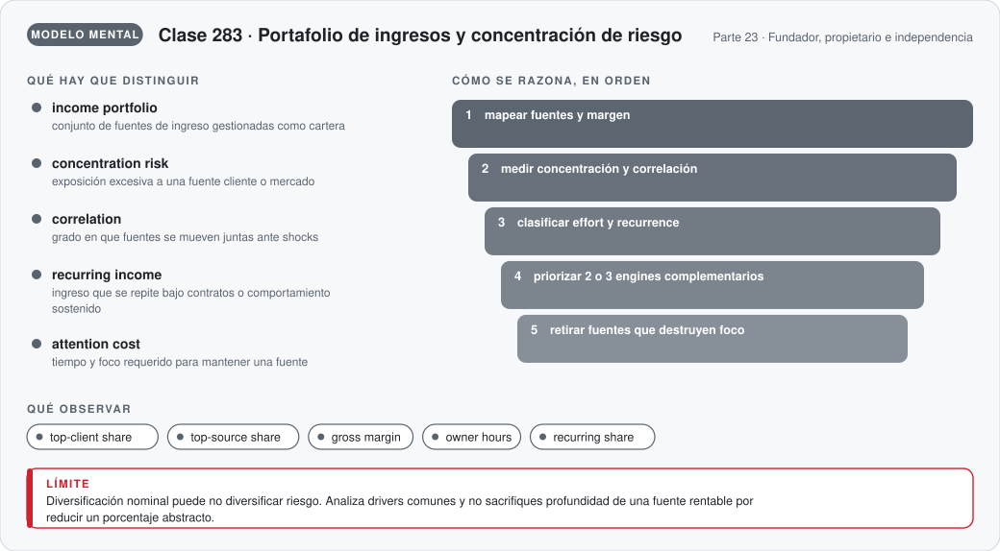

# Clase 283 — Portafolio de ingresos y concentración de riesgo

<!-- nav:inicio -->
> **Parte 23 · Independencia profesional y Business Owner Capstone** — clase 7 de 12 · [índice de la parte](../../README.md) · [temario](../../../../SYLLABUS.md)
<!-- nav:fin -->

**Parte:** 23 — Independencia profesional y Business Owner Capstone  
**Nivel:** Etapa 6 — Independencia  
**Duración sugerida:** 150–180 minutos · **Estándar:** deep-class-v2

## 🎯 Propósito

Quien trabaja por cuenta propia recibe ingresos de varias fuentes: un cliente principal, otros proyectos, algún curso, charlas, un servicio mensual. La pregunta que casi nunca se hace en orden es: **¿cuánto de mi ingreso se rompería si una sola cosa cambiara?** Una persona puede tener seis fuentes y, sin embargo, depender de un único sector, de una única plataforma o de dos clientes que, juntos, generan la mayor parte del dinero. Eso es **concentración de riesgo**. Y el extremo opuesto también es dañino: tener tantas líneas pequeñas que ninguna alcanza profundidad, reputación o margen, y que el tiempo se disperse en cambios de contexto. Un portafolio de ingresos bien diseñado busca **dos o tres motores complementarios** que se sostengan entre sí: uno que aporte estabilidad (recurrente), otro que aporte margen y reputación (especializado) y otro que ofrezca crecimiento o escala (producto o servicio estandarizado).

La clase propone un método para gestionar el portafolio: mapear fuentes y margen, medir concentración y correlación, clasificar esfuerzo y recurrencia, priorizar motores complementarios y retirar fuentes que destruyen foco. Se apoya en Aulet (segmentar y elegir con evidencia), McKeown (elegir menos cosas y hacerlas mejor), Wasserman (decisiones sobre recursos y relaciones), Drucker (concentrarse en lo que da resultados y abandonar lo que no) y Gerber (el negocio como sistema). Al terminar sabrás calcular la participación de la mayor fuente y del mayor cliente, identificar concentración oculta por factores comunes, estimar la contribución por hora de cada línea, decidir qué fuentes retirar sin sacrificar caja y planificar una transición gradual.

## 📚 Resultados de aprendizaje

Al finalizar podrás:

1. **Mapear** las fuentes de ingreso con margen, esfuerzo y recurrencia.
2. **Medir** concentración nominal y concentración por factores comunes.
3. **Calcular** la contribución por hora de cada fuente.
4. **Priorizar** dos o tres motores complementarios.
5. **Decidir** qué retirar y cuándo, protegiendo la caja durante la transición.

## 🧭 Agenda

| Tramo | Qué se hace |
|---|---|
| 0–20 min | Recuperación: ¿qué porcentaje de tu ingreso se perdería si cambiara tu principal cliente o sector? |
| 20–60 min | Mapa de fuentes, concentración, factores comunes, esfuerzo, motores y retiro. |
| 60–105 min | Ejemplo trabajado: concentración nominal y por sector, contribución por hora y plan de retiro. |
| 105–150 min | Caso ejecutivo y práctica. |
| 150–175 min | Límites y entregable. |

## 🧩 Conceptos centrales

| Concepto | Definición | Cómo se reconoce |
|---|---|---|
| **Portafolio de ingresos** | Conjunto de fuentes de ingreso de una persona o empresa. | Lista con montos, márgenes y esfuerzo. |
| **Concentración** | Dependencia de pocas fuentes, clientes o sectores. | Participación de la mayor fuente. |
| **Factor común** | Variable que afecta a varias fuentes a la vez. | Mismo sector, plataforma o cliente. |
| **Contribución por hora** | Margen de una fuente dividido por las horas que consume. | Pesos por hora. |
| **Motor de ingresos** | Fuente que sostiene el portafolio. | Recurrencia, margen y escala. |
| **Retiro de una fuente** | Decisión de abandonar una línea. | Plan con fecha y reemplazo. |

## 🧠 Modelo mental

**Cómo leer el diagrama.** Dos ejes. El horizontal mide la **recurrencia** (de poco a muy recurrente); el vertical, el **margen** (de bajo a alto). Cuatro cuadrantes: **recurrente y de alto margen**, motor principal, que se protege y se invierte; **poco recurrente y de alto margen**, alto margen puntual, que se mantiene sin depender de él; **recurrente y de bajo margen**, estabilizador a mejorar (precio o costo); **poco recurrente y de bajo margen**, retirar, porque consume foco. La nota advierte que una diversificación nominal puede no reducir el riesgo si las fuentes dependen de los mismos factores y que no se sacrifica la profundidad de una fuente rentable por bajar un porcentaje abstracto; el pie, que se mide la concentración por cliente y por fuente.

## 📖 Desarrollo

### 1. Mapear las fuentes

El primer paso es una tabla con todas las fuentes de ingreso de los últimos doce meses: nombre, **ingreso anual**, **costos directos** y **margen de contribución**, **horas dedicadas** (ventas, entrega, administración), **recurrencia** (qué parte se repite con alta probabilidad), **cliente o canal** y **sector**. Se incluye todo lo relevante, incluso lo que parece pequeño o ocasional. Con ella se calculan: participación de cada fuente en el ingreso y en la contribución, la **contribución por hora**, y el **peso del ingreso recurrente**. Drucker enseña que concentrar los recursos en lo que produce resultados exige primero saber qué produce qué; el mapa es esa base. Es frecuente descubrir que la fuente que más tiempo consume no es la que más margen deja.

### 2. Concentración por cliente, fuente y sector

Se calculan tres medidas de concentración. **Por cliente**: cuánto representa el mayor cliente y los tres mayores. **Por fuente**: cuánto representa la mayor línea de ingreso. **Por sector o factor común**: cuánto del ingreso depende de una misma industria, una plataforma, una tecnología, una regulación o una región. Un índice sencillo es la suma de los cuadrados de las participaciones (cuanto más alto, más concentrado), o su inverso, que da un «número efectivo» de fuentes. Pero los números por sí solos no bastan: **la diversificación nominal puede no diversificar el riesgo**. Seis líneas que dependen del mismo sector se mueven juntas. Por eso se pregunta, para cada fuente: ¿qué evento la afectaría?, ¿y afectaría también a las demás?

### 3. Correlación y factores comunes

La correlación entre fuentes se estima de forma cualitativa: **¿qué factor mueve a cada una?** Ejemplos: ciclo del sector de la construcción, política de una gran plataforma, tipo de cambio, decisión de un cliente que es también proveedor de otro, vacaciones o estacionalidad, una regulación. Las fuentes que comparten factores deben tratarse como **una sola** para efectos de riesgo. Taleb señala que la fragilidad aparece cuando una estructura depende de supuestos que, si fallan, fallan todos a la vez. Un portafolio robusto tiene fuentes cuyos factores de riesgo **no coinciden**: por ejemplo, un servicio para el sector A, un producto que se vende a un público distinto y un retainer con clientes de otro sector. Reducir la dependencia de un factor común es más valioso que sumar una fuente más.

### 4. Esfuerzo, recurrencia y contribución por hora

Un ingreso grande con mucho esfuerzo y poca recurrencia puede ser peor que uno menor, recurrente y de bajo esfuerzo. Por eso se clasifica cada fuente según **esfuerzo** (horas y energía), **recurrencia** (probabilidad de repetirse), **margen** y **escalabilidad** (si crece sin crecer proporcionalmente el tiempo). La **contribución por hora** compara fuentes de manera simple: margen anual dividido por horas anuales. Se combina con el cuadrante de recurrencia y margen. Aulet recomienda decidir con evidencia en qué segmento invertir; aquí, la evidencia es la tabla de contribución, recurrencia y demanda. Se evita decidir solo por el monto bruto: una fuente que parece grande puede ser la que más agota y menos deja.

### 5. Elegir dos o tres motores complementarios

McKeown sugiere concentrarse en menos cosas con mayor impacto. Un portafolio con **dos o tres motores** suele ser más gestionable que uno con diez fuentes. Criterios para elegirlos: que tengan **buen margen y contribución por hora**, que **se complementen** (uno estable, otro de alto margen, otro con potencial de escala), que **no compartan factores de riesgo críticos**, que **se refuercen** (un servicio genera casos para un producto; un producto genera clientes para un servicio) y que **encajen con las capacidades y valores** de la persona (clase 278). Los motores reciben la mayor parte de la inversión de tiempo y reputación; las demás fuentes se mantienen como complementos o se retiran. Se define qué papel cumple cada una: estabilidad, margen, aprendizaje o escala.

### 6. Retirar sin dañar la caja

Retirar una fuente es una decisión de **foco**, pero puede amenazar la caja. Se hace con un **plan de transición**: ¿cuánto margen se pierde?, ¿cuántas horas se liberan?, ¿en qué se usarán?, ¿con qué probabilidad el uso alternativo generará un ingreso equivalente?, ¿cuál es la **pista** disponible durante el cambio (clase 284)? Wasserman destaca que las decisiones sobre recursos y relaciones tienen consecuencias a largo plazo; salir de una relación con un cliente histórico debe hacerse con cuidado, con aviso y, si corresponde, con una transición ordenada. Una regla prudente: **no retirar una fuente hasta que su reemplazo tenga evidencia** (conversaciones avanzadas, contratos firmados o ingresos iniciales), salvo que destruya más valor del que aporta o implique riesgos éticos o legales.

### 7. Revisión y gobierno del portafolio

El portafolio se revisa **cada trimestre**: ingresos, margen, horas, concentración por cliente, fuente y sector, recurrencia, nuevas oportunidades y señales de riesgo. Se define un **límite de concentración** (por ejemplo, ningún cliente sobre el 30 % del ingreso, ningún sector sobre el 50 %) y lo que se hace al acercarse a él (buscar clientes en otro sector, reducir dependencia). Gerber recuerda que un negocio sano es un sistema; el portafolio se gestiona con reglas, no con reacciones. Se registran las decisiones y sus resultados, y se actualiza la tabla. Con el tiempo, el portafolio evoluciona de **servicios a medida** hacia **servicios productizados** y **activos escalables**, sin dejar de proteger el motor que paga las cuentas.

## 📚 Lectura comparada

| Obra | Qué aporta | Qué no resuelve | Pregunta para contrastar |
|---|---|---|---|
| Drucker | Concentrar recursos en lo que produce resultados. | No da fórmulas de concentración. | ¿Qué fuente produce los resultados y cuál solo consume tiempo? |
| Aulet | Decidir con evidencia dónde invertir. | Proceso pensado para empresas nuevas. | ¿Qué evidencia tengo de demanda en cada línea? |
| McKeown | Elegir menos y hacerlo mejor. | No calcula riesgo. | ¿Qué línea distrae más de lo que aporta? |
| Wasserman | Decisiones sobre recursos y relaciones. | No es guía de portafolio de ingresos. | ¿Qué relación me limita o me sostiene? |
| Gerber | Negocio como sistema. | No cubre concentración. | ¿Qué reglas gobiernan mi portafolio? |

## 🧮 Ejemplo trabajado

**Situación (hipotética).** Un consultor del sector construcción tiene seis fuentes de ingreso. Revisa su portafolio anual. Todas las cifras son **supuestos**.

**Mapa de fuentes (pesos anuales).**

| Fuente | Ingreso | Margen | Contribución | Horas | Recurrencia | Sector |
|---|---|---|---|---|---|---|
| A. Consultoría para el cliente X | 30.000.000 | 70 % | 21.000.000 | 420 | 50 % | Construcción |
| B. Consultoría para otros clientes | 18.000.000 | 65 % | 11.700.000 | 300 | 10 % | Construcción |
| C. Retainer de seguimiento | 14.400.000 | 80 % | 11.520.000 | 120 | 100 % | Construcción |
| D. Curso en línea | 9.600.000 | 85 % | 8.160.000 | 150 | 20 % | Mixto |
| E. Servicio productizado | 8.400.000 | 75 % | 6.300.000 | 180 | 30 % | Mixto |
| F. Charlas | 3.600.000 | 60 % | 2.160.000 | 60 | 0 % | Mixto |
| **Total** | **84.000.000** | **72,4 %** | **60.840.000** | **1.230** | | |

**Concentración nominal.** Participación de la mayor fuente: A = 30 ÷ 84 = **35,7 %**. Cliente X (fuente A): 35,7 % del ingreso total. Suma de cuadrados de participaciones: 0,357² + 0,214² + 0,171² + 0,114² + 0,100² + 0,043² = 0,127 + 0,046 + 0,029 + 0,013 + 0,010 + 0,002 = **0,228**; número efectivo de fuentes: 1 ÷ 0,228 = **4,4**. A primera vista, el portafolio parece razonablemente diversificado.

**Concentración por factor común.** Las fuentes A, B y C dependen del sector de la construcción: (30 + 18 + 14,4) ÷ 84 = 62,4 ÷ 84 = **74,3 %**. Si el sector sufriera una caída, tres cuartas partes del ingreso caerían a la vez. **La diversificación nominal (4,4 fuentes efectivas) esconde una dependencia sectorial del 74 %.**

**Contribución por hora.**

| Fuente | Contribución por hora |
|---|---|
| C. Retainer | 11.520.000 ÷ 120 = **96.000** |
| D. Curso | 8.160.000 ÷ 150 = **54.400** |
| A. Consultoría cliente X | 21.000.000 ÷ 420 = **50.000** |
| B. Consultoría otros | 11.700.000 ÷ 300 = **39.000** |
| F. Charlas | 2.160.000 ÷ 60 = **36.000** |
| E. Servicio productizado | 6.300.000 ÷ 180 = **35.000** |
| **Promedio** | 60.840.000 ÷ 1.230 = **49.463** |

**Lectura con el cuadrante.** C es el **motor principal** (recurrente, alto margen, 96.000 por hora). D es **alto margen puntual** (recurrencia baja). A es un buen ingreso pero concentrado en un cliente. B tiene baja recurrencia y menos contribución por hora. E tiene margen alto, pero bajo rendimiento por hora, quizás porque aún se está estandarizando. F tiene baja contribución y recurrencia nula.

**Plan de retiro y transición.** Propuesta: retirar F y reducir B a la mitad para liberar 60 + 150 = 210 horas, y reasignarlas a nuevos retainers (C) y a la mejora de E. Contribución perdida: 2,16 + 5,85 = **8,01 millones**. Si se consiguen dos nuevos retainers como el actual (7,2 millones de ingreso cada uno, 80 % de margen = 5,76 millones, 60 horas cada uno), la contribución ganada sería 11,52 millones con 120 horas: **+3,51 millones netos** y 90 horas liberadas. **Pero** la probabilidad de conseguir esos retainers no es 100 %: con una probabilidad de 50 % cada uno, la contribución esperada es 5,76 millones, y el resultado esperado de la operación es **−2,25 millones** (5,76 − 8,01). Por eso se aplica la regla: **no reducir B hasta tener firmado al menos un retainer nuevo**; F, de menor tamaño, puede retirarse antes (pierde 2,16 millones y libera 60 horas).

**Límites de concentración propuestos.** Ningún cliente sobre el 30 % del ingreso (hoy 35,7 %), ningún sector sobre el 60 % (hoy 74,3 %). Meta a 12 meses: reducir X a 28 % y el sector construcción a 60 % mediante retainers y productos en otros sectores (por ejemplo, infraestructura y energía).

**Decisión.** Retirar F al terminar los compromisos vigentes; mantener B hasta firmar un retainer nuevo; invertir las horas liberadas en una oferta de retainer para dos sectores distintos; mejorar el rendimiento por hora de E con plantillas; informar a X con anticipación y proponer un retainer complementario para reducir el riesgo mutuo.

**Cuidados.** Los valores son supuestos; las probabilidades y márgenes se actualizan con datos reales, y las obligaciones contractuales con clientes se respetan y se revisan con asesoría.

**Qué muestra.** (1) La concentración por sector fue mayor que la nominal. (2) La contribución por hora cambió el ranking de las fuentes. (3) La probabilidad de reemplazo convirtió una ganancia aparente en una pérdida esperada, y modificó la secuencia de retiro.

## 🔀 Comparación y límites

**Diversificación frente a foco.** La diversificación reduce la dependencia de un factor; el foco aumenta la profundidad, la reputación y el margen. Un portafolio sano combina ambos: pocos motores complementarios con factores de riesgo distintos.

**Límites.** La diversificación nominal puede no diversificar el riesgo si hay factores comunes; reducir un porcentaje abstracto sacrificando profundidad en una fuente rentable puede ser un error. Las estimaciones de recurrencia y de probabilidad de reemplazo son inciertas. Las cifras del ejemplo son supuestos.

## 🪜 De profesional a owner

| Nivel | Cómo se relaciona con el portafolio de ingresos |
|---|---|
| **Profesional** | Entiende de dónde viene su ingreso y su dependencia de un empleador. |
| **Jefe / Team Lead** | Gestiona el aporte de su equipo y sus clientes. |
| **Gerente** | Responde por la concentración de clientes de su área. |
| **CEO / Director** | Define límites de concentración y asignación de recursos. |
| **Founder / Owner** | Diseña los motores, retira lo que distrae y protege la caja en la transición. |

## 🏢 Caso ejecutivo

Una diseñadora de interiores independiente factura 96 millones de pesos al año: proyectos residenciales de lujo (42 millones, dos clientes de un mismo desarrollador inmobiliario, margen de 55 %, 600 horas), asesorías a tiendas (24 millones, seis clientes, margen de 60 %, 400 horas), una línea de muebles con un taller externo (18 millones, margen de 25 %, 250 horas), cursos y talleres (9 millones, margen de 80 %, 120 horas) y reseñas patrocinadas en redes sociales (3 millones, margen de 90 %, 80 horas, dependientes de una plataforma). El desarrollador inmobiliario le comunica que reducirá encargos en el próximo año. Tiene pista de 5 meses. Dos amigas le proponen una sociedad para ampliar la línea de muebles. Su agenda está saturada y rechazó dos encargos de alto margen por falta de tiempo.

Entrega un **memo estratégico del portafolio de ingresos** que contenga: (a) la tabla de fuentes con contribución, contribución por hora y recurrencia; (b) las concentraciones por cliente, fuente, sector y plataforma; (c) el análisis de factores comunes y de la amenaza del desarrollador; (d) la propuesta de motores complementarios y el plan de retiro con el efecto esperado; (e) la evaluación de la sociedad para muebles frente al foco; (f) los límites de concentración, la revisión trimestral y los límites del análisis.

## 🧪 Práctica

1. Construye la tabla de tus fuentes con ingreso, margen, horas, recurrencia y sector.
2. Calcula la participación de tu mayor fuente, de tu mayor cliente y de tu mayor sector.
3. Calcula la contribución por hora de cada fuente y ubícalas en el cuadrante.
4. Elige dos o tres motores y define el papel de cada uno.
5. Redacta límites de concentración y la regla para retirar una fuente.

## ⚠️ Errores frecuentes

| Error | Por qué ocurre | Cómo corregirlo |
|---|---|---|
| Mirar solo el monto bruto | Es lo más visible | Calcular contribución por hora y recurrencia. |
| Diversificar nominalmente | Se cuentan fuentes y no factores | Identificar factores comunes. |
| Retirar una fuente sin reemplazo | Se quiere foco inmediato | Exigir evidencia del reemplazo. |
| Mantener demasiadas líneas | Miedo a perder ingresos | Elegir dos o tres motores. |
| No fijar límites | Se confía en la intuición | Límites por cliente, fuente y sector. |
| No revisar | Se supone estable | Revisión trimestral con la tabla. |

## ❓ Preguntas de comprobación

1. ¿Qué es la concentración de ingresos?
2. ¿Por qué la diversificación nominal puede engañar?
3. ¿Cómo se calcula la contribución por hora?
4. ¿Qué papel cumplen los motores complementarios?
5. ¿Cuándo conviene retirar una fuente?
6. ¿Qué límites de concentración se pueden fijar?
7. ¿Qué límite tiene el análisis?

Claves de respuesta

1. La dependencia de pocas fuentes, clientes o sectores para la mayor parte del ingreso.
2. Porque varias fuentes pueden depender de un mismo sector, plataforma o cliente y moverse juntas.
3. Dividiendo el margen de contribución de una fuente por las horas que consume.
4. Aportan estabilidad, margen y escala de forma complementaria, con factores de riesgo distintos.
5. Cuando destruye foco o valor y su reemplazo tiene evidencia suficiente, protegiendo la caja.
6. Por ejemplo, un máximo de participación por cliente y por sector, con acciones al acercarse.
7. Depende de estimaciones inciertas de recurrencia y de reemplazo; no sacrifica profundidad por un porcentaje abstracto.

## 📥 Entregable

Guarda en `portfolio/283-portafolio-de-ingresos-y-concentracion-de-riesgo/`:

- `strategy-memo.md` (plantilla [Strategy memo](../../../../templates/strategy-memo.md)) con el memo estratégico del caso ejecutivo;
- `decision-journal.md` con la tabla de fuentes, los límites de concentración y el plan de retiro.

## 📗 Fuentes y verificación

- Peter F. Drucker — *The Effective Executive* (Collins, 2002). **Uso en esta clase:** concentrar los recursos en lo que produce resultados. Lectura selectiva sobre **portafolio de ingresos y concentración de riesgo**. **Localizador:** [ISBN-13 9780060516079](https://openlibrary.org/isbn/9780060516079).
- Peter F. Drucker — *Management: Tasks, Responsibilities, Practices* (Harper & Row, 1974). **Uso en esta clase:** abandonar sistemáticamente lo que no produce. Lectura selectiva sobre **portafolio de ingresos y concentración de riesgo**. **Localizador:** [ISBN-13 9780060110925](https://openlibrary.org/isbn/9780060110925).
- Bill Aulet — *Disciplined Entrepreneurship* (John Wiley & Sons, Incorporated, 2013). **Uso en esta clase:** decidir con evidencia dónde invertir. Lectura selectiva sobre **portafolio de ingresos y concentración de riesgo**. **Localizador:** [ISBN-13 9781299848641](https://openlibrary.org/isbn/9781299848641).
- Greg McKeown — *Essentialism* (Virgin Books, 2014). **Uso en esta clase:** elegir menos cosas y hacerlas mejor. Lectura selectiva sobre **portafolio de ingresos y concentración de riesgo**. **Localizador:** [ISBN-13 9780753555163](https://openlibrary.org/isbn/9780753555163).
- Noam Wasserman — *The Founder's Dilemmas* (Princeton University Press, 2012). **Uso en esta clase:** decisiones sobre recursos y relaciones. Lectura selectiva sobre **portafolio de ingresos y concentración de riesgo**. **Localizador:** [ISBN-13 9780691149134](https://openlibrary.org/isbn/9780691149134).
- Michael E. Gerber — *The E-Myth Revisited* (HarperAudio, 1995). **Uso en esta clase:** el negocio como sistema con reglas. Lectura selectiva sobre **portafolio de ingresos y concentración de riesgo**. **Localizador:** [ISBN-13 9780060574901](https://openlibrary.org/isbn/9780060574901).
- Nassim Nicholas Taleb — *Antifragile* (Random House, 2012). **Uso en esta clase:** fragilidad cuando varias fuentes dependen de un mismo factor. Lectura selectiva sobre **portafolio de ingresos y concentración de riesgo**. **Localizador:** [ISBN-13 9780679645276](https://openlibrary.org/isbn/9780679645276).

> **Regla de fuentes para Portafolio de ingresos y concentración de riesgo:** las obras anteriores estructuran las perspectivas de esta materia; cualquier norma, ley o estándar vivo mencionado debe comprobarse nuevamente en su fuente primaria vigente, incluidas las obligaciones contractuales con clientes. Los ejemplos y casos son hipotéticos, con cifras ilustrativas. El desarrollo es original y no reproduce capítulos protegidos.

<!-- pie:inicio -->
---

| Anterior | Índice | Siguiente |
|---|---|---|
| [← 282 · SaaS y modelos recurrentes](../282-saas-y-modelos-recurrentes/README.md) | [Parte 23](../../README.md) · [Programa](../../../../SYLLABUS.md) | [284 · Runway personal y empresarial →](../284-runway-personal-y-empresarial/README.md) |
<!-- pie:fin -->
