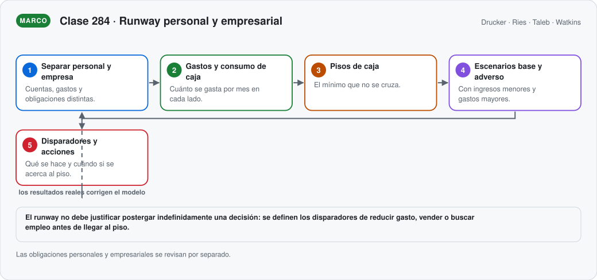

# Clase 284 — Runway personal y empresarial

<!-- nav:inicio -->
> **Parte 23 · Independencia profesional y Business Owner Capstone** — clase 8 de 12 · [índice de la parte](../../README.md) · [temario](../../../../SYLLABUS.md)
<!-- nav:fin -->

**Parte:** 23 — Independencia profesional y Business Owner Capstone  
**Nivel:** Etapa 6 — Independencia  
**Duración sugerida:** 150–180 minutos · **Estándar:** deep-class-v2

## 🎯 Propósito

El **runway** o pista es el número de meses que una persona o una empresa puede sostener su gasto actual con la caja que tiene, si los ingresos no llegaran o fueran menores. Es una de las cifras más importantes para quien trabaja por cuenta propia o dirige un negocio pequeño, y una de las peor calculadas. Los errores típicos son tres: **mezclar** la caja personal con la de la empresa, de modo que no se sabe cuánto hay realmente para cada una; **calcular con el caso base**, sin imaginar un trimestre malo; y **no decidir con anticipación** qué se hará cuando la pista se acorte, de modo que las decisiones (recortar, vender, buscar empleo) se toman tarde, bajo presión y con peores opciones. El runway no sirve para tranquilizarse ni para angustiarse: sirve para **tomar decisiones a tiempo**.

La clase propone un método: separar lo personal de lo empresarial, calcular gastos y consumo de caja (burn), definir pisos de caja, construir escenarios base y adverso y ligar el runway a acciones con fechas de disparo. Se apoya en Drucker (decidir con información y anticiparse), Ries (el ritmo al que se aprende y se gasta: un negocio nuevo necesita llegar a evidencia antes de quedarse sin caja), Taleb (evitar la ruina: lo que puede llevarte a cero debe evitarse aunque su probabilidad sea baja), Watkins (planes por etapas con hitos) y Gerber (separar al dueño del negocio). Al terminar sabrás calcular tu pista personal y empresarial, definir pisos, simular un escenario adverso, fijar disparadores y revisar el modelo cada mes.

## 📚 Resultados de aprendizaje

Al finalizar podrás:

1. **Separar** caja, gastos y obligaciones personales y empresariales.
2. **Calcular** el consumo mensual de caja (burn) neto y la pista en meses.
3. **Definir** pisos de caja personal y empresarial con criterio.
4. **Construir** un escenario base y uno adverso con supuestos explícitos.
5. **Ligar** la pista a acciones y fechas de disparo escritas con anticipación.

## 🧭 Agenda

| Tramo | Qué se hace |
|---|---|
| 0–20 min | Recuperación: ¿cuántos meses podrías sostener tu vida y tu negocio si tus ingresos cayeran 40 %? |
| 20–60 min | Separación, gastos y burn, pisos, escenarios, disparadores y revisión mensual. |
| 60–105 min | Ejemplo trabajado: pista combinada, escenario adverso y fechas de disparo. |
| 105–150 min | Caso ejecutivo y práctica. |
| 150–175 min | Límites y entregable. |

## 🧩 Conceptos centrales

| Concepto | Definición | Cómo se reconoce |
|---|---|---|
| **Runway (pista)** | Meses que dura la caja al ritmo de consumo actual. | Caja ÷ consumo mensual neto. |
| **Burn neto** | Salida de caja mensual después de ingresos. | Gastos menos ingresos disponibles. |
| **Piso de caja** | Nivel mínimo que no se cruza. | Meses de gasto esencial. |
| **Escenario adverso** | Proyección con ingresos menores y gastos mayores. | Supuestos de estrés. |
| **Disparador** | Condición que activa una acción predefinida. | Umbral y fecha. |
| **Separación personal-empresa** | Cuentas y reglas distintas para cada ámbito. | Retiros documentados. |

## 🧠 Modelo mental

**Cómo leer el diagrama.** Una cadena de cinco pasos. **Separar personal y empresa**: cuentas, gastos y obligaciones distintas. **Gastos y consumo de caja**: cuánto se gasta por mes en cada lado. **Pisos de caja**: el mínimo que no se cruza. **Escenarios base y adverso**: con ingresos menores y gastos mayores. **Disparadores y acciones**: qué se hace y cuándo si se acerca al piso. La flecha de retorno indica que los resultados reales corrigen el modelo. La nota advierte que el runway no debe justificar postergar indefinidamente una decisión y que se definen los disparadores antes de llegar al piso; el pie, que las obligaciones personales y empresariales se revisan por separado.

## 📖 Desarrollo

### 1. Separar lo personal de lo empresarial

Cuando el dinero de la persona y el del negocio se mezclan, no es posible saber si el negocio gana, cuánto retira el dueño ni qué ocurriría si uno de los dos fallara. La **separación** exige: **cuentas bancarias distintas**; un **sueldo o retiro** definido y documentado que la persona se paga desde la empresa (monto, periodicidad y forma, consultados con asesoría tributaria); **gastos personales** pagados desde la cuenta personal; una política para **préstamos** entre ambos (con contrato y registro). Gerber insiste en que el dueño y el negocio son entidades distintas; en la clase 258 se vio la separación contable. Aquí interesa su consecuencia: se calculan **dos pistas** y una **pista combinada**. Las obligaciones tributarias y previsionales de quien trabaja por cuenta propia o de una sociedad se verifican con fuentes oficiales y asesoría.

### 2. Gastos y consumo de caja (burn)

Se listan los gastos de cada lado, separando **esenciales** (los que no se pueden recortar sin daño: vivienda, alimentación, salud, deudas, impuestos, cotizaciones, remuneraciones, arriendos) de **discrecionales** (los que se pueden diferir o eliminar). El **burn bruto** es el gasto mensual; el **burn neto** es el gasto menos los ingresos disponibles de ese mes. Se incluyen los gastos **no mensuales** prorrateados (seguros, impuestos anuales, renovaciones, vacaciones). Una pista calculada sin los gastos anuales sobrestima los meses disponibles. Drucker recomienda decidir con información y no con impresiones; la lista de gastos, completa y actualizada, es esa información. Cada trimestre se compara lo proyectado con lo real y se corrige el modelo.

### 3. La caja relevante y los pisos

No toda la plata es caja disponible: el **ahorro** que podría venderse con pérdida, un depósito a plazo con penalización, el dinero comprometido a impuestos próximos o el capital de trabajo necesario para operar **no cuentan completamente**. Se define la **caja relevante**: efectivo y equivalentes de rápido acceso, menos obligaciones de corto plazo. Luego se fijan los **pisos de caja**: el nivel que **no se cruza** porque más abajo se pierden opciones o se comprometen necesidades esenciales. Ejemplos: un piso personal de tres meses de gastos esenciales y un piso empresarial de dos meses de costos fijos. Taleb advierte que **evitar la ruina** es prioritario: un evento que lleve a cero la caja puede impedir seguir en el juego, aunque sea poco probable; los pisos son una defensa.

### 4. Escenarios: base y adverso

El **escenario base** proyecta con los ingresos y gastos esperados; el **adverso** supone un trimestre malo: ingresos 30 a 50 % menores, gastos algo mayores (por inflación o imprevistos), pagos de clientes retrasados. Un tercer **escenario de estrés** puede suponer la pérdida del cliente principal. Para cada uno se calcula el burn neto y la **pista combinada** (caja relevante ÷ burn neto) y los **meses hasta el piso** (caja sobre el piso ÷ burn neto). Ries recuerda que, en un negocio nuevo, lo importante es **aprender lo suficiente antes de quedarse sin caja**: si el modelo muestra que no hay tiempo para validar una hipótesis crítica, hay que cambiar el plan (recortar costos, reducir alcance, buscar ingresos puente). La proyección se actualiza con datos reales cada mes.

### 5. Disparadores y acciones con fecha

La parte más importante del runway es la que se escribe **antes** de necesitarla: una tabla de **disparadores**. Ejemplo: «si la caja combinada baja de 15 millones: recortar gastos discrecionales y acelerar cobranza»; «si baja de 12 millones: intensificar ventas, ofrecer descuentos por pago anticipado y evaluar ingresos puente (un empleo a tiempo parcial o un contrato temporal)»; «si falta un mes para el piso: iniciar búsqueda laboral activa o vender activos». Cada fila tiene **condición**, **acción**, **responsable** y **fecha de revisión**. Escribir esto cuando la situación está tranquila evita decisiones emocionales en medio de la presión. Watkins recomienda planificar por etapas con hitos y puntos de control; los disparadores son esos puntos de control para la caja.

### 6. Acciones para extender o proteger la pista

Hay palancas por el **lado de los ingresos** (acelerar cobranza, pedir anticipos, ventas a clientes existentes, ingresos puente, subir precios con cuidado) y por el **lado de los gastos** (recortar discrecionales, renegociar arriendos, diferir inversiones, pasar costos fijos a variables, reducir el retiro del dueño). También hay palancas de **financiamiento** (línea de crédito, aporte de socios, venta de activos), cada una con costos y riesgos que se evalúan con cuidado (clases 222 y 269). Es preferible **tener una línea de crédito disponible antes de necesitarla** que pedirla en una crisis. Y hay palancas **no financieras**: red de contactos, reputación y claridad sobre qué trabajos se aceptarían si fuera necesario. La opcionalidad se construye antes del apuro.

### 7. Revisión mensual y la trampa de postergar

El runway se revisa **una vez al mes**: caja real por cuenta, gastos reales, ingresos reales, proyección actualizada, estado de los disparadores y decisiones. Se registra en una hoja simple. Una trampa frecuente es usar la pista como **razón para postergar** una decisión difícil («todavía tengo 12 meses»), cuando la evidencia ya muestra que el modelo no funciona. Se evita con un **hito de evidencia**: en tal fecha, el negocio debe mostrar ciertos resultados (ingresos recurrentes, clientes, margen); si no, se ejecuta la acción acordada. También se evita la trampa contraria: **recortar demasiado pronto** lo que genera ingresos futuros (ventas, formación, red). El criterio es proteger la **capacidad de generar ingresos** y las **opciones**, no solo el saldo.

## 📚 Lectura comparada

| Obra | Qué aporta | Qué no resuelve | Pregunta para contrastar |
|---|---|---|---|
| Drucker | Decidir con información y anticiparse. | No calcula la pista. | ¿Qué información me falta para decidir? |
| Ries | Aprender antes de quedarse sin caja. | Enfoque de negocios nuevos. | ¿Cuántos meses tengo para validar lo crítico? |
| Taleb | Evitar la ruina y la fragilidad. | No es guía contable. | ¿Qué evento me llevaría a cero? |
| Watkins | Planes por etapas con hitos. | Enfoque de nuevos roles. | ¿Qué hito de caja activa una acción? |
| Gerber | Separar al dueño del negocio. | No trata disparadores. | ¿Qué es del negocio y qué es mío? |

## 🧮 Ejemplo trabajado

**Situación (hipotética).** Una diseñadora de producto tiene una pequeña empresa y vive de ella. Quiere calcular su pista combinada y fijar disparadores. Todos los valores son **supuestos**; las obligaciones tributarias y previsionales se verifican con asesoría y fuentes oficiales.

**Datos mensuales y de caja.**

| Concepto | Valor (pesos) |
|---|---|
| Gastos personales mensuales | 2.100.000 |
| Costos fijos de la empresa | 1.200.000 |
| Ingresos mensuales de la empresa (base) | 3.600.000 |
| Costos variables de la empresa | 20 % de los ingresos |
| Caja personal relevante | 12.600.000 |
| Caja de la empresa relevante | 7.200.000 |
| **Caja combinada** | **19.800.000** |

**Escenario base.** Resultado de la empresa: 3.600.000 × 0,80 − 1.200.000 = 2.880.000 − 1.200.000 = **1.680.000** al mes. Gastos personales: 2.100.000. **Burn neto combinado:** 2.100.000 − 1.680.000 = **420.000** al mes. **Pista:** 19.800.000 ÷ 420.000 = **47,1 meses**.

**Escenario adverso (ingresos −40 %, gastos personales +10 %, costos fijos +10 %).**

- Ingresos: 3.600.000 × 0,60 = 2.160.000; margen tras costos variables: 2.160.000 × 0,80 = 1.728.000.
- Costos fijos: 1.200.000 × 1,10 = 1.320.000; resultado de la empresa: 1.728.000 − 1.320.000 = **408.000**.
- Gastos personales: 2.100.000 × 1,10 = **2.310.000**.
- **Burn neto combinado:** 2.310.000 − 408.000 = **1.902.000** al mes.
- **Pista:** 19.800.000 ÷ 1.902.000 = **10,4 meses**.

**Pisos de caja.** Personal: tres meses de gastos esenciales (supuesto de 2.100.000 de gastos esenciales en el base): 6.300.000. Empresarial: dos meses de costos fijos: 2.400.000. Caja sobre los pisos: (12.600.000 − 6.300.000) + (7.200.000 − 2.400.000) = 6.300.000 + 4.800.000 = **11.100.000**. **Meses hasta el piso en el escenario adverso:** 11.100.000 ÷ 1.902.000 = **5,8 meses**.

**Disparadores (escenario adverso).**

| Condición | Caja combinada | Mes estimado | Acción |
|---|---|---|---|
| Disparador 1 | < 15.000.000 | (19,8 − 15,0) ÷ 1,902 = **2,5** | Recortar discrecionales y acelerar cobranza. |
| Disparador 2 | < 12.000.000 | (19,8 − 12,0) ÷ 1,902 = **4,1** | Intensificar ventas; evaluar ingresos puente. |
| Disparador 3 | Un mes antes del piso (≈ 8,7 millones + 1,9) | **≈ 4,8** | Búsqueda laboral activa; revisar venta de activos. |
| Piso | 8.700.000 (6,3 + 2,4) | **5,8** | No se cruza: decisión ya ejecutada. |

**Acciones de extensión.** Recortar gastos discrecionales personales en 0,63 millones al mes y los no esenciales de la empresa en 0,15 millones: burn neto de 1.902.000 − 630.000 − 150.000 = **1.122.000**; pista de **17,6 meses** (19,8 ÷ 1,122) y meses hasta el piso: 11,1 ÷ 1,122 = **9,9**. Un ingreso puente de 1,5 millones mensuales llevaría el burn neto a 1.122.000 − 1.500.000 = −378.000: **la caja dejaría de consumirse** y la pista dejaría de ser un límite.

**Hito de evidencia.** A los seis meses, si los ingresos de la empresa no superan 3.000.000 mensuales de forma sostenida o no hay dos nuevos clientes recurrentes, se ejecuta el plan de ingresos puente.

**Decisión.** Mantener cuentas separadas, fijar su retiro mensual en un monto definido y documentado, mantener una línea de crédito sin usar, actualizar el modelo cada mes y registrar los disparadores en un documento que su pareja y su contador conozcan.

**Cuidados.** Los números son supuestos. Los impuestos, cotizaciones y obligaciones de salud y previsión se verifican con asesoría y fuentes oficiales.

**Qué muestra.** (1) La pista base de 47 meses cae a 10 en el adverso. (2) Los pisos redujeron el tiempo útil a 5,8 meses. (3) Los disparadores y las palancas se definieron antes de necesitarlos.

## 🔀 Comparación y límites

**Pista frente a rentabilidad.** La rentabilidad mide si el negocio gana; la pista mide cuánto tiempo se puede sostener si no gana. Una empresa rentable puede quedarse sin caja; una con pérdidas puede tener una pista larga. Se necesitan ambas.

**Límites.** El runway no debe justificar postergar indefinidamente una decisión. Las proyecciones dependen de supuestos que pueden fallar. El cálculo no contempla eventos extraordinarios (enfermedad, litigios, desastres) que requieren seguros y reservas. No es asesoría financiera, tributaria ni legal. Las cifras del ejemplo son supuestos.

## 🪜 De profesional a owner

| Nivel | Cómo se relaciona con el runway |
|---|---|
| **Profesional** | Conoce su pista personal y la de su empleador cuando le afecta. |
| **Jefe / Team Lead** | Entiende cómo el gasto de su equipo consume caja. |
| **Gerente** | Responde por el pronóstico de caja de su área. |
| **CEO / Director** | Define pisos, escenarios y disparadores de la empresa. |
| **Founder / Owner** | Calcula la pista combinada, fija pisos y ejecuta las acciones acordadas a tiempo. |

## 🏢 Caso ejecutivo

Un desarrollador independiente de 41 años tiene una pequeña agencia de software con tres personas. Ingresos de los últimos seis meses: 9,6; 8,1; 12,3; 6,0; 7,2 y 10,2 millones de pesos (promedio 8,9); costos fijos de la agencia (sueldos de dos personas, arriendo de oficina, herramientas): 6,4 millones mensuales; costos variables de 15 % de los ingresos; retiros personales de 2,8 millones mensuales, sobre gastos personales esenciales de 2,3 y totales de 3,1 millones. Caja de la agencia: 11 millones; ahorros personales líquidos: 9 millones; un crédito personal con cuota de 0,6 millones (incluida en los gastos). Un cliente que representa el 38 % de los ingresos ha anunciado que su contrato terminará en tres meses. Tiene una oferta de empleo a tiempo completo por 4,2 millones mensuales. Le deben 14 millones en facturas con 60 a 90 días de atraso.

Entrega un **informe de gobierno y riesgos de caja** que contenga: (a) la separación de caja, gastos y obligaciones de la persona y de la agencia; (b) el burn neto y la pista combinada en el escenario base, el adverso y el de pérdida del cliente; (c) los pisos y los meses hasta el piso; (d) la tabla de disparadores con condición, acción, responsable y fecha, y las palancas de extensión con su efecto; (e) la evaluación de la oferta de empleo frente a seguir independiente, con un hito de evidencia; (f) los límites del análisis y las verificaciones tributarias y legales pendientes.

## 🧪 Práctica

1. Separa tus gastos personales y empresariales y distingue esenciales de discrecionales.
2. Calcula tu caja relevante, tu burn neto y tu pista en el escenario base.
3. Construye un escenario adverso con ingresos −40 % y calcula los meses hasta el piso.
4. Escribe una tabla de tres disparadores con condición, acción y fecha de revisión.
5. Define un hito de evidencia y la acción que ejecutarás si no se cumple.

## ⚠️ Errores frecuentes

| Error | Por qué ocurre | Cómo corregirlo |
|---|---|---|
| Mezclar caja personal y empresarial | Comodidad | Cuentas y retiros definidos. |
| Calcular solo el escenario base | Optimismo | Escenario adverso y de estrés. |
| Olvidar gastos anuales | Se piensa en lo mensual | Prorratear seguros, impuestos y renovaciones. |
| No fijar pisos | Se cree que se verá a tiempo | Pisos escritos antes de la crisis. |
| Postergar decisiones por «aún hay pista» | Evitar el conflicto | Hitos de evidencia y disparadores. |
| Recortar lo que genera ingresos | Pánico | Proteger ventas, red y capacidad. |

## ❓ Preguntas de comprobación

1. ¿Qué es el runway y cómo se calcula?
2. ¿Qué diferencia hay entre burn bruto y neto?
3. ¿Qué es un piso de caja?
4. ¿Por qué se construye un escenario adverso?
5. ¿Qué debe tener un disparador?
6. ¿Qué palancas extienden la pista?
7. ¿Qué límite tiene el runway?

Claves de respuesta

1. Los meses que dura la caja al ritmo de consumo; caja relevante dividida por el burn neto mensual.
2. El bruto es el gasto mensual; el neto es el gasto menos los ingresos disponibles.
3. El nivel mínimo de caja que no se cruza para no comprometer lo esencial ni las opciones.
4. Para saber cuánto tiempo hay si los ingresos caen y los gastos suben, y preparar acciones.
5. Una condición medible, una acción, un responsable y una fecha de revisión.
6. Acelerar cobranza, recortar discrecionales, ingresos puente, diferir inversiones y financiamiento evaluado.
7. No debe justificar postergar decisiones y depende de supuestos; no cubre eventos extraordinarios.

## 📥 Entregable

Guarda en `portfolio/284-runway-personal-y-empresarial/`:

- `risk-governance-brief.md` (plantilla [Risk governance brief](../../../../templates/risk-governance-brief.md)) con el informe del caso ejecutivo;
- `cash-runway.md` (plantilla [Cash runway](../../../../templates/cash-runway.md)) con los escenarios y disparadores;
- `decision-journal.md` con los pisos, las palancas y el hito de evidencia.

## 📗 Fuentes y verificación

- Peter F. Drucker — *The Effective Executive* (Collins, 2002). **Uso en esta clase:** decidir con información y anticiparse. Lectura selectiva sobre **runway personal y empresarial**. **Localizador:** [ISBN-13 9780060516079](https://openlibrary.org/isbn/9780060516079).
- Peter F. Drucker — *Management: Tasks, Responsibilities, Practices* (Harper & Row, 1974). **Uso en esta clase:** gestión por resultados y responsabilidad. Lectura selectiva sobre **runway personal y empresarial**. **Localizador:** [ISBN-13 9780060110925](https://openlibrary.org/isbn/9780060110925).
- Eric Ries — *The Lean Startup* (Crown Business, 2011). **Uso en esta clase:** aprender antes de quedarse sin caja. Lectura selectiva sobre **runway personal y empresarial**. **Localizador:** [ISBN-13 9780307887894](https://openlibrary.org/isbn/9780307887894).
- Nassim Nicholas Taleb — *Antifragile* (Random House, 2012). **Uso en esta clase:** evitar la ruina y la fragilidad. Lectura selectiva sobre **runway personal y empresarial**. **Localizador:** [ISBN-13 9780679645276](https://openlibrary.org/isbn/9780679645276).
- Michael D. Watkins — *The First 90 Days* (Harvard Business School Press, 2003). **Uso en esta clase:** planes por etapas con hitos y puntos de control. Lectura selectiva sobre **runway personal y empresarial**. **Localizador:** [ISBN-13 9781591391104](https://openlibrary.org/isbn/9781591391104).
- Michael E. Gerber — *The E-Myth Revisited* (HarperAudio, 1995). **Uso en esta clase:** separar al dueño del negocio. Lectura selectiva sobre **runway personal y empresarial**. **Localizador:** [ISBN-13 9780060574901](https://openlibrary.org/isbn/9780060574901).

> **Regla de fuentes para Runway personal y empresarial:** las obras anteriores estructuran las perspectivas de esta materia; cualquier norma, ley o estándar vivo mencionado debe comprobarse nuevamente en su fuente primaria vigente, incluidas las obligaciones tributarias y previsionales. Los ejemplos y casos son hipotéticos, con cifras ilustrativas. El desarrollo es original y no reproduce capítulos protegidos.

<!-- pie:inicio -->
---

| Anterior | Índice | Siguiente |
|---|---|---|
| [← 283 · Portafolio de ingresos y concentración de riesgo](../283-portafolio-de-ingresos-y-concentracion-de-riesgo/README.md) | [Parte 23](../../README.md) · [Programa](../../../../SYLLABUS.md) | [285 · Sistema semanal de ventas →](../285-sistema-semanal-de-ventas/README.md) |
<!-- pie:fin -->
