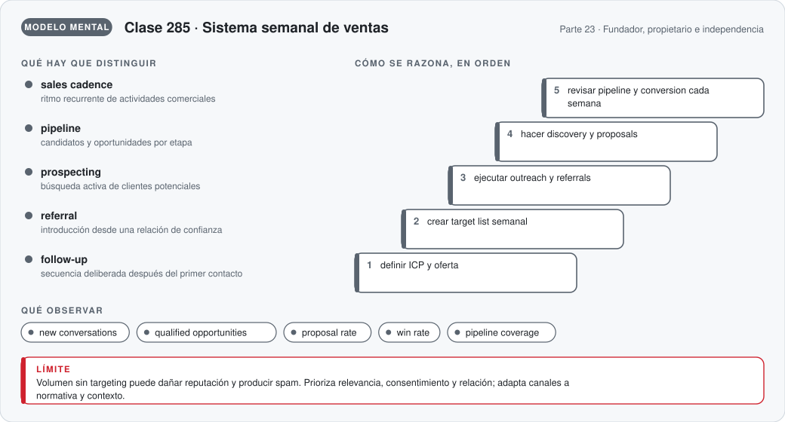

# Clase 285 — Sistema semanal de ventas

<!-- nav:inicio -->
> **Parte 23 · Independencia profesional y Business Owner Capstone** — clase 9 de 12 · [índice de la parte](../../README.md) · [temario](../../../../SYLLABUS.md)
<!-- nav:fin -->

**Parte:** 23 — Independencia profesional y Business Owner Capstone  
**Nivel:** Etapa 6 — Independencia  
**Duración sugerida:** 150–180 minutos · **Estándar:** deep-class-v2

## 🎯 Propósito

El ciclo de «banquete y hambruna» del trabajador independiente tiene una causa simple: **vende cuando le falta trabajo y deja de vender cuando le sobra**. Entrega con todo su tiempo, termina el proyecto y descubre que no tiene el siguiente; entonces se pone a buscar clientes, pero los resultados de ese esfuerzo llegan semanas o meses después, de modo que el siguiente vacío es inevitable. La solución no es un golpe de marketing sino **un sistema semanal**: una cantidad pequeña, constante y medida de actividades comerciales que se ejecutan siempre, sin importar cuánto trabajo haya. Un sistema semanal define a quién se le habla (perfil de cliente ideal), con qué oferta, cuántas conversaciones nuevas se inician cada semana, cómo se pide y se aprovecha una referencia, cómo se hacen los descubrimientos y las propuestas, y cómo se revisa el embudo con números. Ross y Tyler lo plantean como **ingresos predecibles**: se construye un proceso que genera oportunidades con regularidad, en lugar de depender de la suerte.

La clase propone el sistema como un ciclo semanal de cinco etapas: cliente ideal y oferta, lista de objetivos, contacto y referencias, descubrimiento y propuestas, y revisión del embudo. Se apoya en Ross y Tyler (ingresos predecibles), Rackham (venta consultiva con preguntas de situación, problema, implicación y necesidad), Dixon y Adamson (aportar una perspectiva que cambie cómo el cliente ve su problema), Newport (proteger bloques de trabajo profundo y evitar la actividad superficial constante), Drucker y Gerber. Al terminar sabrás calcular cuántos contactos y conversaciones semanales necesitas para un objetivo de ingresos, diseñar mensajes relevantes, estructurar un descubrimiento y una propuesta, proteger tu tiempo y medir el embudo con cifras para mejorar cada semana.

## 📚 Resultados de aprendizaje

Al finalizar podrás:

1. **Definir** el cliente ideal y una oferta clara para cada ciclo.
2. **Construir** una lista semanal de objetivos con motivo de contacto.
3. **Medir** el embudo y calcular la actividad semanal necesaria para una meta.
4. **Conducir** descubrimientos y propuestas con preguntas y perspectiva.
5. **Revisar** cada semana y ajustar lista, mensaje y oferta con evidencia.

## 🧭 Agenda

| Tramo | Qué se hace |
|---|---|
| 0–20 min | Recuperación: ¿cuántas conversaciones nuevas inicias por semana y cuántas generan una propuesta? |
| 20–60 min | Cliente ideal, lista, contacto, referencias, descubrimiento, propuestas y revisión. |
| 60–105 min | Ejemplo trabajado: embudo medido, actividad necesaria y mejora de la tasa de respuesta. |
| 105–150 min | Caso ejecutivo y práctica. |
| 150–175 min | Límites y entregable. |

## 🧩 Conceptos centrales

| Concepto | Definición | Cómo se reconoce |
|---|---|---|
| **Sistema semanal de ventas** | Rutina constante de actividades comerciales medidas. | Calendario fijo y métricas. |
| **Embudo** | Etapas desde el contacto hasta la venta. | Contactos, respuestas, descubrimientos, propuestas, ventas. |
| **Conversación nueva** | Contacto relevante que recibe respuesta. | Intercambio real, no solo envío. |
| **Oportunidad calificada** | Caso con problema, presupuesto, decisor y plazo. | Criterios cumplidos. |
| **Tasa de propuesta** | Proporción de oportunidades que llegan a propuesta. | Propuestas ÷ oportunidades. |
| **Perspectiva** | Observación nueva que cambia cómo el cliente ve su problema. | Dato o idea relevante. |

## 🧠 Modelo mental

**Cómo leer el diagrama.** Una cadena de cinco pasos. **Cliente ideal y oferta**: a quién y con qué propuesta. **Lista semanal**: nombres concretos y motivo de contacto. **Contacto y referencias**: mensajes relevantes y presentaciones. **Descubrimiento y propuestas**: preguntas antes de ofrecer. **Revisión semanal**: conversaciones, oportunidades y conversión. La flecha de retorno indica que la revisión ajusta lista y mensaje. La nota advierte que el volumen sin selección puede dañar la reputación y convertirse en spam y que se priorizan relevancia, consentimiento y relación, respetando la normativa de comunicaciones comerciales; el pie, que la constancia semanal pesa más que los picos de esfuerzo.

## 📖 Desarrollo

### 1. Cliente ideal y oferta para el ciclo

Cada ciclo (un trimestre, por ejemplo) parte de una definición: **a quién le vendo** (sector, tamaño, rol, situación que dispara la necesidad) y **qué le ofrezco** (un resultado claro, con un alcance y un precio de referencia, apoyado en casos). Las clases 278 a 280 construyeron las bases: inventario de capacidades, servicio profesional y servicios productizados. Un perfil de cliente ideal estrecho permite mensajes relevantes y referencias; uno amplio produce mensajes genéricos. La oferta se expresa en una frase: «Ayudo a [cliente] a [resultado] mediante [método] en [plazo]». Se prepara también un **material mínimo**: un caso, una página con la oferta, una agenda de reunión. Sin esa claridad, la actividad comercial se dispersa.

### 2. La lista semanal de objetivos

Ross y Tyler describen un modelo de prospección basado en **listas** de cuentas objetivo y mensajes personalizados, más que en publicidad masiva. Cada semana se prepara una **lista de contactos** (por ejemplo, 20 a 30) con: persona, cargo, empresa, **motivo de contacto** (algo observable y reciente: un cambio de equipo, una publicación, un proyecto, una expansión) y fuente. La lista se arma con **investigación breve** y se limita para poder hacerlo bien. Se priorizan personas que **calzan con el perfil** y que podrían **tener el problema ahora**. Las referencias de clientes anteriores y de la red son la fuente más productiva: se pide presentación a quienes conocen a personas del perfil. Se respetan las normas de datos personales y de comunicaciones comerciales (consentimiento, derecho a no recibir mensajes), que se verifican con fuentes oficiales y asesoría.

### 3. Contacto: mensajes relevantes, no volumen

El mensaje debe ser **breve, específico y útil**. Dixon y Adamson, en su estudio de vendedores de alto desempeño, destacan a quienes **enseñan algo**: aportan una perspectiva o un dato que cambia la forma en que el cliente ve su problema, y después conectan con una solución. Un mensaje efectivo contiene: **motivo** (por qué escribo a esta persona), **observación** (algo relevante que noté), **valor** (qué podría ganar) y **petición pequeña** (15 minutos para conversar). Se evita la lista de servicios, los adjetivos y las promesas vagas. Se prueban **dos variantes** y se mide la tasa de respuesta. El **seguimiento** educado (uno o dos recordatorios espaciados) es parte del sistema; el acoso no. Un volumen alto de mensajes genéricos daña la reputación y reduce la respuesta.

### 4. Descubrimiento y propuesta

La conversación de descubrimiento sigue la lógica de Rackham: preguntas de **situación** (cómo funcionan hoy), de **problema** (qué dificultades tienen), de **implicación** (qué consecuencias y costos tiene el problema) y de **necesidad de solución** (qué valor tendría resolverlo). Se escucha más de lo que se habla, se confirma el **criterio de éxito** del cliente, se identifica a quienes deciden y el presupuesto, y se acuerda un **siguiente paso con fecha**. La **propuesta** (clase 279) se envía dentro de un plazo corto, resume lo conversado en las palabras del cliente, ofrece dos o tres opciones y fija condiciones. Se califica con criterios (problema, presupuesto, decisor, plazo); las oportunidades que no cumplen se registran y se retoman más adelante, no se persiguen indefinidamente.

### 5. Proteger el tiempo: trabajo profundo y ritmo

Newport sostiene que el trabajo valioso requiere **bloques de concentración sin interrupciones** y que la actividad superficial constante (correos, redes, reuniones sin propósito) consume el tiempo que haría falta para entregar bien. Un sistema semanal de ventas debe convivir con la entrega. Una estructura posible: **dos bloques fijos** de 90 minutos para ventas (por ejemplo, martes y jueves por la mañana: preparar la lista, enviar mensajes, hacer seguimiento y descubrimientos), un bloque semanal para propuestas y un bloque de **revisión** de 30 minutos el viernes. El resto del tiempo se protege para entrega y trabajo profundo. La **constancia** pesa más que los picos: veinte contactos todas las semanas dan mejores resultados que doscientos una vez al trimestre. Drucker aconseja administrar el tiempo según lo que realmente se hace, registrándolo.

### 6. Medir el embudo

Las etapas del embudo se cuentan cada semana: **contactos enviados**, **respuestas**, **descubrimientos realizados**, **oportunidades calificadas**, **propuestas enviadas**, **ventas cerradas** y **valor**. Con esos números se calculan las **tasas de conversión** entre etapas y la tasa total de contacto a venta. Se interpreta con cuidado: con pocos datos, las tasas son inestables; se necesitan al menos ocho a doce semanas para ver patrones. Con las tasas, se calcula la **actividad necesaria** para una meta: ventas deseadas ÷ tasa total de conversión = contactos necesarios. También se identifican **cuellos de botella**: una baja tasa de respuesta indica problema de lista o mensaje; una baja tasa de calificación, problema de enfoque; una baja tasa de propuestas ganadas, problema de oferta, precio o competencia. Cada cuello se trabaja con una **hipótesis y una prueba** (clase 247).

### 7. Revisar, aprender y ajustar cada semana

La **revisión semanal** (30 minutos) responde: ¿cuántas actividades planeadas se hicieron?, ¿cuántas conversaciones nuevas hubo?, ¿qué mensajes funcionaron?, ¿qué objeciones aparecieron?, ¿qué oportunidades avanzan o se detienen?, ¿qué se aprende?, ¿qué se cambia la próxima semana? Se actualiza un **registro simple** (planilla o herramienta) y se anota una **mejora**. Cada mes se revisan las tasas y cada trimestre, el perfil de cliente, la oferta y el precio. Taleb recuerda que conviene **muchas apuestas pequeñas** con costo limitado: cada mensaje, cada conversación es una apuesta pequeña; unas pocas dan resultados grandes. Un sistema que se ejecuta y se mide mejora; uno que se abandona cuando hay trabajo vuelve al ciclo de banquete y hambruna.

## 📚 Lectura comparada

| Obra | Qué aporta | Qué no resuelve | Pregunta para contrastar |
|---|---|---|---|
| Ross y Tyler | Ingresos predecibles con procesos y listas. | Enfoque de empresas con equipos de ventas. | ¿Cuántas oportunidades genero por semana? |
| Rackham | Preguntas de situación, problema, implicación y necesidad. | Estudio de ventas complejas. | ¿Qué preguntas hice antes de proponer? |
| Dixon y Adamson | Aportar una perspectiva que cambie la visión del cliente. | Exige conocimiento profundo del sector. | ¿Qué le enseñé al cliente? |
| Newport | Bloques de trabajo profundo y límites a lo superficial. | No trata el embudo. | ¿Cómo protejo mi tiempo de entrega? |
| Drucker | Administrar el tiempo según lo que se hace. | No contiene métricas de ventas. | ¿En qué se va mi semana? |

## 🧮 Ejemplo trabajado

**Situación (hipotética).** Una consultora independiente mide su embudo durante ocho semanas para planificar su actividad. Todos los valores son **supuestos**.

**Embudo observado (8 semanas).**

| Etapa | Cantidad | Conversión desde la etapa anterior |
|---|---|---|
| Contactos enviados | 160 | — |
| Respuestas | 56 | 35,0 % |
| Descubrimientos realizados | 28 | 50,0 % |
| Oportunidades calificadas | 14 | 50,0 % |
| Propuestas enviadas | 9 | 64,3 % |
| Ventas | 3 | 33,3 % |

**Tasa total de contacto a venta:** 3 ÷ 160 = **1,875 %**.

**Meta.** Ingreso nuevo de 8,0 millones de pesos al mes con un valor promedio de proyecto de 3,2 millones: **2,5 ventas al mes**, es decir, 2,5 ÷ 4,33 = **0,577 ventas por semana**.

**Actividad semanal necesaria.** Contactos por semana = 0,577 ÷ 0,01875 = **30,8**. Con ese nivel:

- Respuestas: 30,8 × 0,35 = **10,8**.
- Descubrimientos: 10,8 × 0,50 = **5,4**.
- Oportunidades calificadas: 5,4 × 0,50 = **2,7**.
- Propuestas: 2,7 × 0,643 = **1,7**.
- Ventas: 1,7 × 0,333 = **0,58**.

**Horas semanales.** Contactos: 30,8 × 0,10 h (investigación y mensaje) = **3,1 h**. Descubrimientos: 5,4 × 1,0 h = **5,4 h**. Propuestas: 1,7 × 3,0 h = **5,2 h**. Total: **13,7 horas por semana**, frente a las 20 contactos y unas 9 horas actuales.

**Mejora de la tasa de respuesta.** Si una lista más precisa y un mensaje con perspectiva elevaran la tasa de respuesta de 35 % a 45 %, la tasa total sería 0,45 × 0,50 × 0,50 × 0,643 × 0,333 = **2,41 %** (frente a 1,875 %): los contactos necesarios bajarían a 0,577 ÷ 0,0241 = **23,9 por semana** y las horas de contacto, a 2,4. **Mejorar la relevancia reduce el trabajo necesario en 22 %** (de 30,8 a 23,9).

**Sensibilidad.** Si la tasa de ventas baja de 33,3 % a 25 % (más competencia): tasa total 0,35 × 0,50 × 0,50 × 0,643 × 0,25 = 1,41 %; contactos = 0,577 ÷ 0,0141 = **40,9** por semana. Si el valor promedio sube a 4,0 millones, las ventas necesarias bajan a 2,0 al mes (0,46 por semana) y los contactos a 24,6 con las tasas originales. **Subir el valor del proyecto o la tasa de cierre pesa tanto como aumentar el volumen.**

**Calendario semanal.** Martes y jueves, 9:00 a 10:30: preparar lista, enviar mensajes y seguimiento; miércoles por la tarde: descubrimientos; viernes 8:30: propuestas; viernes 16:00: revisión de 30 minutos. El resto de la semana se protege para entrega y trabajo profundo.

**Decisión.** Subir el objetivo a 25 contactos por semana (con mejor selección) y trabajar para llevar la respuesta a 45 %; pedir presentaciones a los tres clientes más satisfechos; probar dos variantes de mensaje durante cuatro semanas; registrar todo semanalmente y revisar a las 12 semanas.

**Cuidados.** Las tasas y los tiempos son supuestos y la muestra es pequeña; las normas de comunicaciones comerciales y datos personales se verifican con fuentes oficiales y asesoría.

**Qué muestra.** (1) El embudo permitió calcular la actividad necesaria. (2) Mejorar la respuesta reduce el trabajo. (3) La sensibilidad mostró que el valor por venta importa tanto como el volumen.

## 🔀 Comparación y límites

**Sistema semanal frente a campaña.** Una campaña concentra esfuerzo en un período corto con un pico de actividad; un sistema semanal reparte un esfuerzo moderado y constante. El segundo evita el ciclo de banquete y hambruna.

**Límites.** El volumen sin selección puede dañar la reputación y convertirse en spam; se priorizan relevancia, consentimiento y relación, y se adaptan los canales a la normativa y al contexto. Las tasas con pocos datos son frágiles. Algunos servicios se venden casi solo por referencias y reputación, con menos prospección directa. Las cifras del ejemplo son supuestos.

## 🪜 De profesional a owner

| Nivel | Cómo se relaciona con las ventas |
|---|---|
| **Profesional** | Construye reputación y relaciones que generan oportunidades. |
| **Jefe / Team Lead** | Apoya a ventas con casos y conocimiento. |
| **Gerente** | Gestiona el embudo y las metas de su equipo. |
| **CEO / Director** | Define el cliente ideal, la oferta y las reglas de venta. |
| **Founder / Owner** | Ejecuta el sistema semanal mientras entrega y lo delega cuando puede. |

## 🏢 Caso ejecutivo

Un arquitecto independiente que ofrece reformas de oficinas tiene trabajo por seis semanas y ningún proyecto después. Su embudo de las últimas 10 semanas: 120 mensajes a administradores de edificios y gerentes de empresas, 30 respuestas, 12 reuniones, 7 oportunidades calificadas, 5 propuestas y 1 venta de 9 millones. Dedica 6 horas semanales a ventas; no mide su embudo. Sus mejores clientes llegaron por referidos, pero nunca los ha pedido. Su objetivo es de 2 proyectos al mes de 8 millones cada uno. Un conocido le propone comprar una lista de 5.000 correos de gerentes y enviar un mensaje masivo. Una colega le sugiere asociarse con una inmobiliaria que podría derivarle clientes a cambio de una comisión del 10 %. Dispone de 25 horas semanales fuera de la entrega.

Entrega un **informe de decisión comercial** que contenga: (a) el embudo con tasas de conversión y la tasa total; (b) la actividad semanal necesaria para su objetivo y las horas implicadas; (c) el análisis de la compra de la lista y del envío masivo con riesgos reputacionales y legales; (d) la evaluación de la alianza con comisión del 10 % y del pedido sistemático de referencias; (e) el calendario semanal y las métricas de revisión; (f) los límites del análisis y las verificaciones sobre comunicaciones comerciales y datos personales.

## 🧪 Práctica

1. Define tu cliente ideal, tu oferta en una frase y tu material mínimo.
2. Prepara una lista de 20 personas con motivo de contacto específico.
3. Redacta dos variantes de mensaje y define cómo medirás la respuesta.
4. Registra tu embudo durante ocho semanas y calcula la tasa total y la actividad necesaria.
5. Diseña tu calendario semanal con dos bloques de ventas y una revisión.

## ⚠️ Errores frecuentes

| Error | Por qué ocurre | Cómo corregirlo |
|---|---|---|
| Vender solo cuando falta trabajo | Se prioriza la entrega | Bloques semanales fijos de ventas. |
| Mensajes genéricos masivos | Se confunde volumen con resultado | Lista corta, motivo y perspectiva. |
| No medir el embudo | Se confía en la sensación | Registro semanal de cada etapa. |
| Proponer sin descubrir | Se quiere cerrar rápido | Preguntas de situación, problema, implicación y necesidad. |
| No pedir referencias | Se da por sentado | Pedir presentaciones a clientes satisfechos. |
| Comprar listas sin verificar el consentimiento | Se busca rapidez | Respetar normas de datos y comunicaciones comerciales. |

## ❓ Preguntas de comprobación

1. ¿Por qué un sistema semanal evita el ciclo de banquete y hambruna?
2. ¿Qué contiene un mensaje de contacto efectivo?
3. ¿Cómo se calcula la actividad necesaria para una meta?
4. ¿Qué son las preguntas de situación, problema, implicación y necesidad?
5. ¿Qué indica una baja tasa de respuesta?
6. ¿Por qué se protegen bloques de trabajo profundo?
7. ¿Qué límite tiene el volumen de mensajes?

Claves de respuesta

1. Porque reparte un esfuerzo comercial constante y medido en lugar de vender solo cuando falta trabajo.
2. Motivo, observación relevante, valor y una petición pequeña.
3. Dividiendo las ventas necesarias por la tasa total de contacto a venta.
4. Preguntas para entender cómo funcionan hoy, qué dificultades tienen, qué consecuencias tienen y qué valor tendría resolverlas.
5. Un problema de lista, mensaje o relevancia.
6. Para poder entregar con calidad sin que la actividad superficial consuma el tiempo.
7. El volumen sin selección daña la reputación y puede infringir normas; se prioriza la relevancia y el consentimiento.

## 📥 Entregable

Guarda en `portfolio/285-sistema-semanal-de-ventas/`:

- `commercial-decision-brief.md` (plantilla [Commercial decision brief](../../../../templates/commercial-decision-brief.md)) con el informe del caso ejecutivo;
- `decision-journal.md` con el embudo, el calendario semanal y las pruebas de mensaje.

## 📗 Fuentes y verificación

- Aaron Ross & Marylou Tyler — *Predictable Revenue* (Pebblestorm, 2020). **Uso en esta clase:** ingresos predecibles con procesos y listas de objetivos. Lectura selectiva sobre **sistema semanal de ventas**. **Localizador:** [ISBN-13 9780984380244](https://openlibrary.org/isbn/9780984380244).
- Neil Rackham — *SPIN Selling* (Highbridge Audio, 1998). **Uso en esta clase:** preguntas de situación, problema, implicación y necesidad. Lectura selectiva sobre **sistema semanal de ventas**. **Localizador:** [ISBN-13 9781565112605](https://openlibrary.org/isbn/9781565112605).
- Matthew Dixon & Brent Adamson — *The Challenger Sale* (Portfolio/Penguin, 2011). **Uso en esta clase:** aportar una perspectiva que cambie la visión del cliente. Lectura selectiva sobre **sistema semanal de ventas**. **Localizador:** [ISBN-13 9781591844358](https://openlibrary.org/isbn/9781591844358).
- Cal Newport — *Deep Work* (Grand Central Publishing, 2016). **Uso en esta clase:** bloques de trabajo profundo y límites a lo superficial. Lectura selectiva sobre **sistema semanal de ventas**. **Localizador:** [ISBN-13 9781455586691](https://openlibrary.org/isbn/9781455586691).
- Peter F. Drucker — *The Effective Executive* (Collins, 2002). **Uso en esta clase:** administrar el tiempo según lo que realmente se hace. Lectura selectiva sobre **sistema semanal de ventas**. **Localizador:** [ISBN-13 9780060516079](https://openlibrary.org/isbn/9780060516079).
- Peter F. Drucker — *Management: Tasks, Responsibilities, Practices* (Harper & Row, 1974). **Uso en esta clase:** gestión por resultados. Lectura selectiva sobre **sistema semanal de ventas**. **Localizador:** [ISBN-13 9780060110925](https://openlibrary.org/isbn/9780060110925).
- Michael E. Gerber — *The E-Myth Revisited* (HarperAudio, 1995). **Uso en esta clase:** convertir la actividad en un sistema. Lectura selectiva sobre **sistema semanal de ventas**. **Localizador:** [ISBN-13 9780060574901](https://openlibrary.org/isbn/9780060574901).

> **Regla de fuentes para Sistema semanal de ventas:** las obras anteriores estructuran las perspectivas de esta materia; cualquier norma, ley o estándar vivo mencionado debe comprobarse nuevamente en su fuente primaria vigente, incluidas las normas de comunicaciones comerciales y de datos personales. Los ejemplos y casos son hipotéticos, con cifras ilustrativas. El desarrollo es original y no reproduce capítulos protegidos.

<!-- pie:inicio -->
---

| Anterior | Índice | Siguiente |
|---|---|---|
| [← 284 · Runway personal y empresarial](../284-runway-personal-y-empresarial/README.md) | [Parte 23](../../README.md) · [Programa](../../../../SYLLABUS.md) | [286 · Riesgo, ética y reputación →](../286-riesgo-etica-y-reputacion/README.md) |
<!-- pie:fin -->
