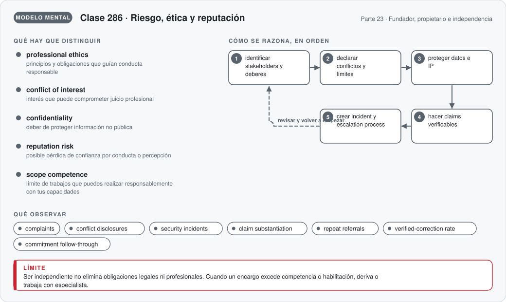

# Clase 286 — Riesgo, ética y reputación

<!-- nav:inicio -->
> **Parte 23 · Independencia profesional y Business Owner Capstone** — clase 10 de 12 · [índice de la parte](../../README.md) · [temario](../../../../SYLLABUS.md)
<!-- nav:fin -->

**Parte:** 23 — Independencia profesional y Business Owner Capstone  
**Nivel:** Etapa 6 — Independencia  
**Duración sugerida:** 150–180 minutos · **Estándar:** deep-class-v2

## 🎯 Propósito

Una persona que trabaja por cuenta propia lleva su reputación como único activo irremplazable. En una organización grande, un error individual se diluye en la marca, en los procesos y en los seguros; en un independiente, **el error es la marca**. Un conflicto de interés no declarado, una promesa de resultados que no se pueden demostrar, una filtración de información de un cliente, un encargo aceptado fuera de la competencia o una discusión mal manejada pueden costar los siguientes cinco años de clientes. Por eso este tema no es «cumplimiento»: es **gestión del riesgo del activo principal**. A diferencia de un empleado, el independiente no tiene un departamento legal, una unidad de seguridad ni un comité de ética que le avise: debe construir, en pequeño, los hábitos que esas unidades hacen en grande.

La clase propone un método sencillo y proporcional: identificar las partes interesadas y los deberes, declarar los conflictos y fijar límites, proteger los datos y la propiedad intelectual de terceros, hacer afirmaciones verificables y crear un proceso de incidentes y escalamiento. Se apoya en Drucker (la responsabilidad del profesional y la ética de la persona), McKeown (decir no a lo que no corresponde), Gerber (sistemas y reglas que no dependen del ánimo del día), Aulet (claridad sobre el cliente y la promesa), Taleb (evitar la exposición a pérdidas que no se pueden revertir) y Anderson (principios de seguridad: proteger lo que importa de forma proporcional). **No es asesoría legal**: las obligaciones profesionales, de confidencialidad, de datos personales y de consumo se verifican en fuentes oficiales vigentes y con asesoría. Al terminar sabrás mapear deberes y riesgos, diseñar políticas mínimas y estimar el beneficio de prevenir.

## 📚 Resultados de aprendizaje

Al finalizar podrás:

1. **Identificar** las partes interesadas y los deberes que se tienen con cada una.
2. **Declarar** conflictos de interés y fijar límites de competencia y de aceptación de encargos.
3. **Proteger** datos y propiedad intelectual ajenos con medidas proporcionales.
4. **Formular** afirmaciones verificables sobre resultados y experiencia.
5. **Diseñar** un proceso de incidentes, reclamos y escalamiento, y estimar el valor de prevenir.

## 🧭 Agenda

| Tramo | Qué se hace |
|---|---|
| 0–20 min | Recuperación: ¿qué decisión tuya podría dañar tu reputación en un solo día? |
| 20–60 min | Partes interesadas, conflictos, competencia, datos, afirmaciones e incidentes. |
| 60–105 min | Ejemplo trabajado: exposición esperada antes y después de controles mínimos. |
| 105–150 min | Caso ejecutivo y práctica. |
| 150–175 min | Límites y entregable. |

## 🧩 Conceptos centrales

| Concepto | Definición | Cómo se reconoce |
|---|---|---|
| **Parte interesada** | Persona u organización afectada por tu trabajo. | Cliente, usuarios, empleados del cliente, comunidad, colegas. |
| **Conflicto de interés** | Situación en que un interés propio puede sesgar el consejo. | Comisiones, vínculos, otros clientes. |
| **Límite de competencia** | Frontera entre lo que se puede hacer con rigor y lo que requiere otro especialista. | Habilitaciones, experiencia, evidencia. |
| **Afirmación verificable** | Declaración sobre resultados que se puede respaldar. | Datos, casos, rangos y condiciones. |
| **Incidente** | Evento que afecta a un cliente, a datos o a la reputación. | Error, filtración, reclamo. |
| **Escalamiento** | Paso a una instancia superior o a un especialista. | Contacto definido y plazo. |

## 🧠 Modelo mental

**Cómo leer el diagrama.** Una tabla de tres columnas. **Área**: partes interesadas, conflictos de interés, datos y propiedad intelectual, afirmaciones e incidentes. **Pregunta**: a quién se debe lealtad y qué se le debe, qué intereses chocan con los del cliente, qué información ajena se maneja y cómo se protege, si se puede probar lo que se promete o se dice, y qué se hace si algo sale mal. **Control**: mapa de deberes, declaración y límites, acuerdos y seguridad básica, evidencia y lenguaje preciso, y un proceso de escalamiento y aviso. La nota afirma que ser independiente no elimina las obligaciones legales ni profesionales y que, cuando un encargo excede la competencia o la habilitación, se deriva o se trabaja con un especialista; el pie, que una reputación se construye con muchos actos pequeños y se pierde con uno solo grave.

## 📖 Desarrollo

### 1. Partes interesadas y deberes

El primer paso es dibujar el mapa de **a quién afecta tu trabajo** y **qué le debes**: el **cliente** (resultado prometido, confidencialidad, honestidad sobre límites), **los usuarios finales o terceros** que sufrirán las consecuencias de tus recomendaciones (empleados del cliente, consumidores, comunidad), **colegas y subcontratistas** (trato justo, reconocimiento), **tu propia profesión** (normas de ejercicio, colegiaturas y códigos de ética cuando existen) y **la sociedad** (cumplimiento de la ley). A veces los deberes chocan: lo que el cliente quiere puede perjudicar a un tercero. Drucker sostiene que el profesional del conocimiento tiene **responsabilidad personal** por el uso de su conocimiento y que no puede delegarla en la organización; para el independiente, esa responsabilidad es directa. Un mapa explícito evita decidir «sobre la marcha» en medio de la presión.

### 2. Conflictos de interés y límites de aceptación

Un **conflicto de interés** existe cuando un interés propio o ajeno puede **sesgar** tu consejo: recibes una comisión por recomendar un proveedor, trabajas para dos competidores, tienes participación en la empresa que vas a evaluar, tu pareja es la directora del área que contratas. No todos los conflictos se evitan, pero **todos se declaran** a las partes afectadas y se gestionan con límites (abstenerse, separar tareas, pedir consentimiento informado). McKeown aboga por decir no a lo que no corresponde: a un encargo que contradice tus valores, a un cliente que pide algo ilícito o a un plazo que impide trabajar con rigor. Se redactan **criterios de aceptación** (qué tipos de encargo no se toman, qué condiciones se exigen) y se registran las excepciones. Ser claro desde el comienzo es mucho más barato que renunciar a mitad de un proyecto.

### 3. Competencia y habilitaciones

Ser independiente no habilita a ejercer cualquier cosa. Algunas actividades requieren **títulos, registros o autorizaciones** (profesiones reguladas, servicios financieros, de salud, de ingeniería con responsabilidad legal, de auditoría, de seguridad). Otras no están reguladas, pero exigen **competencia real**. Se pregunta: ¿tengo la formación y la experiencia para este encargo?, ¿tengo evidencia?, ¿qué ocurre si me equivoco y quién resulta perjudicado?, ¿hay requisitos legales o contractuales que debo cumplir (seguros, garantías, habilitaciones)?, ¿necesito un especialista a mi lado? Las obligaciones de cada actividad se **verifican en fuentes oficiales y con asesoría**; esta clase no las interpreta. Cuando un encargo excede la competencia o la habilitación, lo correcto es **derivar o asociarse con un especialista**, con transparencia hacia el cliente.

### 4. Datos y propiedad intelectual de terceros

El independiente maneja información valiosa y sensible de sus clientes: estados financieros, listas de clientes, datos de personas, estrategias, códigos fuente. Anderson, en su obra de ingeniería de seguridad, enfatiza que la seguridad es un problema de **incentivos, personas y procesos** tanto como de tecnología, y que debe ser **proporcional** a lo que se protege. Medidas mínimas: **acuerdos de confidencialidad** claros, **acceso limitado** (solo lo necesario), **contraseñas fuertes y un gestor**, **autenticación en dos pasos**, **cifrado y respaldo** de dispositivos, **separación** de datos por cliente, **política de retención y borrado** al terminar, y cuidado con herramientas de terceros (nubes, asistentes, plataformas) que pueden recibir datos de clientes sin autorización. Los datos personales tienen normas específicas que se verifican en las fuentes oficiales aplicables. Respetar la **propiedad intelectual** del cliente y de terceros también es un deber.

### 5. Afirmaciones verificables

La reputación se destruye con una promesa que no se cumple y con una afirmación que no se puede probar. Reglas simples: **no garantizar resultados que dependen de factores fuera de tu control**; presentar **rangos y condiciones** («en casos similares, con datos de calidad X, se logró entre 10 y 20 %»); citar **casos reales** con permiso y sin exagerar el papel propio; no declarar **títulos o experiencia** que no se poseen; distinguir **hecho, opinión y hipótesis** en informes y presentaciones; **corregir públicamente** los errores propios. Aulet destaca la importancia de claridad sobre qué se promete y a quién; en la práctica, eso significa un **lenguaje preciso** y una oferta que se pueda cumplir. Las normas de publicidad y de consumo aplicables a la forma en que se anuncia un servicio se verifican con fuentes oficiales y asesoría.

### 6. Incidentes, reclamos y escalamiento

Tarde o temprano algo sale mal: un error en un informe, un dato enviado a la persona equivocada, un entregable atrasado, un reclamo, una discusión con un cliente. Lo que distingue a un profesional confiable es **cómo responde**. Un proceso mínimo: **detectar y contener** (detener el daño, recuperar información); **informar** pronto y con claridad al cliente y a las partes afectadas (y a la autoridad, si hay obligación legal, que se verifica con asesoría); **corregir** y **compensar** cuando corresponde; **registrar** el incidente (qué, cuándo, causa, acción, aprendizaje); **mejorar** el control. Se define de antemano a **quién escalar** (un abogado, un contador, un colega de confianza, un seguro de responsabilidad si se contrata) y los **plazos**. La rapidez y la honestidad suelen convertir un incidente en una oportunidad de confianza; la ocultación, en una crisis.

### 7. Medir, revisar y valorar la prevención

Se llevan indicadores simples: **reclamos** por cada diez proyectos, **conflictos declarados**, **encargos rechazados por criterio**, **incidentes de seguridad**, **tiempo de respuesta** a incidentes y **referencias** recibidas. Se revisa trimestralmente: ¿hubo situaciones límite?, ¿se aplicaron las reglas?, ¿qué se aprendió?, ¿qué cambio falta? También se **valora la prevención**: estimar probabilidad y costo de cada riesgo, el costo de los controles y la reducción esperada. Taleb aconseja evitar exposiciones a pérdidas **irreversibles** aunque sean improbables; la reputación de un independiente es un caso típico. Se ajustan las medidas a lo que realmente protege el valor del negocio, sin burocracia.

## 📚 Lectura comparada

| Obra | Qué aporta | Qué no resuelve | Pregunta para contrastar |
|---|---|---|---|
| Drucker | Responsabilidad personal del profesional del conocimiento. | No fija reglas concretas. | ¿Qué responsabilidad asumo yo personalmente? |
| McKeown | Decir no a lo que no corresponde. | No trata seguridad ni datos. | ¿Qué encargo debo rechazar hoy? |
| Gerber | Sistemas y reglas que no dependen del ánimo. | No cubre ética profesional. | ¿Qué regla evita decidir bajo presión? |
| Aulet | Claridad sobre el cliente y la promesa. | No aborda incidentes. | ¿Puedo cumplir lo que prometo? |
| Anderson | Seguridad como problema de incentivos, personas y procesos. | Texto técnico extenso. | ¿Qué información ajena protejo y cómo? |

## 🧮 Ejemplo trabajado

**Situación (hipotética).** Un consultor independiente en análisis de datos para empresas de retail estima su exposición reputacional antes y después de controles mínimos. Todas las cifras son **supuestos** de pérdida esperada (costo de reparar la situación, clientes perdidos, tiempo); los costos legales reales y las obligaciones se verifican con asesoría.

**Riesgos identificados (probabilidad anual y pérdida estimada).**

| Riesgo | Probabilidad | Pérdida | Exposición esperada |
|---|---|---|---|
| Conflicto de interés no declarado (recomienda una herramienta en la que tiene comisión) | 10 % | 12.000.000 | 1.200.000 |
| Incidente de datos (filtración o pérdida de información de un cliente) | 5 % | 20.000.000 | 1.000.000 |
| Reclamo por una afirmación exagerada sobre resultados | 15 % | 4.000.000 | 600.000 |
| Encargo fuera de competencia con consecuencias para el cliente | 4 % | 30.000.000 | 1.200.000 |
| **Total** | | | **4.000.000** |

**Controles mínimos y costos.**

| Control | Costo anual | Reducción de probabilidad |
|---|---|---|
| Declaración y registro de conflictos, y política de comisiones | 100.000 | 70 % |
| Gestor de contraseñas, autenticación en dos pasos, cifrado, respaldo y acuerdos de confidencialidad | 600.000 | 60 % |
| Revisión de afirmaciones con lista de verificación y rangos | 50.000 | 80 % |
| Criterios de competencia y red de especialistas para derivar | 100.000 | 75 % |
| **Total** | **850.000** | |

**Exposición esperada después de los controles.**

- Conflictos: 0,10 × 0,30 × 12.000.000 = **360.000**.
- Datos: 0,05 × 0,40 × 20.000.000 = **400.000**.
- Afirmaciones: 0,15 × 0,20 × 4.000.000 = **120.000**.
- Competencia: 0,04 × 0,25 × 30.000.000 = **300.000**.
- **Total: 1.180.000.**

**Beneficio neto.** Reducción de exposición: 4.000.000 − 1.180.000 = **2.820.000**; menos el costo de controles de 850.000: **+1.970.000 pesos al año**. Razón beneficio/costo: 2.820.000 ÷ 850.000 = **3,3**.

**Lectura.** Los controles mínimos se pagan con los supuestos dados. **La exposición esperada subestima la gravedad de eventos raros e irreversibles**: un incidente de datos de 20 millones es mucho más dañino para un independiente que una pérdida promedio de 1 millón repartida en el año. Por eso, aun con razón beneficio/costo baja, convendría tener las medidas de datos y de competencia.

**Indicadores de seguimiento.** Reclamos: 2 en 20 proyectos (10 %); conflictos declarados: 3; encargos rechazados por criterio: 2; incidentes de seguridad: 0; tiempo de respuesta a incidentes: menos de 24 horas.

**Caso de afirmación.** El consultor iba a publicar «aumentamos las ventas de nuestros clientes en 30 %». Revisión: el 30 % se obtuvo en un cliente de 8, durante una campaña especial; en los otros, entre 4 y 12 %. Se reemplaza por «en 8 proyectos de retail, entre 4 % y 30 % de aumento de ventas atribuible al análisis, dependiendo de la calidad de los datos y del apoyo del cliente». Menos llamativo, pero defendible.

**Decisión.** Implementar los cuatro controles esta semana, firmar acuerdos de confidencialidad con todos los clientes, adoptar una declaración de conflictos para cada propuesta, usar la lista de verificación de afirmaciones, definir los especialistas a quienes derivará y evaluar un seguro de responsabilidad profesional con un corredor.

**Cuidados.** Las probabilidades y pérdidas son supuestos; las obligaciones legales, de datos y de consumo se verifican con asesoría y fuentes oficiales.

**Qué muestra.** (1) La exposición se estimó con riesgos concretos. (2) Los controles mínimos tuvieron retorno positivo. (3) La exposición esperada no capta la gravedad de eventos irreversibles.

## 🔀 Comparación y límites

**Ética frente a cumplimiento.** El cumplimiento satisface lo exigido por la ley y los contratos; la ética pregunta además qué es correcto hacer cuando nadie lo exige. Una reputación sólida se construye en el segundo plano, además del primero.

**Límites.** Ser independiente no elimina las obligaciones legales ni profesionales; cuando un encargo excede la competencia o habilitación, se deriva o se trabaja con un especialista. Las estimaciones de probabilidad y pérdida son subjetivas. Esta clase no es asesoría legal; las obligaciones de confidencialidad, datos personales, consumo y ejercicio profesional se verifican con fuentes oficiales y asesoría. Las cifras del ejemplo son supuestos.

## 🪜 De profesional a owner

| Nivel | Cómo se relaciona con el riesgo y la ética |
|---|---|
| **Profesional** | Cumple las normas y se responsabiliza de su trabajo. |
| **Jefe / Team Lead** | Cuida que su equipo declare conflictos y proteja los datos. |
| **Gerente** | Gestiona incidentes y reclamos de su área. |
| **CEO / Director** | Define políticas y cultura de integridad. |
| **Founder / Owner** | Lleva la reputación como activo principal y responde personalmente por ella. |

## 🏢 Caso ejecutivo

Un consultor financiero independiente asesora a pequeñas empresas en financiamiento. Cobra honorarios fijos y, además, recibe una comisión de 1,2 % del monto cuando un banco aprueba un crédito que él recomienda; no la declara a sus clientes. En un proyecto reciente guardó la contabilidad completa de un cliente en un pendrive que perdió; el cliente aún no lo sabe. En su sitio web dice «garantizo la aprobación de su crédito en 30 días». Un cliente le pide estructurar los estados financieros de forma que muestren utilidades mayores a las reales para obtener un préstamo. Otro cliente le pide asesoría tributaria compleja que excede su experiencia; su amigo contador está dispuesto a ayudar si le paga una comisión. Su pista es de 4 meses y teme perder ingresos si se vuelve «demasiado estricto». Cobra 2,4 millones de pesos por proyecto y hace 14 al año.

Entrega un **informe de gobierno y riesgos éticos** que contenga: (a) el mapa de partes interesadas y deberes; (b) el análisis de los conflictos, la comisión, el pedido de estados financieros inflados y la asesoría tributaria, con la acción para cada uno; (c) el plan de respuesta al extravío de datos, incluyendo qué comunicar y qué verificar con asesoría; (d) la revisión de afirmaciones del sitio web con lenguaje verificable; (e) el cálculo de exposición esperada con supuestos explícitos y el costo de los controles; (f) los límites del análisis y las verificaciones legales pendientes.

## 🧪 Práctica

1. Dibuja tu mapa de partes interesadas y escribe el deber principal que tienes con cada una.
2. Lista tus posibles conflictos de interés y cómo los declararás.
3. Redacta criterios de aceptación y rechazo de encargos y una red de especialistas para derivar.
4. Revisa tus afirmaciones públicas y reescríbelas con rangos y condiciones.
5. Escribe un proceso de incidentes de una página con responsables, plazos y escalamiento.

## ⚠️ Errores frecuentes

| Error | Por qué ocurre | Cómo corregirlo |
|---|---|---|
| Ocultar comisiones o vínculos | Miedo a perder el encargo | Declarar y gestionar los conflictos. |
| Aceptar encargos fuera de competencia | Necesidad de ingresos | Derivar o asociarse con especialistas. |
| Garantizar resultados | Se busca persuadir | Rangos, condiciones y casos reales. |
| Descuidar la seguridad de datos | Se piensa que es cosa de grandes | Medidas mínimas proporcionales. |
| Ocultar un incidente | Vergüenza o temor | Informar pronto, corregir y registrar. |
| No tener un proceso escrito | Se improvisa | Proceso de incidentes y escalamiento. |

## ❓ Preguntas de comprobación

1. ¿Qué es un conflicto de interés y qué se hace con él?
2. ¿Qué es una afirmación verificable?
3. ¿Qué medidas mínimas protegen datos de clientes?
4. ¿Qué incluye un proceso de incidentes?
5. ¿Cuándo corresponde derivar un encargo?
6. ¿Por qué la exposición esperada puede subestimar un riesgo?
7. ¿Qué límite tiene esta clase?

Claves de respuesta

1. Un interés que puede sesgar el consejo; se declara a las partes afectadas y se gestiona con límites.
2. Una declaración sobre resultados que se puede respaldar con datos, casos, rangos y condiciones.
3. Acuerdos de confidencialidad, acceso limitado, contraseñas y doble autenticación, cifrado, respaldo y borrado.
4. Detectar y contener, informar, corregir, registrar y mejorar, con escalamiento definido.
5. Cuando excede la competencia o la habilitación, o implica requisitos que no se cumplen.
6. Porque los eventos raros e irreversibles pueden ser mucho más dañinos que su promedio anual.
7. No es asesoría legal; las obligaciones se verifican con fuentes oficiales y especialistas.

## 📥 Entregable

Guarda en `portfolio/286-riesgo-etica-y-reputacion/`:

- `risk-governance-brief.md` (plantilla [Risk governance brief](../../../../templates/risk-governance-brief.md)) con el informe del caso ejecutivo;
- `decision-journal.md` con los conflictos declarados, los criterios de aceptación y los incidentes.

## 📗 Fuentes y verificación

- Peter F. Drucker — *The Effective Executive* (Collins, 2002). **Uso en esta clase:** responsabilidad personal del profesional del conocimiento. Lectura selectiva sobre **riesgo, ética y reputación**. **Localizador:** [ISBN-13 9780060516079](https://openlibrary.org/isbn/9780060516079).
- Peter F. Drucker — *Management: Tasks, Responsibilities, Practices* (Harper & Row, 1974). **Uso en esta clase:** responsabilidades y ética de la gestión. Lectura selectiva sobre **riesgo, ética y reputación**. **Localizador:** [ISBN-13 9780060110925](https://openlibrary.org/isbn/9780060110925).
- Greg McKeown — *Essentialism* (Virgin Books, 2014). **Uso en esta clase:** decir no a lo que no corresponde. Lectura selectiva sobre **riesgo, ética y reputación**. **Localizador:** [ISBN-13 9780753555163](https://openlibrary.org/isbn/9780753555163).
- Michael E. Gerber — *The E-Myth Revisited* (HarperAudio, 1995). **Uso en esta clase:** sistemas y reglas que no dependen del ánimo. Lectura selectiva sobre **riesgo, ética y reputación**. **Localizador:** [ISBN-13 9780060574901](https://openlibrary.org/isbn/9780060574901).
- Bill Aulet — *Disciplined Entrepreneurship* (John Wiley & Sons, Incorporated, 2013). **Uso en esta clase:** claridad sobre el cliente y la promesa. Lectura selectiva sobre **riesgo, ética y reputación**. **Localizador:** [ISBN-13 9781299848641](https://openlibrary.org/isbn/9781299848641).
- Nassim Nicholas Taleb — *Antifragile* (Random House, 2012). **Uso en esta clase:** evitar exposiciones a pérdidas irreversibles. Lectura selectiva sobre **riesgo, ética y reputación**. **Localizador:** [ISBN-13 9780679645276](https://openlibrary.org/isbn/9780679645276).
- Ross Anderson — *Security Engineering* (John Wiley & Sons, Incorporated, 2001). **Uso en esta clase:** seguridad como problema de incentivos, personas y procesos. Lectura selectiva sobre **riesgo, ética y reputación**. **Localizador:** [ISBN-13 9781119642831](https://openlibrary.org/isbn/9781119642831).

> **Regla de fuentes para Riesgo, ética y reputación:** las obras anteriores estructuran las perspectivas de esta materia; cualquier norma, ley o estándar vivo mencionado debe comprobarse nuevamente en su fuente primaria vigente, incluidas las normas de confidencialidad, datos personales, consumo y ejercicio profesional. Los ejemplos y casos son hipotéticos, con cifras ilustrativas. El desarrollo es original y no reproduce capítulos protegidos.

<!-- pie:inicio -->
---

| Anterior | Índice | Siguiente |
|---|---|---|
| [← 285 · Sistema semanal de ventas](../285-sistema-semanal-de-ventas/README.md) | [Parte 23](../../README.md) · [Programa](../../../../SYLLABUS.md) | [287 · Plan de 90 días y plan anual →](../287-plan-de-90-dias-y-plan-anual/README.md) |
<!-- pie:fin -->
