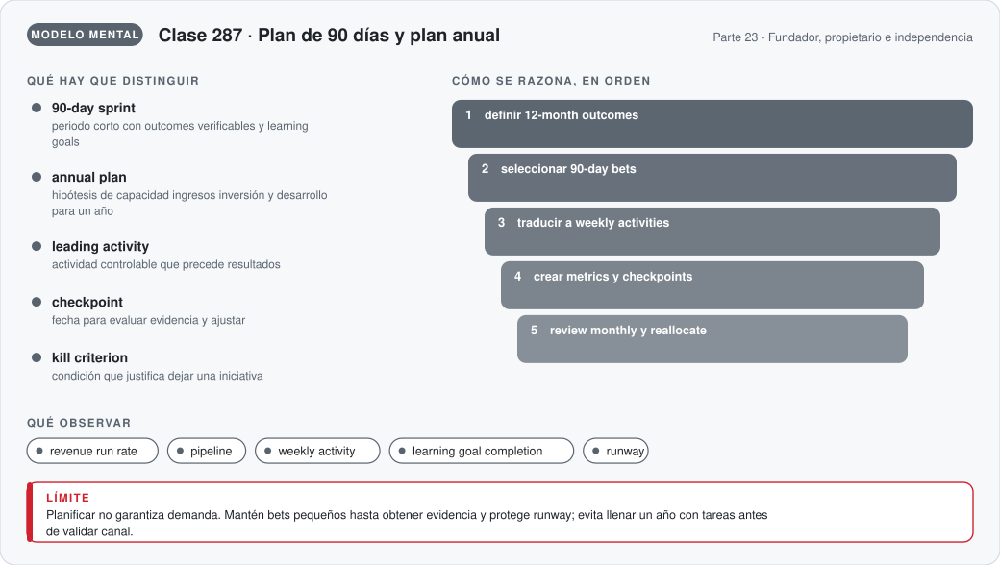

# Clase 287 — Plan de 90 días y plan anual

<!-- nav:inicio -->
> **Parte 23 · Independencia profesional y Business Owner Capstone** — clase 11 de 12 · [índice de la parte](../../README.md) · [temario](../../../../SYLLABUS.md)
<!-- nav:fin -->

**Parte:** 23 — Independencia profesional y Business Owner Capstone  
**Nivel:** Etapa 6 — Independencia  
**Duración sugerida:** 150–180 minutos · **Estándar:** deep-class-v2

## 🎯 Propósito

Quien trabaja por su cuenta no tiene jefe que fije objetivos, calendario de evaluación ni presupuesto. Esa libertad es la razón de ser de la independencia y, a la vez, su mayor riesgo: sin un plan, la semana se llena de lo urgente (entregas, correos, solicitudes) y el año pasa sin que se construya lo importante (activos, clientes recurrentes, reputación, caja). Un plan anual, sin embargo, tampoco basta: los planes de doce meses suelen ser listas largas de buenas intenciones que se abandonan en el segundo mes porque dependen de supuestos que nadie ha validado. Un plan útil combina **tres niveles**: **resultados a doce meses** (pocos, medibles, con supuestos explícitos), **apuestas de noventa días** (dos o tres experimentos pequeños con hipótesis y criterios de éxito) y **actividades semanales** con métricas y revisión mensual. El horizonte de noventa días es corto para urgir y largo para mostrar resultados; permite cambiar el rumbo sin esperar a diciembre.

La clase presenta el método y lo ilustra con una asignación de tiempo limitado a apuestas con valor esperado. Se apoya en Watkins (planes de noventa días con hitos y victorias tempranas), Drucker (los pocos resultados que importan y el tiempo que realmente se dispone), Ries (apuestas pequeñas con aprendizaje validado), Taleb (muchas apuestas acotadas con ganancia potencial asimétrica), Gerber (sistemas que sostienen lo importante) y Buehler, Griffin y Ross (la falacia de la planificación: la tendencia a subestimar el tiempo que tomarán las tareas). Al terminar sabrás fijar resultados anuales con cifras, elegir apuestas de noventa días con criterio, ajustar estimaciones por sesgo de planificación, traducir todo a actividades semanales y diseñar una revisión mensual que reasigne esfuerzo.

## 📚 Resultados de aprendizaje

Al finalizar podrás:

1. **Definir** tres a cinco resultados a doce meses con cifras y supuestos.
2. **Elegir** dos o tres apuestas de noventa días con hipótesis, criterios y plazos.
3. **Ajustar** las estimaciones de esfuerzo por la falacia de la planificación.
4. **Asignar** el tiempo disponible según valor esperado y capacidad real.
5. **Revisar** cada mes con métricas y reasignar esfuerzo con criterios previos.

## 🧭 Agenda

| Tramo | Qué se hace |
|---|---|
| 0–20 min | Recuperación: ¿qué tres resultados te gustaría haber logrado en doce meses y qué harás esta semana por ellos? |
| 20–60 min | Resultados anuales, apuestas, estimación, capacidad, actividades semanales y revisión. |
| 60–105 min | Ejemplo trabajado: valor esperado por hora y selección de apuestas con capacidad limitada. |
| 105–150 min | Caso ejecutivo y práctica. |
| 150–175 min | Límites y entregable. |

## 🧩 Conceptos centrales

| Concepto | Definición | Cómo se reconoce |
|---|---|---|
| **Resultado a 12 meses** | Estado medible que se quiere alcanzar en un año. | Cifra, fecha y supuestos. |
| **Apuesta de 90 días** | Experimento acotado que prueba una hipótesis. | Hipótesis, esfuerzo y criterio de éxito. |
| **Actividad semanal** | Tarea recurrente que sostiene una apuesta. | Calendario y registro. |
| **Falacia de la planificación** | Tendencia a subestimar tiempo y costo de las tareas. | Plazos que se exceden sistemáticamente. |
| **Ritmo de ingresos (run rate)** | Ingreso mensual actual proyectado al año. | Último mes o trimestre × factor. |
| **Reasignación** | Cambio de esfuerzo entre apuestas según evidencia. | Decisión en la revisión mensual. |

## 🧠 Modelo mental

**Cómo leer el diagrama.** Tres columnas. **Resultados a 12 meses**: ingresos, caja y capacidades, pocos resultados y medibles, con supuestos explícitos. **Apuestas de 90 días**: dos o tres apuestas pequeñas, con hipótesis y criterio de éxito, y qué se detiene si no hay tracción. **Actividades semanales**: conversaciones, ofertas y entregas, métricas de actividad y de resultado, y revisión mensual con reasignación. La nota advierte que planificar no garantiza demanda, que las apuestas se mantienen pequeñas hasta tener evidencia y que se protege el runway sin llenar el año de tareas antes de validar el canal; el pie, que el plan se revisa cada mes y se reasigna el esfuerzo.

## 📖 Desarrollo

### 1. Resultados a doce meses: pocos y medibles

Un plan anual comienza por **tres a cinco resultados** que, si se lograran, definirían un buen año. Deben ser **medibles** (cifra y fecha), **relevantes** para la independencia (clase 277), **coherentes entre sí** y **sujetos a supuestos explícitos**. Ejemplos: «ritmo de ingresos de 4 millones mensuales en el mes 12», «tres clientes recurrentes que cubran el 50 % de mis gastos esenciales», «pista combinada de nueve meses», «un servicio productizado con diez ventas», «reducir la participación del mayor cliente a menos del 30 %». Cada uno se acompaña de **supuestos** (tasa de conversión, valor por proyecto, horas disponibles) que se validan en las apuestas. Drucker insiste en la concentración en los pocos resultados que importan; un plan con quince objetivos no es un plan. Se anota también lo que **no** se hará este año.

### 2. Apuestas de noventa días

Los resultados anuales se traducen en **apuestas** de 90 días: experimentos con **hipótesis**, **esfuerzo estimado**, **criterio de éxito**, **fecha de revisión** y **qué se detiene** si no hay tracción. Ejemplo de hipótesis: «Si ofrezco un servicio de seguimiento mensual a mis 15 clientes anteriores, al menos 3 aceptarán una prueba de tres meses». Watkins recomienda planes de noventa días con hitos y victorias tempranas que construyan credibilidad e información; Ries, aprender con el menor gasto posible. Se eligen **dos o tres apuestas**, no diez: más apuestas diluyen el esfuerzo y no permiten aprender de ninguna. Taleb sugiere acotar el costo de cada apuesta y buscar **asimetrías**: pérdidas limitadas y ganancias potencialmente grandes. Una apuesta que, si falla, pone en riesgo la pista no es una apuesta pequeña.

### 3. La falacia de la planificación

Buehler, Griffin y Ross documentaron que las personas subestiman sistemáticamente el tiempo que tomarán sus tareas, incluso cuando saben que proyectos similares se retrasaron: tienden a imaginar el mejor escenario. Para corregirlo se usan tres prácticas. **Mirar la base**: cuánto tardaron tareas parecidas en el pasado. **Descomponer** la tarea y estimar cada parte. **Aplicar un factor de ajuste** (por ejemplo, multiplicar por 1,5) y registrar después el tiempo real para calibrar. Un plan con estimaciones optimistas produce una sensación de fracaso cuando en realidad el problema es la estimación. Se aplican también **colchones** a plazos que dependen de terceros (clientes que responden tarde, trámites). Anotar las horas reales es una de las mejores inversiones de un independiente.

### 4. Capacidad real y valor esperado

El tiempo disponible es el límite. Se calcula la **capacidad** semanal para apuestas: horas totales menos entrega comprometida, administración, ventas ya planificadas y descanso. Con esa capacidad, y las horas **ajustadas**, se estima el **valor esperado** de cada apuesta (probabilidad de éxito × valor si tiene éxito) y su **valor esperado por hora**. Se priorizan las de mayor valor por hora hasta agotar la capacidad, con criterio: las apuestas no se pueden fraccionar siempre, y algunas tienen **efectos de aprendizaje** que no aparecen en el cálculo. Las probabilidades son juicios subjetivos: se registran, se contrastan con evidencia y se corrigen. El método no pretende exactitud; **obliga a explicitar supuestos y a elegir** en lugar de intentar todo.

### 5. Actividades semanales y métricas

Cada apuesta se traduce en **actividades semanales** concretas, con tiempo reservado en el calendario: por ejemplo, «martes y jueves, 9:00 a 10:30: contactar clientes anteriores» o «viernes: avanzar el paquete». Se definen **métricas de actividad** (conversaciones iniciadas, propuestas enviadas, horas de desarrollo) y **métricas de resultado** (oportunidades calificadas, ventas, ingresos). Las de actividad indican si se hizo el trabajo; las de resultado, si el trabajo funciona. La clase 285 desarrolla el sistema de ventas; la 279 a 283, los servicios, los productos y los portafolios. Una **revisión semanal** corta mantiene el ritmo. El plan debe convivir con la entrega: se protegen bloques de trabajo profundo (clase 285) y se evita llenar la agenda hasta el 100 %.

### 6. Revisión mensual y reasignación

Cada mes se revisa: **resultados** frente al plan, **estado de cada apuesta**, **aprendizaje**, **caja y pista** (clase 284) y **energía**. Se decide con criterios previos: **continuar** (hay tracción), **ajustar** (la hipótesis se cumple parcialmente: cambiar mensaje, precio, canal), **detener** (no hay tracción en el plazo definido) o **escalar** (resultados superiores a lo esperado). Se registra la decisión y su razón. Las reglas de detención se escriben **antes**: por ejemplo, «si a la semana seis no hay al menos tres conversaciones con interés, se reemplaza la apuesta». Watkins subraya la importancia de revisar y ajustar el plan a medida que se aprende; Ries, de **pivotar o perseverar** con base en evidencia, no en ánimo. Esta revisión libera de seguir invirtiendo en lo que no funciona.

### 7. El plan anual como hipótesis viva

El plan anual no es un contrato sino una **hipótesis sobre cómo se lograrán los resultados**. Se revisa cada trimestre: ¿los supuestos se cumplieron?, ¿cambió el mercado?, ¿surgieron oportunidades?, ¿se agotó una vía? Se actualizan los resultados y se eligen nuevas apuestas para los noventa días siguientes. Planificar no garantiza demanda: las apuestas se mantienen pequeñas hasta tener evidencia, y se protege el runway; evitar llenar un año con tareas antes de validar el canal es una forma de proteger la caja y el ánimo. Un buen plan también incluye **descanso, salud y relaciones**, porque la independencia sostenible exige energía. Se documentan las lecciones y se celebran los avances, aunque sean pequeños.

## 📚 Lectura comparada

| Obra | Qué aporta | Qué no resuelve | Pregunta para contrastar |
|---|---|---|---|
| Watkins | Planes de 90 días con hitos y victorias tempranas. | Pensado para nuevos roles en organizaciones. | ¿Qué hito demuestra que voy bien en 30, 60 y 90 días? |
| Drucker | Concentrarse en los pocos resultados que importan. | No incluye estimación de esfuerzo. | ¿Cuáles son mis tres resultados clave? |
| Ries | Aprender con apuestas pequeñas y decidir con evidencia. | Enfoque de productos y empresas nuevas. | ¿Qué hipótesis pongo a prueba en estos 90 días? |
| Taleb | Apuestas acotadas con ganancia potencial grande. | No es guía de planificación. | ¿Cuál es la pérdida máxima de esta apuesta? |
| Buehler, Griffin y Ross | Sesgo de subestimar tiempos de tareas. | Estudios de laboratorio y campo, no un método de plan. | ¿Cuánto tardaron tareas parecidas? |

## 🧮 Ejemplo trabajado

**Situación (hipotética).** Una consultora independiente planifica su próximo trimestre. Todos los números son **supuestos**.

**Resultados a 12 meses.** (1) Ritmo de ingresos de 4,0 millones mensuales al mes 12 (hoy 2,6). (2) Dos clientes recurrentes que cubran el 40 % de sus gastos esenciales. (3) Pista combinada de 9 meses (hoy 6). (4) Participación del mayor cliente por debajo de 30 % (hoy 41 %).

**Capacidad para apuestas.** Horas semanales disponibles tras entrega, administración y ventas ya planificadas: 12. En 13 semanas: **156 horas**.

**Apuestas candidatas, con estimaciones ajustadas por falacia de planificación (factor 1,5).**

| Apuesta | Horas estimadas | Horas ajustadas (×1,5) | Probabilidad de éxito | Valor si tiene éxito | Valor esperado | Valor esperado por hora ajustada |
|---|---|---|---|---|---|---|
| A. Retainer de seguimiento a 15 clientes anteriores | 60 | **90** | 40 % | 2 retainers × 800.000 × 9 meses = 14.400.000 | 5.760.000 | **64.000** |
| B. Lanzar servicio productizado | 90 | **135** | 50 % | 5 paquetes × 1.800.000 = 9.000.000 | 4.500.000 | **33.333** |
| C. Boletín semanal para construir audiencia | 80 | **120** | 25 % | 2 proyectos × 3.200.000 = 6.400.000 | 1.600.000 | **13.333** |
| D. Nuevo producto digital | 150 | **225** | 30 % | 6.000.000 | 1.800.000 | **8.000** |

**Cálculos de ejemplo.** A: 0,40 × 14.400.000 = 5.760.000; ÷ 90 = 64.000. B: 0,50 × 9.000.000 = 4.500.000; ÷ 135 = 33.333. C: 0,25 × 6.400.000 = 1.600.000; ÷ 120 = 13.333. D: 0,30 × 6.000.000 = 1.800.000; ÷ 225 = 8.000.

**Selección con capacidad de 156 horas.** Se ordenan por valor esperado por hora: A (90 h), B (135 h), C (120 h), D (225 h). A cabe: quedan 66 horas. B completa necesita 135: no cabe. Opción: **B reducida** a un piloto con dos paquetes (60 horas ajustadas) con valor esperado de 0,50 × 3.600.000 = **1.800.000**. Total: 90 + 60 = **150 horas** (≤ 156) y valor esperado de 5.760.000 + 1.800.000 = **7.560.000**. Sin el ajuste de planificación (con las horas originales), A y B habrían parecido caber con 150 horas, y el plan se habría desbordado a 225.

**Efecto de ignorar la falacia.** Con estimaciones sin ajustar (60 + 90 = 150 horas), parece que A y B completos caben en 156 horas; si la realidad es 1,5 veces, se necesitarían 225 horas: **69 horas más** de las disponibles (44 % por encima), lo que implicaría descuidar la entrega o abandonar una apuesta a mitad de camino.

**Criterios de revisión (escritos antes).**

| Apuesta | Criterio de éxito a 90 días | Regla de detención |
|---|---|---|
| A | Al menos 3 de 15 clientes aceptan una prueba de tres meses | Si a la semana 6 hay menos de 3 conversaciones con interés, reemplazar o cambiar la oferta |
| B (piloto) | 2 paquetes vendidos | Si a la semana 8 no hay una propuesta aceptada, revisar oferta o canal |

**Actividades semanales.** Martes y jueves, 9:00 a 10:30: contacto con clientes anteriores (apuesta A: 3 horas por semana); miércoles por la tarde: desarrollo del piloto (apuesta B: 4 horas), viernes: revisión de 30 minutos y preparación de la semana siguiente. **Métricas semanales:** conversaciones iniciadas (meta 4), oportunidades calificadas (meta 1), propuestas enviadas (meta 0,5).

**Revisión mensual.** Se compara cada apuesta con su criterio, se actualizan probabilidades con evidencia, se revisan caja y pista, y se decide continuar, ajustar, detener o escalar. Se registra el tiempo real de cada tarea para calibrar el factor de ajuste.

**Decisión.** Ejecutar A y el piloto de B, dejar C y D para el próximo trimestre, proteger los bloques de entrega, y revisar el plan anual al día 90.

**Cuidados.** Las probabilidades, valores y horas son supuestos y se actualizan con datos; el plan no sustituye la entrega comprometida ni la protección de la caja.

**Qué muestra.** (1) El valor esperado por hora ordenó las apuestas. (2) Corregir la falacia de la planificación evitó un plan desbordado. (3) Los criterios de detención se escribieron antes de empezar.

## 🔀 Comparación y límites

**Plan de 90 días frente a plan anual.** El plan de 90 días permite experimentar y corregir con rapidez; el anual da dirección y coherencia. Ambos se necesitan, y el segundo se alimenta del aprendizaje del primero.

**Límites.** Planificar no garantiza demanda. Las probabilidades de éxito son juicios subjetivos y los valores esperados, estimaciones. Las apuestas se mantienen pequeñas hasta tener evidencia y se protege el runway. Un plan demasiado detallado se vuelve una carga. Las cifras del ejemplo son supuestos.

## 🪜 De profesional a owner

| Nivel | Cómo se relaciona con el plan |
|---|---|
| **Profesional** | Planifica su desarrollo y registra sus resultados. |
| **Jefe / Team Lead** | Traduce metas del equipo en actividades semanales. |
| **Gerente** | Gestiona un plan trimestral con métricas y reasignación. |
| **CEO / Director** | Fija resultados anuales y asigna recursos entre apuestas. |
| **Founder / Owner** | Define el plan, lo prueba en pequeño y lo ajusta cada mes con evidencia. |

## 🏢 Caso ejecutivo

Un ingeniero independiente de 36 años factura 3,1 millones de pesos mensuales (ritmo anual de 37,2 millones) con un cliente que le aporta el 58 %. Su pista es de 7 meses. Quiere llegar a 5 millones mensuales en 12 meses. Ideas para el trimestre: ofrecer un servicio de mantenimiento mensual a 12 clientes anteriores (estima 50 horas, probabilidad de éxito de 35 %, valor de 2 retainers de 700.000 por 9 meses), lanzar un paquete de auditoría técnica en una semana (80 horas, 45 %, 6 paquetes a 1,5 millones), grabar un curso (200 horas, 25 %, 8 millones), asistir a tres eventos del sector (30 horas, 30 %, un proyecto de 4 millones) y escribir un libro (300 horas, 10 %, 12 millones). Tiene 10 horas semanales disponibles para apuestas. Sus estimaciones previas de tareas se excedieron, en promedio, 60 %. Su cliente principal lo invitó a dedicarse en exclusiva a un proyecto de 12 meses con un pago de 4,2 millones mensuales.

Entrega un **informe de gobierno y riesgos del plan** que contenga: (a) los resultados a doce meses con supuestos; (b) la tabla de apuestas con horas ajustadas por la falacia de la planificación, valor esperado y valor esperado por hora; (c) la selección según capacidad y los criterios de éxito y detención; (d) las actividades semanales y las métricas; (e) el análisis de la oferta de exclusividad frente al plan, con sus riesgos de concentración; (f) los límites del análisis y la forma de revisar el plan cada mes.

## 🧪 Práctica

1. Escribe tres resultados a doce meses con cifra, fecha y supuestos.
2. Lista cinco apuestas posibles con horas estimadas, probabilidad y valor si tiene éxito.
3. Ajusta las horas con un factor basado en tu historial y calcula el valor esperado por hora.
4. Selecciona dos o tres apuestas según tu capacidad y escribe criterios de éxito y detención.
5. Diseña tu semana tipo y tu revisión mensual de 45 minutos.

## ⚠️ Errores frecuentes

| Error | Por qué ocurre | Cómo corregirlo |
|---|---|---|
| Demasiados objetivos | Se quiere abarcar todo | Tres a cinco resultados medibles. |
| Estimar horas con optimismo | Falacia de la planificación | Mirar la base, descomponer y ajustar. |
| Apuestas sin criterio de detención | Se teme abandonar | Escribir reglas antes de empezar. |
| Llenar la agenda al 100 % | Se ignora la entrega y el descanso | Capacidad realista y colchones. |
| No medir actividades ni resultados | Se confía en la sensación | Métricas semanales y revisión mensual. |
| Tratar el plan como contrato | Rigidez | Hipótesis viva, revisión trimestral. |

## ❓ Preguntas de comprobación

1. ¿Qué tres niveles tiene el plan?
2. ¿Qué es una apuesta de 90 días?
3. ¿Qué es la falacia de la planificación y cómo se corrige?
4. ¿Cómo se calcula el valor esperado por hora?
5. ¿Por qué se escriben reglas de detención antes de comenzar?
6. ¿Qué se revisa cada mes?
7. ¿Qué límite tiene este método?

Claves de respuesta

1. Resultados a doce meses, apuestas de noventa días y actividades semanales.
2. Un experimento acotado con hipótesis, esfuerzo, criterio de éxito y fecha de revisión.
3. La tendencia a subestimar tiempos; se corrige con datos históricos, descomposición y factores de ajuste.
4. Probabilidad de éxito por el valor si tiene éxito, dividido por las horas ajustadas.
5. Para decidir con evidencia y no con ánimo cuando hay presión.
6. Resultados, estado de apuestas, aprendizaje, caja y pista, y energía, para continuar, ajustar, detener o escalar.
7. Se basa en probabilidades subjetivas y no garantiza demanda; se mantienen apuestas pequeñas y se protege el runway.

## 📥 Entregable

Guarda en `portfolio/287-plan-de-90-dias-y-plan-anual/`:

- `risk-governance-brief.md` (plantilla [Risk governance brief](../../../../templates/risk-governance-brief.md)) con el informe del caso ejecutivo;
- `decision-journal.md` con las apuestas, los criterios y las revisiones mensuales.

## 📗 Fuentes y verificación

- Michael D. Watkins — *The First 90 Days* (Harvard Business School Press, 2003). **Uso en esta clase:** planes de noventa días con hitos y victorias tempranas. Lectura selectiva sobre **plan de 90 días y plan anual**. **Localizador:** [ISBN-13 9781591391104](https://openlibrary.org/isbn/9781591391104).
- Peter F. Drucker — *The Effective Executive* (Collins, 2002). **Uso en esta clase:** concentrarse en los pocos resultados que importan. Lectura selectiva sobre **plan de 90 días y plan anual**. **Localizador:** [ISBN-13 9780060516079](https://openlibrary.org/isbn/9780060516079).
- Peter F. Drucker — *Management: Tasks, Responsibilities, Practices* (Harper & Row, 1974). **Uso en esta clase:** gestión por resultados. Lectura selectiva sobre **plan de 90 días y plan anual**. **Localizador:** [ISBN-13 9780060110925](https://openlibrary.org/isbn/9780060110925).
- Eric Ries — *The Lean Startup* (Crown Business, 2011). **Uso en esta clase:** apuestas pequeñas y aprendizaje validado. Lectura selectiva sobre **plan de 90 días y plan anual**. **Localizador:** [ISBN-13 9780307887894](https://openlibrary.org/isbn/9780307887894).
- Nassim Nicholas Taleb — *Antifragile* (Random House, 2012). **Uso en esta clase:** apuestas acotadas con ganancia potencial asimétrica. Lectura selectiva sobre **plan de 90 días y plan anual**. **Localizador:** [ISBN-13 9780679645276](https://openlibrary.org/isbn/9780679645276).
- Roger Buehler, Dale Griffin & Michael Ross — *Exploring the "planning fallacy": Why people underestimate their task completion times* (Journal of Personality and Social Psychology, 1994). **Uso en esta clase:** sesgo de subestimar el tiempo de las tareas. Lectura selectiva sobre **plan de 90 días y plan anual**. **Localizador:** [DOI 10.1037/0022-3514.67.3.366](https://doi.org/10.1037/0022-3514.67.3.366).
- Michael E. Gerber — *The E-Myth Revisited* (HarperAudio, 1995). **Uso en esta clase:** sistemas que sostienen lo importante. Lectura selectiva sobre **plan de 90 días y plan anual**. **Localizador:** [ISBN-13 9780060574901](https://openlibrary.org/isbn/9780060574901).

> **Regla de fuentes para Plan de 90 días y plan anual:** las obras anteriores estructuran las perspectivas de esta materia; cualquier norma, ley o estándar vivo mencionado debe comprobarse nuevamente en su fuente primaria vigente. Los ejemplos y casos son hipotéticos, con cifras ilustrativas. El desarrollo es original y no reproduce capítulos protegidos.

<!-- pie:inicio -->
---

| Anterior | Índice | Siguiente |
|---|---|---|
| [← 286 · Riesgo, ética y reputación](../286-riesgo-etica-y-reputacion/README.md) | [Parte 23](../../README.md) · [Programa](../../../../SYLLABUS.md) | [288 · Capstone final: defensa como CEO, founder y owner →](../288-capstone-final-defensa-como-ceo-founder-y-owner/README.md) |
<!-- pie:fin -->
