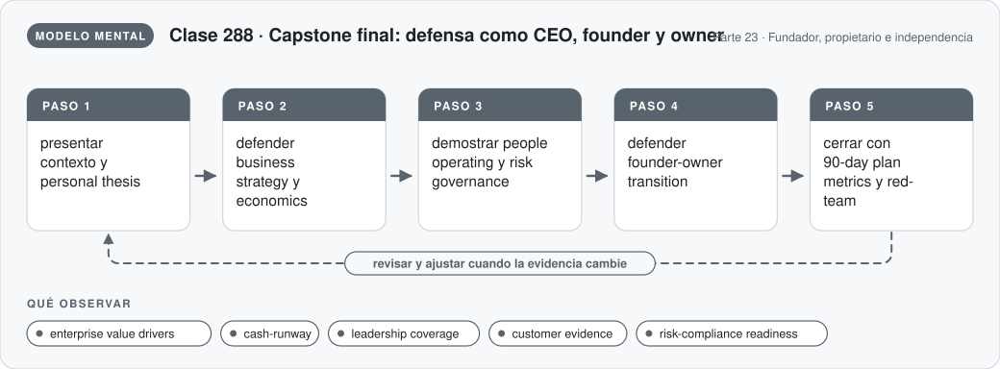

# Clase 288 — Capstone final: defensa como CEO, founder y owner

<!-- nav:inicio -->
> **Parte 23 · Independencia profesional y Business Owner Capstone** — clase 12 de 12 · [índice de la parte](../../README.md) · [temario](../../../../SYLLABUS.md)
<!-- nav:fin -->

**Parte:** 23 — Independencia profesional y Business Owner Capstone  
**Nivel:** Etapa 6 — Independencia  
**Duración sugerida:** 150–180 minutos · **Estándar:** deep-class-v2

## 🎯 Propósito

El programa recorre doscientas ochenta y ocho clases: liderazgo personal y de equipos, estrategia, finanzas, riesgo y gobierno, tecnología y datos, comunicación, creación de empresas, formalización en Chile, escalamiento y propiedad, e independencia profesional. Esta clase final no agrega un tema: pide **integrar** lo aprendido en una **defensa** ante un comité imaginario o real, con tres sombreros a la vez. Como **CEO**, debes mostrar que sabes dirigir una organización: estrategia, economía, personas, operación y riesgo. Como **founder**, que sabes crear y validar: problema, cliente, modelo y evidencia. Como **owner**, que sabes decidir sobre capital, control, gobierno y sucesión, y que puedes reducir la dependencia de tu presencia. La defensa no es una exposición de logros: es una **demostración de criterio** ante preguntas difíciles, con evidencia, cifras, límites y un plan de noventa días.

La clase propone una estructura de defensa en seis partes: contexto y tesis personal, estrategia y economía, personas, operación y riesgo, transición de fundador a propietario, plan de 90 días con métricas, y preguntas con límites. Integra a Drucker (eficacia y responsabilidad), Wasserman (los dilemas de riqueza y control del fundador), Gerber (la empresa como sistema), Aulet (cliente, propuesta y economía con evidencia), Newport (profundidad y foco en el trabajo propio), y Koller y colaboradores (valor y riesgo de los flujos). Al terminar sabrás preparar un dossier y una presentación, estimar el valor y la pista con supuestos explícitos, medir la cobertura de liderazgo, responder preguntas incómodas y declarar con honestidad lo que no sabes y cuándo escalarías a un experto. **El capstone no certifica competencia legal, contable ni profesional regulada.**

## 📚 Resultados de aprendizaje

Al finalizar podrás:

1. **Estructurar** una defensa integrada con tesis, evidencia, riesgos, transición y plan.
2. **Demostrar** economía, caja y valor con cifras, supuestos y sensibilidad.
3. **Evidenciar** cobertura de liderazgo, controles y gobierno proporcional.
4. **Defender** la transición de fundador a propietario con una prueba o plan verificable.
5. **Responder** con honestidad sobre límites, incertidumbres y momentos de escalar a expertos.

## 🧭 Agenda

| Tramo | Qué se hace |
|---|---|
| 0–20 min | Recuperación: ¿cuál es tu tesis en tres frases y qué evidencia la sostiene? |
| 20–60 min | Contexto, estrategia y economía, personas y riesgo, transición, plan y preguntas. |
| 60–105 min | Ejemplo trabajado: dossier de una defensa con valor, pista, cobertura y rúbrica. |
| 105–150 min | Caso ejecutivo y práctica de defensa. |
| 150–175 min | Límites y entregable. |

## 🧩 Conceptos centrales

| Concepto | Definición | Cómo se reconoce |
|---|---|---|
| **Defensa** | Presentación sometida a preguntas para demostrar criterio. | Tesis, evidencia y respuestas. |
| **Tesis personal** | Afirmación central sobre qué empresa eres y qué decides. | Tres frases verificables. |
| **Impulsores de valor** | Variables que más mueven el valor de la empresa. | Crecimiento, margen, retorno y riesgo. |
| **Cobertura de liderazgo** | Proporción de roles críticos con responsable y sucesor. | Roles cubiertos ÷ roles críticos. |
| **Pista de caja** | Meses de operación con la caja actual. | Caja ÷ consumo mensual neto. |
| **Rúbrica** | Criterios y pesos con que se evalúa la defensa. | Puntajes por sección. |

## 🧠 Modelo mental

**Cómo leer el diagrama.** Una cadena de seis partes. **Contexto y tesis**: quién eres, qué empresa y por qué. **Estrategia y economía**: cómo ganas dinero y con qué evidencia. **Personas, operación y riesgo**: quién hace qué y qué puede fallar. **Del fundador al propietario**: qué dejas de hacer y qué decides. **Plan de 90 días**: metas, métricas y puntos de control. **Preguntas y límites**: qué no sabes y cuándo escalas a expertos. La flecha de retorno indica que las preguntas ajustan el plan. La nota afirma que el capstone no certifica competencia legal, contable ni profesional regulada y que evalúa la capacidad de integrar decisiones y de saber cuándo escalar a especialistas; el pie, que se defiende con evidencia y con los límites del propio análisis.

## 📖 Desarrollo

### 1. Qué se evalúa en una defensa

Una defensa no mide memoria, sino **criterio**: ¿puedes explicar por qué tomas las decisiones que tomas, con qué evidencia, qué alternativas descartaste, qué riesgos aceptas y qué harías si te equivocaras? Un comité atento busca cuatro cosas. **Coherencia**: que la estrategia, la economía, las personas, el riesgo y el plan cuenten una misma historia. **Evidencia**: que las afirmaciones se apoyen en datos, casos y pruebas, no en adjetivos. **Honestidad**: que se reconozcan incertidumbres, errores y límites. **Capacidad de aprender**: que haya un mecanismo para corregir. Drucker sostiene que el ejecutivo eficaz toma decisiones tras definir bien el problema, considerar alternativas y asegurar que se ejecuten; la defensa es la prueba de que sigues ese proceso. Por eso, se evalúa también cómo respondes cuando la respuesta es «no lo sé todavía».

### 2. Contexto y tesis personal

La defensa comienza con una **tesis** de tres frases: qué empresa o práctica profesional diriges, qué problema resuelve para quién y qué decisión estás tomando ahora (invertir, escalar, transferir, vender, consolidar, cambiar de rumbo). Se complementa con un **contexto** breve: historia, números clave, etapa (creación, escalamiento, independencia) y **qué cambió** en los últimos doce meses. Wasserman muestra que las decisiones iniciales del fundador sobre quién entra, cuánto controla y cuánto riesgo asume condicionan toda la trayectoria; la tesis debe explicitar **tu posición** en esos dilemas de riqueza y control. Se evita contar la historia completa: se selecciona lo que hace comprensible la decisión. Una tesis clara permite que el comité evalúe todo lo demás.

### 3. Estrategia y economía

La segunda parte demuestra que el negocio **gana dinero de forma repetible**: cliente y problema (clases 241 a 252), propuesta y modelo de negocio, economía por cliente, precio, canal, costo de adquisición, margen de contribución, concentración de clientes y de ingresos (clases 268 y 283). Aulet exige definir al cliente específico, la propuesta de valor y la economía con evidencia; Koller y colaboradores, que el valor depende de **crecimiento, retorno sobre el capital y riesgo**. Se presentan pocas cifras bien explicadas, con **supuestos** y **sensibilidad**: qué pasa si el margen cae, la cancelación sube o se pierde un cliente. También se muestra la **evidencia** (conversaciones, pagos, retención, casos), no solo proyecciones. Si hay un punto débil, se declara y se indica cómo se reducirá.

### 4. Personas, operación y riesgo

La tercera parte muestra que la empresa **funciona**: organización y roles, líderes y su cobertura, sistemas y procesos críticos (clase 266), controles financieros (269), gobierno proporcional (270), cumplimiento y obligaciones (parte 21), riesgo, ética y reputación (286), caja y pista (284). Se presenta la **cobertura de liderazgo** (cuántos roles críticos tienen responsable y sucesor), los **indicadores clave** del tablero (clase 275), las **excepciones** y las **fallas** detectadas y corregidas. Gerber enseña que la empresa debe ser un sistema que funcione con independencia de quien la creó; el comité querrá ver evidencia, no declaraciones: cierres, actas, simulaciones, contratos, calendarios, registros. En este punto se declaran también los **riesgos principales** y los planes de mitigación, incluidos los que requieren expertos.

### 5. Del fundador al propietario

La cuarta parte es la más personal: **¿qué dejas de hacer, qué decides y cómo sabes que la empresa funciona sin ti?** Se presenta el mapa de dependencias (clase 265), las decisiones delegadas con límites (274), los resultados de una simulación de ausencia (276) o el plan para realizarla, la estructura de propiedad y gobierno (270 a 272), las opciones de capital (adquirir, reinvertir, repartir, vender) y la **política de capital** del propietario. También se presenta tu **plan personal**: qué rol ocuparás, cómo medirás tu desempeño como propietario, cómo cuidarás tu pista y tu independencia (clases 277 y 284). Newport recuerda el valor de proteger el trabajo profundo: se explica a qué dedicarás tu atención y qué rechazarás para mantener foco.

### 6. Plan de noventa días y métricas

La quinta parte convierte la defensa en **acción**: tres a cinco resultados a doce meses, dos o tres apuestas de noventa días con hipótesis, criterios de éxito y reglas de detención (clase 287), actividades semanales, métricas de actividad y de resultado, y una cadencia de revisión mensual. Se ajustan las estimaciones por la falacia de la planificación y se cuida la capacidad real. Se incluye un **plan de contingencia**: qué se hará si ocurre el escenario adverso (caída de ventas, pérdida de un cliente, ausencia del fundador) con disparadores y fechas. Un plan sin métricas ni puntos de control es una intención. El comité evalúa si las apuestas son **pequeñas, ejecutables y aprendibles**, y si protegen la caja.

### 7. Preguntas, límites y escalamiento

La última parte —y probablemente la más reveladora— es el **diálogo**. Se preparan respuestas a preguntas difíciles: ¿qué evidencia tienes de que los clientes pagarían más?, ¿qué pasa si tu mayor cliente se va?, ¿qué haces si un líder renuncia?, ¿cuál es el error más caro que cometiste y qué cambiaste?, ¿qué decisión estás evitando?, ¿cuánto vale tu empresa y por qué?, ¿qué te haría vender o cerrar?, ¿en qué materias necesitas un experto? La regla: **responder con evidencia, reconocer límites y decir cuándo y a quién escalarías** (abogado, contador, asesor tributario, especialista laboral, de seguridad o financiero), con claridad de que este programa no sustituye esa asesoría. Una buena defensa muestra tanto lo que sabes como lo que no sabes y cómo lo resolverías. La clase 286 enseñó que la honestidad es parte de la reputación.

## 📚 Lectura comparada

| Obra | Qué aporta a la defensa | Qué no resuelve | Pregunta para contrastar |
|---|---|---|---|
| Drucker | Eficacia, decisiones bien definidas y responsabilidad. | No fija cifras de tu caso. | ¿Definí bien el problema antes de decidir? |
| Wasserman | Dilemas de riqueza y control del fundador. | No evalúa tu empresa concreta. | ¿Qué cedí y qué conservé en control y riqueza? |
| Gerber | Empresa como sistema que no depende de su creador. | No trata valoración. | ¿Qué evidencia tengo de que funciona sin mí? |
| Aulet | Cliente, propuesta y economía con evidencia. | Proceso extenso. | ¿Qué datos reales respaldan mi economía? |
| Koller y coautores | Valor por flujos, retorno sobre el capital y riesgo. | No define el plan operativo. | ¿Qué impulsores mueven más el valor? |
| Newport | Foco y profundidad en el trabajo propio. | No trata gobierno. | ¿A qué dedico mi atención como propietario? |

## 🧮 Ejemplo trabajado

**Situación (hipotética).** La fundadora de una empresa de servicios técnicos para clínicas prepara su defensa. El dossier contiene los siguientes datos, todos **supuestos**; el valor, los impuestos y las obligaciones se verifican con asesores.

**Datos económicos.**

| Concepto | Valor |
|---|---|
| Ingresos anuales | 960 millones (80 por mes) |
| Margen de contribución | 45 % → 36 millones por mes |
| Costos fijos mensuales | 24 millones |
| EBITDA mensual / anual | 12 millones / 144 millones (15 %) |
| Flujo de caja libre anual | 84 millones |
| Caja | 96 millones |
| Deuda neta | 120 millones |
| Cliente mayor | 31 % de los ingresos |

**Valor de referencia (con supuestos explícitos).** Múltiplo de 4,5 veces el EBITDA normalizado: 4,5 × 144 = **648 millones** de valor empresa; menos deuda neta de 120: **528 millones** para los propietarios. **Sensibilidad por concentración:** con un cliente mayor sobre 30 %, los compradores suelen descontar; con un múltiplo de 4,0: 4,0 × 144 = 576; menos 120 = **456 millones** (−72 millones, −13,6 %). **Por dependencia del fundador:** con un múltiplo de 3,5: 504 − 120 = **384 millones**. El rango de 384 a 528 millones muestra cuánto valen **la diversificación y la independencia del fundador**: hasta 144 millones (528 − 384), es decir 27 % del valor.

**Pista de caja.**

- Escenario base: EBITDA positivo; no hay consumo de caja.
- Adverso (ingresos −30 %): ingresos 56 por mes; contribución 25,2; costos fijos 24; **EBITDA +1,2 por mes**: sigue positivo, pero el margen de seguridad es mínimo.
- Estrés (ingresos −50 %): ingresos 40; contribución 18; costos fijos 24; **consumo de caja de 6 por mes**; **pista = 96 ÷ 6 = 16 meses**.
- Pérdida del cliente mayor (31 % de ingresos = 24,8 por mes; contribución perdida 11,2 por mes): EBITDA = 12 − 11,2 = **0,8 por mes**; la empresa sobrevive, pero sin margen para el servicio de la deuda y la inversión: se activa el plan de contingencia (reducir costos fijos y acelerar la diversificación).

**Cobertura de liderazgo.** Roles críticos: 8 (gerencia comercial, operaciones, finanzas, personas, jefe técnico, servicio al cliente, compras, calidad). Con responsable y sucesor entrenado: 5. **Cobertura: 5 ÷ 8 = 62,5 %**. Meta a 12 meses: 87,5 % (7 de 8). Resultados de la simulación de ausencia de tres semanas: contactos 14, 8 y 4; entregas a tiempo 93 %; decisiones pendientes 11 (meta ≤ 8: no cumplida): se repetirá en 90 días.

**Plan de 90 días.** Apuestas: (1) retainers de mantención para 12 clientes actuales (hipótesis: al menos 3 aceptan; regla de detención: si a la semana 6 hay menos de 3 conversaciones con interés, se cambia la oferta); (2) diversificar hacia laboratorios (hipótesis: 2 pilotos pagados en 90 días); (3) segunda simulación de ausencia con remediaciones. Métricas: conversaciones, oportunidades, propuestas, ventas, concentración del mayor cliente (meta de 31 % a 26 %), cobertura de liderazgo, pista.

**Rúbrica de la defensa (pesos y puntajes de una práctica con un comité, escala de 1 a 5).**

| Sección | Peso | Puntaje |
|---|---|---|
| Contexto y tesis | 10 % | 4 |
| Estrategia y economía | 25 % | 4 |
| Personas, operación y riesgo | 25 % | 3 |
| Del fundador al propietario | 20 % | 3 |
| Plan de 90 días | 15 % | 4 |
| Preguntas y límites | 5 % | 5 |

**Puntaje ponderado.** 0,10 × 4 + 0,25 × 4 + 0,25 × 3 + 0,20 × 3 + 0,15 × 4 + 0,05 × 5 = 0,40 + 1,00 + 0,75 + 0,60 + 0,60 + 0,25 = **3,60**. Criterios del comité: puntaje mínimo de **3,5** y **ninguna sección crítica por debajo de 3**. Resultado: **cumple**, con dos secciones en el mínimo (personas y operación, transición) que requieren fortalecerse. **Un puntaje no certifica competencia**: orienta la preparación.

**Preguntas incómodas y respuestas con límites.** «¿Cuánto vale su empresa?» Respuesta: «Entre 384 y 528 millones según supuestos de concentración y dependencia; una valoración formal requiere un asesor y debida diligencia». «¿Qué haría si su mayor cliente se va?» Respuesta: «El EBITDA baja a 0,8 millones mensuales; activaría el plan de reducción de costos fijos y de diversificación; tengo 96 millones de caja». «¿Qué desconoce?» Respuesta: «El tratamiento tributario de una eventual reorganización y las implicancias laborales de ampliar el equipo; lo consultaría con un abogado y un contador antes de decidir».

**Decisión.** Presentar la defensa con el dossier, reforzar las dos secciones débiles con evidencia (actas de gobierno, resultados de la simulación y plan de sucesión), preparar respuestas a diez preguntas difíciles, practicar con dos personas ajenas y registrar los aprendizajes.

**Cuidados.** Las cifras son supuestos; el valor, los impuestos, las obligaciones legales y los efectos contractuales se verifican con asesores y fuentes oficiales vigentes.

**Qué muestra.** (1) La defensa integra economía, valor, caja y liderazgo con cifras. (2) La concentración y la dependencia del fundador tienen un efecto cuantificable sobre el valor. (3) La rúbrica y las respuestas con límites orientan la preparación sin certificar competencia.

## 🔀 Comparación y límites

**Defensa frente a presentación de logros.** La defensa prueba criterio ante preguntas difíciles, con evidencia y límites; una presentación de logros solo exhibe resultados. El comité evalúa más lo primero.

**Límites.** El capstone no certifica competencia legal, contable ni profesional regulada: evalúa la capacidad de integrar decisiones y saber cuándo escalar a expertos; la ejecución real requiere fuentes vigentes y experiencia. Las valoraciones por múltiplos son referencias, no tasaciones. Los puntajes de una práctica son orientaciones. Las cifras del ejemplo son supuestos.

## 🪜 De profesional a owner

| Nivel | Cómo se relaciona con la defensa final |
|---|---|
| **Profesional** | Demuestra criterio técnico y resultados propios. |
| **Jefe / Team Lead** | Demuestra criterio al conducir personas y procesos. |
| **Gerente** | Demuestra resultados, controles y cobertura de su área. |
| **CEO / Director** | Demuestra estrategia, economía, gobierno y gestión de riesgos. |
| **Founder / Owner** | Demuestra todo lo anterior y la transición hacia una empresa menos dependiente de él. |

## 🏢 Caso ejecutivo

Un fundador de 47 años dirige una empresa de ingeniería ambiental con 38 personas, ventas anuales de 2.280 millones de pesos, margen de contribución de 40 %, costos fijos mensuales de 55 millones, caja de 140 millones y deuda neta de 210 millones. Su cliente mayor representa el 36 % de las ventas y dos clientes más, el 22 % en conjunto. Tiene 7 roles críticos; 4 tienen responsable y sucesor. En una simulación de ausencia de dos semanas hubo 21 contactos (11 evitables) y cuatro decisiones pendientes de monto alto. Recibió una oferta de compra por 5 veces el EBITDA del último año (que fue de 197 millones) sujeta a que permanezca dos años. Quiere defender ante su consejo asesor (tres personas independientes) una de tres tesis: vender, crecer comprando a un competidor o consolidar y reducir su dependencia. Sabe poco de las implicancias tributarias y laborales de cada camino. Dispone de 30 minutos de presentación y 30 de preguntas.

Entrega un **memo ejecutivo de defensa** que contenga: (a) la tesis elegida y por qué descartó las otras con evidencia; (b) el cálculo del EBITDA mensual, el valor de referencia con sensibilidad por concentración y dependencia, y la pista de caja en un escenario de estrés de −40 %; (c) la cobertura de liderazgo y el análisis de la simulación; (d) la evaluación de la oferta de compra (valor, permanencia de dos años, riesgos) con alternativas; (e) el plan de 90 días con métricas y reglas de detención; (f) la lista de preguntas difíciles con respuestas, y los temas en los que escalaría a expertos con la advertencia de que este programa no los sustituye.

## 🧪 Práctica

1. Escribe tu tesis en tres frases y la evidencia que la sostiene.
2. Prepara el dossier: cifras clave, supuestos, sensibilidad, valor de referencia y pista de caja.
3. Calcula tu cobertura de liderazgo y define la meta a doce meses.
4. Redacta tu plan de 90 días con apuestas, métricas y reglas de detención.
5. Practica la defensa con dos personas ajenas y registra las preguntas que no supiste responder.

## ⚠️ Errores frecuentes

| Error | Por qué ocurre | Cómo corregirlo |
|---|---|---|
| Presentar logros sin criterio | Se busca impresionar | Mostrar decisiones, alternativas y evidencia. |
| Cifras sin supuestos ni sensibilidad | Se teme mostrar incertidumbre | Declarar supuestos y probar escenarios. |
| Ocultar debilidades | Miedo al juicio | Reconocerlas con un plan para reducirlas. |
| Inventar respuestas | Presión en las preguntas | Decir qué no sabes y a quién escalarías. |
| Plan sin métricas | Se confunde intención con plan | Métricas, hitos y reglas de detención. |
| Descuidar la transición del fundador | Se prioriza la estrategia | Evidenciar la reducción de dependencia. |

## ❓ Preguntas de comprobación

1. ¿Qué evalúa una defensa y qué no?
2. ¿Qué contiene una tesis personal?
3. ¿Qué cifras y supuestos sostienen la parte de estrategia y economía?
4. ¿Cómo se mide la cobertura de liderazgo?
5. ¿Qué evidencia respalda la transición del fundador al propietario?
6. ¿Cómo se responde cuando no se sabe?
7. ¿Qué límite tiene este capstone?

Claves de respuesta

1. Evalúa criterio, coherencia, evidencia, honestidad y capacidad de aprender; no mide memoria.
2. Qué empresa diriges, qué problema resuelve para quién y qué decisión estás tomando ahora.
3. Economía por cliente, margen, concentración, caja y valor, con supuestos y sensibilidad.
4. Roles críticos con responsable y sucesor dividido por el total de roles críticos.
5. Mapa de dependencias, delegación con límites, simulación de ausencia y política de capital.
6. Reconociendo el límite, explicando cómo se resolvería y a qué experto se escalaría.
7. No certifica competencia legal, contable ni profesional regulada; evalúa integración de decisiones y escalamiento.

## 📥 Entregable

Guarda en `portfolio/288-capstone-final-defensa-como-ceo-founder-y-owner/`:

- `board-or-executive-memo.md` (plantilla [Board or executive memo](../../../../templates/board-or-executive-memo.md)) con el memo ejecutivo de defensa;
- `founder-owner-decision-brief.md` (plantilla [Founder owner decision brief](../../../../templates/founder-owner-decision-brief.md)) con la tesis, la transición y el plan de 90 días;
- `decision-journal.md` con la práctica de la defensa, las preguntas y los aprendizajes.

## 📗 Fuentes y verificación

- Peter F. Drucker — *The Effective Executive* (Collins, 2002). **Uso en esta clase:** eficacia y decisiones bien definidas. Lectura selectiva sobre **capstone final: defensa como ceo, founder y owner**. **Localizador:** [ISBN-13 9780060516079](https://openlibrary.org/isbn/9780060516079).
- Peter F. Drucker — *Management: Tasks, Responsibilities, Practices* (Harper & Row, 1974). **Uso en esta clase:** responsabilidad y gestión por resultados. Lectura selectiva sobre **capstone final: defensa como ceo, founder y owner**. **Localizador:** [ISBN-13 9780060110925](https://openlibrary.org/isbn/9780060110925).
- Noam Wasserman — *The Founder's Dilemmas* (Princeton University Press, 2012). **Uso en esta clase:** dilemas de riqueza y control del fundador. Lectura selectiva sobre **capstone final: defensa como ceo, founder y owner**. **Localizador:** [ISBN-13 9780691149134](https://openlibrary.org/isbn/9780691149134).
- Michael E. Gerber — *The E-Myth Revisited* (HarperAudio, 1995). **Uso en esta clase:** la empresa como sistema que no depende de su creador. Lectura selectiva sobre **capstone final: defensa como ceo, founder y owner**. **Localizador:** [ISBN-13 9780060574901](https://openlibrary.org/isbn/9780060574901).
- Bill Aulet — *Disciplined Entrepreneurship* (John Wiley & Sons, Incorporated, 2013). **Uso en esta clase:** cliente, propuesta y economía con evidencia. Lectura selectiva sobre **capstone final: defensa como ceo, founder y owner**. **Localizador:** [ISBN-13 9781299848641](https://openlibrary.org/isbn/9781299848641).
- Cal Newport — *Deep Work* (Grand Central Publishing, 2016). **Uso en esta clase:** foco y profundidad en el trabajo propio. Lectura selectiva sobre **capstone final: defensa como ceo, founder y owner**. **Localizador:** [ISBN-13 9781455586691](https://openlibrary.org/isbn/9781455586691).
- Tim Koller, Marc Goedhart & David Wessels — *Valuation: Measuring and Managing the Value of Companies* (Wiley, 2005). **Uso en esta clase:** valor por flujos, retorno sobre el capital y riesgo. Lectura selectiva sobre **capstone final: defensa como ceo, founder y owner**. **Localizador:** [ISBN-13 9780471702191](https://openlibrary.org/isbn/9780471702191).

> **Regla de fuentes para Capstone final: defensa como CEO, founder y owner:** las obras anteriores estructuran las perspectivas de esta materia; cualquier norma, ley o estándar vivo mencionado debe comprobarse nuevamente en su fuente primaria vigente, y este capstone no certifica competencia legal, contable ni profesional regulada. Los ejemplos y casos son hipotéticos, con cifras ilustrativas. El desarrollo es original y no reproduce capítulos protegidos.

<!-- pie:inicio -->
---

| Anterior | Índice | Siguiente |
|---|---|---|
| [← 287 · Plan de 90 días y plan anual](../287-plan-de-90-dias-y-plan-anual/README.md) | [Parte 23](../../README.md) · [Programa](../../../../SYLLABUS.md) | — |
<!-- pie:fin -->
